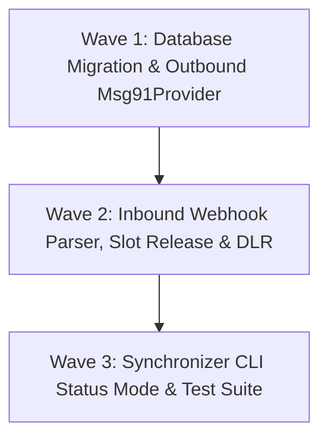

# Phase 05.1: Full MSG91 Integration (INSERTED) — Technical Research & Implementation Blueprint

**Researched:** 2026-10-27  
**Status:** Complete — Ready for Phase Planning  
**Target Phase:** Phase 05.1 (Inserted Roadmap Phase)  
**Requirements Traceability:** `REQ-reminders-notifications`, `REQ-compliance-data-layer`  
**Relevant Prior Decisions:** Phase 05 decisions (D-01 through D-16) & Phase 05.1 decisions (D-01 through D-08 in `05.1-CONTEXT.md`)

---

## 1. Executive Summary

### 1.1 Objective & Context
Phase 05.1 upgrades ClinicOS's messaging infrastructure from stubbed abstractions to a production-grade enterprise communications gateway powered by **MSG91**. ClinicOS delivers clinical records, appointment lifecycle alerts, diagnostic reports, and payment invoices to Indian patients across ambulatory clinics. 

While the system is designed for multi-channel failover (WhatsApp → DLT SMS), **Phase 05.1 focuses 100% on WhatsApp** (Decision `D-01`). Implementation of the MSG91 SMS Flow API (DLT Transactional Fallback) and mobile OTP for staff authentication is intentionally deferred until regulatory TRAI DLT entity, header, and content template registrations are finalized.

### 1.2 Core Architectural Principles
1. **Centralized Platform WABA Architecture (`D-02`):** Rather than subjecting every small clinic to weeks of Meta Business Manager verification and DLT paperwork, all clinics send communications via ClinicQ's single verified WhatsApp Business Account (WABA). Outgoing messages dynamically inject `{{clinic_name}}` and `{{doctor_name}}` into the header and body, delivering unmistakable clinic branding without onboarding friction.
2. **Strict Positional Variable Mapping:** Outbound messages use MSG91's `template-bulk` API (`https://control.msg91.com/api/v5/whatsapp/whatsapp-outbound-message/bulk/`), which strictly mandates positional component variables (`body_1`, `body_2`, `header_1`, `button_1`) rather than raw parameter arrays.
3. **Secure Tokenized Document URLs (`D-03`):** Digital prescriptions, lab reports, invoices, and referral summaries are delivered as secure tokenized links (`https://app.thecliniqai.com/r/[token]`) via Call-To-Action (CTA) URL buttons, avoiding high WhatsApp media upload fees, bandwidth latencies, and file-size constraints.
4. **Interactive Bot & Immediate Calendar Slot Release (`D-04`):** Patient replies to interactive buttons (`[Confirm]`, `[Cancel]`, `[Reschedule]`) trigger instant database actions. Specifically, `[Cancel]` immediately marks the visit `cancelled` with `cancellation_reason: 'patient_whatsapp_bot'`, frees the doctor's calendar slot, triggers a waitlist notification to the front desk, and issues an automated confirmation acknowledgement.
5. **Conversational Auto-Triage (`D-05`):** Unhandled patient text or clinical queries trigger an automated polite reply and fire an in-app alert (Event #18 `inbound_whatsapp_reply`) to the receptionist queue.
6. **Delivery Reports (DLR) Lifecycle Tracking (`D-06`):** Inbound status webhooks from MSG91 capture delivery states (`delivered`, `read`, `failed`), updating the outbox queue (`communication_queue`) and logging audit events in `audit_logs`.
7. **Template Catalogue Synchronization Tooling (`D-07`):** The repository maintains a single source of truth for all 13 clinical and operational templates in `lib/messaging/templates/whatsapp-templates.json`, synchronized to MSG91 via `npm run msg91:sync-templates` with support for a `--status` verification flag.
8. **Development & Testing Failover (`D-08`):** When `MSG91_AUTH_KEY` is omitted, the engine automatically falls back to `DevLoggerProvider`, preserving end-to-end DX without external network dependencies.

---

## 2. Architecture & API Specifications

### 2.1 Outbound Template Messaging: `template-bulk` API

#### Endpoint & Authentication
- **URL:** `POST https://control.msg91.com/api/v5/whatsapp/whatsapp-outbound-message/bulk/`
- **Headers:**
  ```http
  authkey: <MSG91_AUTH_KEY>
  Content-Type: application/json
  Accept: application/json
  ```

#### Request Payload Contract
MSG91's `template-bulk` endpoint requires a nested structure wrapping `to_and_components`. In this structure:
- `integrated_number`: The verified ClinicQ sender mobile number (with country code, e.g. `919876543210`).
- `content_type`: Must be `"template"`.
- `payload.type`: Must be `"template"`.
- `payload.messaging_product`: Must be `"whatsapp"`.
- `payload.template.name`: The exact pre-approved template name registered with Meta/MSG91.
- `payload.template.language`: An object specifying `code` (e.g. `"en"`) and `policy: "deterministic"`.
- `payload.template.to_and_components`: An array where each item binds a recipient number array (`to`) to a `components` dictionary containing positional variable keys.

```json
{
  "integrated_number": "919876543210",
  "content_type": "template",
  "payload": {
    "type": "template",
    "template": {
      "name": "appointment_booked",
      "language": {
        "code": "en",
        "policy": "deterministic"
      },
      "to_and_components": [
        {
          "to": [
            "919876543210"
          ],
          "components": {
            "body_1": {
              "type": "text",
              "value": "Rahul Sharma"
            },
            "body_2": {
              "type": "text",
              "value": "Dr. Aditi Rao"
            },
            "body_3": {
              "type": "text",
              "value": "Pune Care Clinic"
            },
            "body_4": {
              "type": "text",
              "value": "Wednesday, Oct 28 at 10:30 AM"
            }
          }
        }
      ]
    },
    "messaging_product": "whatsapp"
  }
}
```

#### Dynamic CTA URL Button Components
For templates featuring dynamic URL action buttons (such as `prescription_ready` with `https://app.thecliniqai.com/r/{{1}}`), the dynamic parameter is passed in `components` under `button_1`:
```json
{
  "components": {
    "body_1": { "type": "text", "value": "Rahul Sharma" },
    "body_2": { "type": "text", "value": "Dr. Aditi Rao" },
    "body_3": { "type": "text", "value": "Pune Care Clinic" },
    "button_1": {
      "type": "url",
      "value": "rx-token-7a8f9b0c"
    }
  }
}
```

#### Response Payload Contract
- **Success (HTTP 200):**
  ```json
  {
    "status": "success",
    "hasError": false,
    "data": "Your request is in process, check delivery reports for status",
    "errors": null,
    "request_id": "e03d9fe7b8304033b00c97e7c95146fa"
  }
  ```
  *Note:* The `request_id` returned here is persisted into `communication_queue.external_message_id` to correlate subsequent Delivery Report (DLR) webhooks.
- **Client/Validation Error (HTTP 400):**
  ```json
  {
    "status": "error",
    "hasError": true,
    "message": "Template variable count mismatch or invalid template name",
    "errors": "Missing required variable body_3"
  }
  ```
- **Unauthorized (HTTP 401):**
  ```json
  {
    "status": "error",
    "hasError": true,
    "message": "Invalid Auth Key"
  }
  ```

---

### 2.2 Template Variable Mapping Matrix (All 13 Templates)

Every template in `lib/messaging/templates/whatsapp-templates.json` has an exact positional mapping:

| Template Name | Category | Header | Body Variables (`body_1`, `body_2`, ...) | Button Variables (`button_1`) |
|---|---|---|---|---|
| `appointment_booked` | `UTILITY` | Static Text | `1`: `patient_name`<br>`2`: `doctor_name`<br>`3`: `clinic_name`<br>`4`: `appointment_time` | None (Quick Reply: Confirm, Cancel, Reschedule) |
| `appointment_rescheduled` | `UTILITY` | Static Text | `1`: `patient_name`<br>`2`: `doctor_name`<br>`3`: `clinic_name`<br>`4`: `new_appointment_time` | None (Quick Reply: Confirm, Cancel) |
| `appointment_cancelled` | `UTILITY` | Static Text | `1`: `patient_name`<br>`2`: `clinic_name`<br>`3`: `cancellation_reason` | None |
| `appointment_reminder` | `UTILITY` | Static Text | `1`: `patient_name`<br>`2`: `doctor_name`<br>`3`: `clinic_name`<br>`4`: `appointment_time` | None (Quick Reply: Confirm, Cancel, Reschedule) |
| `prescription_ready` | `UTILITY` | Static Text | `1`: `patient_name`<br>`2`: `doctor_name`<br>`3`: `clinic_name` | `button_1`: URL Token (`/r/{{1}}`) |
| `lab_report_uploaded` | `UTILITY` | Static Text | `1`: `patient_name`<br>`2`: `test_name`<br>`3`: `clinic_name` | `button_1`: URL Token (`/r/{{1}}`) |
| `referral_letter_issued` | `UTILITY` | Static Text | `1`: `patient_name`<br>`2`: `doctor_name`<br>`3`: `referred_to_name`<br>`4`: `clinic_name` | `button_1`: URL Token (`/r/{{1}}`) |
| `receipt_issued` | `UTILITY` | Static Text | `1`: `patient_name`<br>`2`: `invoice_number`<br>`3`: `amount_inr`<br>`4`: `clinic_name` | `button_1`: URL Token (`/r/{{1}}`) |
| `consultation_documents` | `UTILITY` | Static Text | `1`: `patient_name`<br>`2`: `doctor_name`<br>`3`: `clinic_name`<br>`4`: `amount_inr`<br>`5`: `invoice_number` | `button_1`: URL Token (`/r/{{1}}`) |
| `follow_up_due` | `UTILITY` | Static Text | `1`: `patient_name`<br>`2`: `doctor_name`<br>`3`: `clinic_name` | None |
| `pediatric_vaccine_due` | `UTILITY` | Static Text | `1`: `child_name`<br>`2`: `vaccine_name`<br>`3`: `due_date`<br>`4`: `clinic_name` | None |
| `balance_due_reminder` | `UTILITY` | Static Text | `1`: `patient_name`<br>`2`: `balance_amount_inr`<br>`3`: `invoice_number`<br>`4`: `clinic_name` | None |
| `staff_onboarding_otp` | `AUTHENTICATION` | None | `1`: `otp_code` | None (OTP button: COPY_CODE) |

#### Parameter Sanitization Rules
Meta enforces strict rules on template parameters:
1. **No Newlines or Carriage Returns:** Newlines (`\n`, `\r`) are forbidden in header and button parameters and should be replaced with spaces in body parameters.
2. **Whitespace Normalization:** Consecutive spaces are collapsed (`/\s+/g -> ' '`), and leading/trailing whitespace trimmed.
3. **Length Envelopes:**
   - Body parameters: Maximum 1024 characters.
   - Header parameters: Maximum 60 characters.
   - Button URL token: Maximum 128 characters.
4. **Mandatory Non-Empty Value Fallbacks:** Meta rejects template dispatches if any parameter is empty string (`""`). Fallback strings must be applied:
   - `patient_name`: Default `"Patient"`
   - `doctor_name`: Default `"Doctor"`
   - `clinic_name`: Default `"Clinic"`
   - `amount`: Default `"0"`
   - `reason`: Default `"Schedule change"`

---

### 2.3 Active Session Free-Text API (Conversational Replies & Bot Acknowledgements)

When a patient responds to an outbound message or clicks an interactive button, a **24-hour Meta Customer Service Window** opens. Within this window, the business can send regular text messages without consuming a pre-approved template.

- **Endpoint:** `POST https://control.msg91.com/api/v5/whatsapp/whatsapp-outbound-message/`
- **Method:** `POST`
- **Headers:**
  ```http
  authkey: <MSG91_AUTH_KEY>
  Content-Type: application/json
  Accept: application/json
  ```
- **Body:**
  ```json
  {
    "integrated_number": "919876543210",
    "recipient_number": "919876543210",
    "content_type": "text",
    "text": "Thank you! Your appointment has been confirmed. We look forward to seeing you."
  }
  ```
- **Fallback Rule:** In `lib/messaging/providers/msg91.ts`, if `sendWhatsApp` is called with a `templateId` that does NOT match any registered template in `whatsapp-templates.json` (such as bot acknowledgement messages `"appointment_confirmed_ack"` or conversational triage `"conversational_triage"`), it automatically dispatches via this session endpoint using `params.message` or `params.text`.

---

### 2.4 Inbound Webhook Specification: `/api/webhooks/messaging/msg91`

MSG91 uses a unified callback endpoint for both Inbound Messages (button clicks, text replies) and Delivery Reports (DLR).

#### Webhook Authentication & Signature Validation
MSG91 supports passing authentication headers and custom query secrets:
1. **Header Validation:** Inbound requests may provide `headers.get("authkey")`. Valid if it equals `process.env.MSG91_AUTH_KEY`.
2. **Secret Header / Query Validation:** When configuring the webhook URL in the MSG91 dashboard, ClinicOS can append a secret token or header:
   - Query string: `/api/webhooks/messaging/msg91?secret=<MSG91_WEBHOOK_SECRET>`
   - Custom header: `x-webhook-secret: <MSG91_WEBHOOK_SECRET>`
3. **Development Bypass:** If running in non-production (`process.env.NODE_ENV !== "production"`) and secrets are unset, verification returns `true` to facilitate local unit and integration tests.

#### Payload Schema 1: Inbound Customer Interactive & Text Messages
Delivered when a patient replies or taps a Quick Reply button:

```json
{
  "eventName": "Inbound",
  "direction": "inbound",
  "customerNumber": "919876543210",
  "integratedNumber": "919876540000",
  "contentType": "interactive",
  "interactive": "{\"type\": \"button_reply\", \"button_reply\": {\"id\": \"btn_confirm\", \"title\": \"Confirm\"}}",
  "button": "{}",
  "text": "",
  "replyMsgId": "wamid.HBgMOTE3NzQ4ODQ3OTkwFQIAERgSRjY0QTUyMzBDQTFFRUI3MDA5AA==",
  "requestId": "87b3c7e4d9914fffa8ccb85ca13e6c8e",
  "uuid": "8ee1c0bcd7664939a3c92359b3328272",
  "customerName": "Rahul Sharma",
  "ts": "1761550930"
}
```

*Inbound Extraction Algorithm:*
1. Phone Number (`from`): Extract `customerNumber` or `customer_number` or `mobile` or `from`. Strip non-digits and normalize.
2. Action / Content:
   - If `interactive` is present: Parse if stringified JSON. Check `button_reply.id` (e.g. `"btn_confirm"`, `"btn_cancel"`, `"btn_reschedule"`) or `button_reply.title`.
   - If `button` is present: Parse if stringified JSON. Check `text` or `payload`.
   - If `text` is present: Use raw text string.
3. Pass extracted string to `parseInboundAction(body)`:
   - `"confirm"` -> Triggers confirmation update on active visit.
   - `"cancel"` -> Calls `cancelAppointment(appointmentId, "patient_whatsapp_bot")`, immediately freeing doctor calendar slot and alerting waitlist.
   - `"reschedule"` -> Generates 24-hr tokenized URL (`/reschedule/[token]`), alerts receptionist, and sends link via WhatsApp.
   - `"unhandled"` -> Sends polite auto-triage reply and fires Event #18 `inbound_whatsapp_reply` notification in clinic front desk.

#### Payload Schema 2: Delivery Reports (DLR)
Delivered when MSG91 receives delivery receipts from Meta:

```json
{
  "eventName": "On Delivered Event",
  "direction": "outbound",
  "status": "Delivered",
  "customer_number": "919876543210",
  "integrated_number": "919876540000",
  "request_id": "876fc02b91894d61bc1f400583d42cc4",
  "message_uuid": "622d25f7914d4405801aa5b69cf31557",
  "delivered_at": "1711086185",
  "read_at": "",
  "submitted_at": "1711086100",
  "reason": ""
}
```

*DLR Processing Algorithm:*
1. Detect DLR: Payload has `direction === "outbound"` OR `status` in `["Delivered", "Read", "Failed", "Send", "Submitted"]` OR `eventName` containing `"Event"`.
2. Match Queue Item: Query `communication_queue` where `external_message_id = request_id || requestId || message_uuid`.
3. State Transitions:
   - Status `"Delivered"` / `"delivered"`:
     - Update `communication_queue`: `status = 'delivered'`, `metadata.delivered_at = new Date().toISOString()`.
     - Log in `audit_logs`: `action: 'communication_dlr_delivered'`.
   - Status `"Read"` / `"read"`:
     - Update `communication_queue`: `status = 'read'`, `metadata.read_at = new Date().toISOString()`.
     - Log in `audit_logs`: `action: 'communication_dlr_read'`.
   - Status `"Failed"` / `"failed"`:
     - Update `communication_queue`: `status = 'failed'`, `error_message = reason || 'Delivery failed'`.
     - Log in `audit_logs`: `action: 'communication_dlr_failed'`.
     - If message is urgent (e.g. `appointment_booked`, `appointment_rescheduled`, `appointment_reminder`), insert an alert into `in_app_notifications` for the clinic receptionist.
4. Response: Always return HTTP 200 `{ success: true, event: "dlr_processed" }` within 5 seconds to satisfy MSG91 SLA.

---

## 3. Database Schema Migration Finding (Critical)

In reviewing `supabase/migrations/000014_communications_and_ai.sql`, line 23 defines:
```sql
status TEXT NOT NULL CHECK (status IN ('pending', 'processing', 'sent', 'failed', 'cancelled', 'dead_letter')) DEFAULT 'pending'
```
And `lib/db/types.ts` defines:
```typescript
export type CommunicationStatus = "pending" | "processing" | "sent" | "failed" | "cancelled" | "dead_letter";
```

### The Problem
If the DLR webhook updates `communication_queue.status` to `'delivered'` or `'read'`, PostgreSQL will throw a check constraint violation error:
`new row for relation "communication_queue" violates check constraint "communication_queue_status_check"`.

### The Solution
A new migration `supabase/migrations/000015_comm_queue_delivery_status.sql` must be introduced:
```sql
-- Migration: 000015_comm_queue_delivery_status.sql
-- Description: Expand communication_queue status to support delivery receipts (delivered, read)

ALTER TABLE public.communication_queue 
  DROP CONSTRAINT IF EXISTS communication_queue_status_check;

ALTER TABLE public.communication_queue 
  ADD CONSTRAINT communication_queue_status_check 
  CHECK (status IN ('pending', 'processing', 'sent', 'delivered', 'read', 'failed', 'cancelled', 'dead_letter'));
```
And `lib/db/types.ts` updated to:
```typescript
export type CommunicationStatus = 
  | "pending" 
  | "processing" 
  | "sent" 
  | "delivered" 
  | "read" 
  | "failed" 
  | "cancelled" 
  | "dead_letter";
```

---

## 4. Codebase Scouting & Existing Patterns

### 4.1 Gap Analysis: `lib/messaging/providers/msg91.ts`
The current implementation in `lib/messaging/providers/msg91.ts` contains several critical deviations:
1. **Wrong Component Shape:** It builds `payload.template.components` using raw Meta arrays (`[{ type: "body", parameters: [...] }]`), whereas MSG91's bulk endpoint strictly expects `to_and_components: [{ to: [...], components: { body_1: ..., button_1: ... } }]`.
2. **Missing Positional Mapping:** It uses `Object.entries(params)` without resolving parameter names (`patient_name`, `doctor_name`) to positional numbers (`1`, `2`, `3`). If an object key order changes, parameters swap in the sent message.
3. **Hardcoded Language Policy:** MSG91 requires `policy: "deterministic"` in the language block.
4. **Endpoint Domain:** It points to `api.msg91.com` instead of the OpenAPI-documented `control.msg91.com`.
5. **No Session Text Fallback:** It attempts to send non-template bot responses (`conversational_triage`, `appointment_confirmed_ack`) through the bulk template endpoint, causing MSG91 to reject them as non-existent templates.

### 4.2 Gap Analysis: `lib/messaging/dispatcher.ts`
`lib/messaging/dispatcher.ts` handles the transactional outbox:
1. **Missing Clinic Branding Context:** Callers in `features/appointments/actions.ts` often pass `patient_name`, `doctor_name`, and `date_time`, but omit `clinic_name`. The dispatcher or provider mapping helper should automatically fetch or default `clinic_name` (e.g. from the tenant name or default to `"Clinic"`) to satisfy `D-02`.
2. **URL Token Extraction:** When sending document messages (`prescription_ready`, `receipt_issued`), callers pass full URLs like `https://app.thecliniqai.com/r/xyz123`. The mapping helper must cleanly parse the trailing token (`xyz123`) so the CTA button parameter receives only the variable segment required by `https://app.thecliniqai.com/r/{{1}}`.

### 4.3 Gap Analysis: `scripts/msg91-sync-templates.ts`
The template synchronizer script supports `--dry-run`, but lacks the `--status` command specified in Decision `D-07`.
- **Target Endpoint for Status:**
  `GET https://control.msg91.com/api/v5/whatsapp/get-template-client/{number}`
  Header: `authkey: <key>`
- **Behavior:** Query all templates associated with `integrated_number`, parse their approval status (`approved`, `pending`, `rejected`), match each against `whatsapp-templates.json`, and print a colored terminal summary table.

---

## 5. Validation Architecture

### 5.1 Vitest Unit & Integration Test Plan

| Test File | Test Cases & Focus Areas |
|---|---|
| `tests/messaging/msg91-provider.spec.ts` | 1. **Payload Generation:** Verifies `to_and_components` structure with `body_1`, `body_2`, etc.<br>2. **Template Mapping:** Validates all 13 templates against sample parameter inputs.<br>3. **Button Token Extraction:** Proves full URLs and bare tokens are correctly parsed into `button_1.value`.<br>4. **Parameter Sanitization:** Confirms newlines are removed, spaces collapsed, and empty strings receive fallbacks.<br>5. **Session Text Fallback:** Validates that non-template IDs route to `/whatsapp-outbound-message/` text endpoint.<br>6. **Resilience:** Gracefully errors when `MSG91_AUTH_KEY` is missing or API returns 400/401. |
| `tests/messaging/msg91-webhook.spec.ts` | 1. **Signature Verification:** Tests header `authkey` and custom webhook secret matching.<br>2. **Inbound Button Actions:** Proves `[Confirm]`, `[Cancel]`, and `[Reschedule]` actions execute successfully.<br>3. **Slot Release:** Proves `[Cancel]` marks appointment `cancelled`, frees calendar, and alerts waitlist.<br>4. **Conversational Triage:** Verifies unhandled queries send auto-reply and fire Event #18 in-app notification.<br>5. **Delivery Reports (DLR):** Verifies `Delivered`, `Read`, and `Failed` payloads update `communication_queue` and write to `audit_logs`.<br>6. **Urgent Delivery Failure:** Proves a failed appointment reminder creates a receptionist notification. |
| `tests/messaging/msg91-sync-templates.spec.ts` | 1. **Dry-Run Mode:** Tests CLI script execution without live credentials.<br>2. **Status Inspection:** Mocks MSG91 `get-template-client` response and tests terminal table generation. |

### 5.2 Verification Commands (CLI & MCP)

#### 1. MSG91 Number & Balance Inspection (using `docstar-cli`):
```bash
# Check connected WhatsApp numbers on MSG91 account
npx docstar-cli msg91 whatsapp to-fetch-whatsapp-number --authkey=$MSG91_AUTH_KEY

# Check WhatsApp prepaid balance
npx docstar-cli msg91 whatsapp check-whatsapp-prepaid-balance --authkey=$MSG91_AUTH_KEY

# List existing remote templates on MSG91
npx docstar-cli msg91 whatsapp get-templates --0=$MSG91_INTEGRATED_NUMBER --authkey=$MSG91_AUTH_KEY
```

#### 2. Template Sync & Status Tooling:
```bash
# Preview payloads without pushing
npm run msg91:sync-templates -- --dry-run

# Inspect live Meta approval statuses
npm run msg91:sync-templates -- --status

# Push all 13 templates to live MSG91 account
npm run msg91:sync-templates
```

#### 3. Vitest Messaging Test Execution:
```bash
npx vitest run tests/messaging/
```

---

## 6. Implementation Waves & Risk Analysis

### 6.1 Execution Waves



- **Wave 1: Database Migration & Outbound Msg91Provider Engine**
  - Create migration `supabase/migrations/000015_comm_queue_delivery_status.sql` adding `'delivered'` and `'read'` to `communication_queue.status`.
  - Update `lib/db/types.ts` `CommunicationStatus`.
  - Build `lib/messaging/templates/mapping.ts` containing positional parameter mapping rules, token extractors, and parameter sanitization.
  - Refactor `lib/messaging/providers/msg91.ts` to implement `template-bulk` with `to_and_components` and session text fallback.
- **Wave 2: Inbound Webhook Parser, Two-Way Bot Actions & DLR Status Engine**
  - Update `lib/messaging/webhook-helpers.ts` with MSG91 payload parser (`parseMsg91Inbound`, `parseMsg91Dlr`).
  - Refactor `app/api/webhooks/messaging/[provider]/route.ts` to route DLR status updates to `communication_queue` and `audit_logs`.
  - Wire interactive button handling for `[Confirm]`, `[Cancel]` (with instant slot release and waitlist alerting), `[Reschedule]`, and conversational auto-triage.
- **Wave 3: Template Synchronizer CLI (`--status`) & Verification**
  - Update `scripts/msg91-sync-templates.ts` to support `--status` flag using `https://control.msg91.com/api/v5/whatsapp/get-template-client/{number}`.
  - Implement full Vitest test suite (`tests/messaging/msg91-provider.spec.ts`, `tests/messaging/msg91-webhook.spec.ts`, `tests/messaging/msg91-sync-templates.spec.ts`).
  - Verify complete passing test suite and TypeScript typecheck.

### 6.2 Risk Analysis & Mitigations

| Risk | Impact | Mitigation Strategy |
|---|---|---|
| **Meta Parameter Validation Failure** | Outbound messages rejected by Meta API if parameters are empty, contain invalid characters, or exceed length limits. | Implement strict parameter sanitizer in `lib/messaging/templates/mapping.ts` providing deterministic defaults (`"Patient"`, `"Doctor"`, `"Clinic"`, `"-"`) and stripping all newlines. |
| **24-Hour Session Expiry on Bot Reply** | If a patient replies after 24 hours, free-text session replies fail. | Bot acknowledgement and triage replies should catch HTTP errors from the session endpoint and silently log without crashing the webhook handler. |
| **Database Check Constraint Violation** | DLR updates fail if `communication_queue.status` does not allow `'delivered'` or `'read'`. | Execute migration `000015_comm_queue_delivery_status.sql` in Wave 1 before testing DLR webhooks. |
| **High DLR Webhook Volume** | Multiple status events (`Submitted` → `Delivered` → `Read`) could cause database row lock contention. | Perform selective targeted updates (`UPDATE communication_queue SET status = ..., metadata = ... WHERE id = ...`) indexed on `external_message_id`. |
| **Missing Credentials in Local Dev / CI** | Vitest or local development runs fail if `MSG91_AUTH_KEY` is not present. | `getMessagingProvider` strictly defaults to `DevLoggerProvider` whenever `MSG91_AUTH_KEY` is empty, logging simulated message payloads to `.planning/dev-messages.txt`. |

---

## RESEARCH COMPLETE
