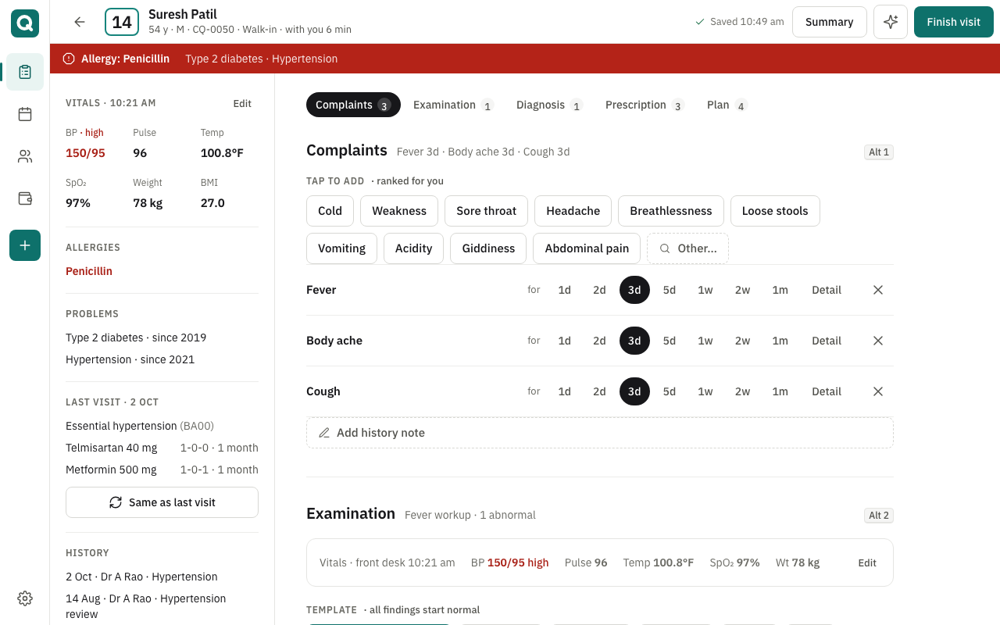
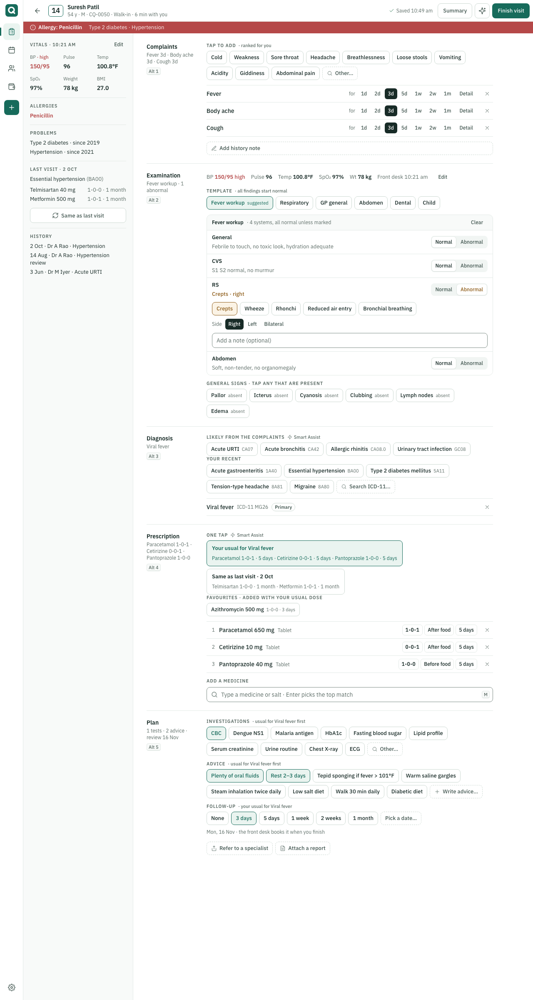
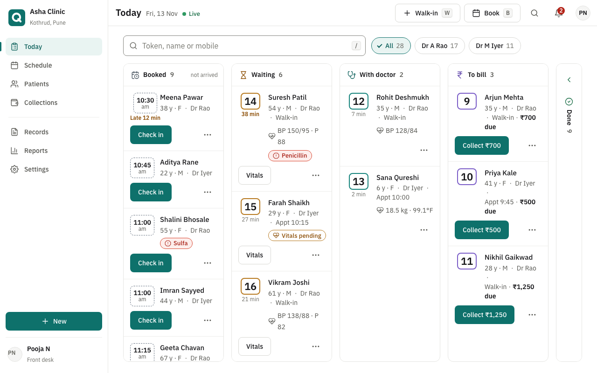
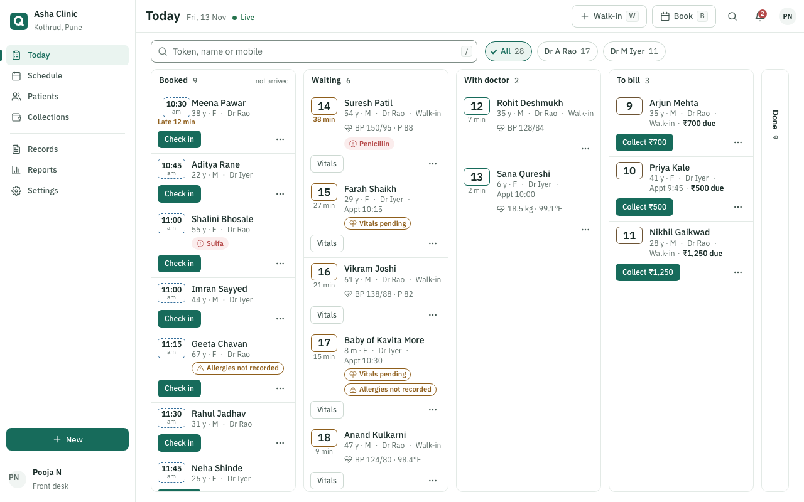

# V2-DX design proposal, round 3: Calm Confidence (for gate G2-D)

| | |
|---|---|
| Phase | V2-DX design exploration, round 3 (round 2: "better, but not where I want it") |
| Gate | **G2-D**: design direction approved, before plan 06-02 |
| Branch | `v2/phase-dx-design-exploration` (sandbox only, nothing under `app/`) |
| Evidence | [`v2-dx-evidence/README.md`](v2-dx-evidence/README.md). Every number below is produced by `v2-dx-capture.mjs`; round-2 comparison figures are rendered from commit `e746613` at capture time |
| Prototypes | `001-palette-type/`, `003-today/`, `004-consult/`, `005-surfaces/`, **`006-components/`** (new). Add `?dir=b` to any URL for direction B |
| Data | Synthetic only |

## 30-minute review path

1. **5 min.** §1 theme evaluation and the recommendation.
2. **10 min.** Open `004-consult/index.html?demo=rx` at desktop width, then `?demo=mid&tab=exam`. Do the ten-tap visit (Fever, Body ache, Cough → Fever workup → RS Abnormal → Crepts → Viral fever → Your usual → Finish → Sign). Then open `003-today/index.html`.
3. **5 min.** `006-components/index.html`, plain and with `?dir=b`.
4. **5 min.** §3 before/after and §4 density numbers.
5. **5 min.** §7 decisions.

## 1. Theme evaluation: A "Calm Confidence" vs B "Calm Azure"

Both were built as full token sets (same names, same four layers; B overrides only the raw palette and two semantic aliases) and rendered across every prototype: Today (desk and doctor), consult, settings/billing, platform, locked/offline/install, and the component gallery. Screens: [A](v2-dx-evidence/screens/today/1280.png) / [B](v2-dx-evidence/screens/today-b/1280.png) Today; [A](v2-dx-evidence/screens/consult-mid/1280.png) / [B](v2-dx-evidence/screens/consult-b-mid/1280.png) consult; [A](v2-dx-evidence/screens/components/1280.png) / [B](v2-dx-evidence/screens/components-b/1280.png) components; [A](v2-dx-evidence/screens/palette/1280.png) / [B](v2-dx-evidence/screens/palette-b/1280.png) palette.

| Criterion | A · Botanical Teal | B · Deep Blue | Edge |
|---|---|---|---|
| Readability | Mineral greys sit neutral under black text; soft surface `#F8FAF9` is almost invisible, which is what a white-first canvas wants | Azure-tinted greys read slightly cool; the muted surface `#EEF2F7` is more visible, so wells and table heads stand out a little more | A (calmer), B (more structure) |
| Contrast (tool-measured, every text/background pair incl. pills on tints and text on soft surfaces) | All gated pairs pass after four AA fixes (below) | All gated pairs pass after the same fixes | tie |
| Clinical trust | Teal reads as care and clinic without being hospital-blue; brass "To bill" is warm and distinct from every clinical state | Deep blue reads as institutional / fintech; trustworthy but closer to hospital IT | A |
| Sophistication | Teal + mineral + brass is a distinctive, editorial combination | Blue + slate is the default SaaS combination (Stripe, Atlassian) | A |
| Consistency across modules | One saturated hue (teal) plus four status hues; nothing collides | **Primary blue vs information blue collide** (`#245B8F` vs `#356F9B`, 1.31:1 apart): "Booked" pills, info banners and the primary button all read as "blue". Resolved in the B token set by moving information/booked to slate `#4C6680` on `#EEF2F7` and keeping the focus ring on a white halo, but the booked pill then loses its colour identity | A |
| Status pills on tints | waiting 4.52, critical 4.63, info 4.76, done 5.16, with-doctor 5.68, to-bill 6.30 | same, except booked/info 5.0 on slate | tie |

AA-driven deviations from the PO reference (both directions, documented in the token files):
1. **Muted text** `#71817B` is 4.09:1 on white and 3.7:1 on the muted surface, so it fails for 12–13 px text. It is kept as `fg-icon` (icons, ≥ 18 px text); body-level muted text uses `#5C6C66` (5.0:1 on the muted surface). B: `#718397` → `#566A7E`.
2. **Control border** `#CDD9D2` is 1.45:1, below the 3:1 for input boundaries. Panels, tiles and dividers keep the PO hairlines; text inputs, selects and the token chip use `#7F8E87` (3.4:1 on white, 3.1:1 on the muted surface). B: `#7A8B9C`.
3. **Brass text** on the brass wash uses `#6D5434` (6.3:1) rather than `#80613B` (5.07:1) because it appears at 11 px in the "To bill" pill; the same brown outlines the "To bill" token chip (brass `#B58A55` is 2.8:1).
4. **Warning** `#98651E` is 4.44:1 on the accent wash (an abnormal finding inside a selected tile), so it becomes `#8F5E1B` (≥ 4.9:1 on every tint). The PO value stays for the waiting pill on its own wash where it was already 4.5:1.

**Recommendation: A, Calm Confidence.** It is the only direction where every hue on screen means exactly one thing, and it already carries the brand teal from DESIGN_SYSTEM §2.1. B is shipped as a complete, switchable token set should you prefer blue; its one structural weakness (primary vs information) is resolved in the tokens but at the cost of a less distinct "Booked" state.

## 2. What round 2 got wrong, and what changed (process steps 2–5)

**Shortcomings found in the round-2 consult** (measured and by inspection): 20 px section titles and 15 px tiles made the page 3,200 px tall at 1280; a 44 px tile grid on desktop wasted the width; every section header, tile group and item list was a separate full-width block, so the page read as stacked capsules; the vitals strip was a boxed card inside a section; "Add history note" was a dashed 44 px capsule; the section strip duplicated the headings; pills were 24 px with 13 px text; the patient column and the note had identical white treatment, so the eye had no anchor; summary pane text wrapped at 14 px in a 304 px column.

**Typography, spacing and dimensions review** → one scale, applied through the shared tokens and `shared/sketch.css`, never per screen:

| | Round 2 | Round 3 |
|---|---|---|
| Desktop body / rows / tiles | 16 / 15 / 15 px | 14 / 14 / 13 px (inputs 16 px on touch) |
| Page title / panel title / section heading | 24 / 20 / 20 px | 20 / 16 / 14 px semibold |
| Status pill | 24 px, 13 px medium | 20 px, 11 px semibold |
| Button / compact / large | 44 / 40 / 48 px | 36 / 28–32 / 44 px (44 for everything on touch) |
| Tile | 44 px desktop | 32 px desktop, 44 px touch |
| Token chip | 36 px, 22 px numerals | 28 px, 17 px numerals |
| Top bar / sidebar | 56 / 232 px | 52 / 216 px |
| Section rhythm | 32 + 36 px padding | 18 + 20 px, label column |
| Radii | 4 · 8 · 12 · 16 | 6 · 8 · 10 · 14 (PO reference 10–14) |
| Depth | none on canvas | hairline panels; one raised card (`0 8px 28px rgba(24,43,39,.06)`) per page; popover/overlay shadows |
| Bold usage | 600 on titles, names, drug names, pills, tile labels | 600 only on titles, pills and emphasis; names, drugs and tiles are 500 |

**Shared tokens and components changed** (all in `themes/clinic-paper.css` + `shared/sketch.css`): new `surface-soft`, `surface-muted`, `fg-secondary`, `fg-icon`, `accent-tint`, `accent-2/-bg/-fg`, `ring-glow`; `text-*` scale rewritten; `spacing-control-dense` 36, `spacing-control-compact` 32, `spacing-pill` 20, `spacing-label-col`; `radius-*` and `shadow-card` per the reference. Components: button hierarchy (primary / soft / secondary / ghost / danger, + loading and disabled), inputs with select, checkbox, radio, switch and error state, status pills, token chips, tiles, toggle chips, pills and stepper, segmented, tabs, sidebar, panel / raised card / well / section row, data table and list row, sheet, dialog, menu, toast, banners, empty, skeleton, spinner. Every one is on `006-components/index.html` in both directions and reused unchanged by Today, consult and the surfaces.

## 3. The consult as the showcase: a structured clinical sheet

**Decision between containers.** Three options were weighed for the note: bordered cards per section (round 1, fragmented), plain blocks with large headings (round 2, flat and tall), or a **label-column sheet**: each section is a row with a 120 px label column (section name 14 px semibold, a one-line summary of what has been recorded in 12 px muted text, and the Alt shortcut) and a content column; rows are separated by a single hairline. This is the Linear/Stripe "properties" structure applied to a clinical note. It gives constant left-edge anchors for scanning, puts the record summary beside the controls, and removes every card border inside the note. Only two boxed elements remain, deliberately: the applied exam template (a soft well, because it is a transient working area) and the dose builder (a hairline panel, because it is a transient editor).

**Hierarchy.** Primary clinical content is the white note column, max 896 px. Supporting information is the patient column on a soft surface (`#F8FAF9`) on the left: identity, vitals with flags, allergies, problems, last visit with "Same as last visit", history. Actions sit in the 52 px top bar: autosave, Summary toggle, AI Assist (preview icon), Finish. The 28 px allergy strip is the only solid colour on the page. The live summary pane (≥ 1440, toggle at 1280) shows the visit as the patient will receive it.

**Movement and speed.** Nothing moved behind navigation; the section strip survives on phones only. Alt 1–5 jump sections, `M` jumps to medicines, `/` opens the command bar, `F` finishes. The ten-tap, zero-typing visit from round 2 is unchanged and re-measured (§5).

| Round 2 | Round 3 |
|---|---|
|  |  |

Exam section at 1280: [A](v2-dx-evidence/screens/consult-mid/1280.png) · [B](v2-dx-evidence/screens/consult-b-mid/1280.png). Prescription with the summary pane at 1440: [here](v2-dx-evidence/screens/consult-rx/1440.png). Phone: [complaints](v2-dx-evidence/screens/consult-mid/360.png) · [prescription](v2-dx-evidence/screens/consult-rx/360.png). Tablet: [820](v2-dx-evidence/screens/consult-mid/820.png) · [1180](v2-dx-evidence/screens/consult-mid/1180.png). States: [dose builder](v2-dx-evidence/screens/states/consult-dose-builder-1280.png) · [command bar](v2-dx-evidence/screens/states/consult-command-bar-1280.png) · [finish sheet](v2-dx-evidence/screens/states/consult-finish-sheet-1280.png).

## 4. Today, before and after

| Round 2 | Round 3 |
|---|---|
|  |  |

Rows are 14 px names, 12 px meta, 28 px token chips, 28 px row actions (44 px on touch); lane headers lost their icons; the Done strip is 44 px. Phone: [360](v2-dx-evidence/screens/today/360.png); doctor's queue: [1280](v2-dx-evidence/screens/today-doctor/1280.png).

**Density above the fold** (tool-measured, same probes on the round-2 archive and round 3, no scrolling; [density.md](v2-dx-evidence/density.md)):

| Probe | 1280×800 r2 → r3 | 820×1180 r2 → r3 |
|---|---|---|
| Today, front desk: queue rows fully visible | 12 → **16** (+33%) | 10 → **12** (+20%) |
| Today, doctor: queue rows fully visible | 5 → 5 (the doctor's list has only 5 rows) | 5 → 5 |
| Consult, full note: tiles, pills and Rx lines fully visible | 39 → **53** (+36%) | 45 → **53** (+18%) |
| Consult, exam section: systems and finding tiles visible | 7 → **15** (+114%) | 15 → 15 |
| Consult, full note height at 1280 | ≈ 3,200 px | ≈ 2,080 px |

## 5. Consult speed (unchanged from round 2, re-measured on round 3)

| Step | v1 taps / typed | v2 round 3 taps / typed |
|---|---|---|
| A. 3 complaints | 3 / 0 | 3 / 0 |
| B. Exam template + 1 abnormal finding | 0 / ≈ 170 | 3 / 0 |
| C. Diagnosis | 1 / 0 | 1 / 0 |
| D. 3-drug Rx, standard dosing | 6 / ≈ 27 | 1 / 0 (bundle); 3 / 0 (favourites); 0 / 12 (keyboard) |
| E. Finish | 2–3 / 0 | 2 / 0 |
| Whole consult | 12 / ≈ 197 (M0: 12 actions, 105 keys) | **10 / 0** |

Details and videos: [counts.md](v2-dx-evidence/counts.md).

## 6. Evidence at a glance (tool output, [README](v2-dx-evidence/README.md))

| Check | Result |
|---|---|
| axe (WCAG 2.0/2.1/2.2 A and AA) | **0 critical, 0 serious** over 107 runs: every surface × width in A, the B surfaces, the component gallery and the open sheets |
| Contrast, every gated token pair incl. pills on tints and text on soft surfaces | **A 139/139 · B 139/139** pass ([contrast.md](v2-dx-evidence/contrast.md)) |
| Consult flows | 10/10 asserted; whole consult **10 taps, 0 typed** |
| Today flows | 7/7 asserted, targets met |
| AI-02 copy rule | 0 violations |
| Network calls, page errors | 0, 0 |
| Tailwind v4 compiles `clinic-paper.css` unchanged | 25/25 utilities, 173 names registered |

Tap targets: 44 px for every control on touch and below 1024 px; 36/32 px with a fine pointer on desktop. Body 14 px on desktop, inputs 16 px on touch, nothing below 11 px (and 11 px only as 600-weight caps).

## 7. Decisions

1. **Theme**: **A, Calm Confidence (Botanical Teal)**, with the three AA deviations in §1. B stays available as `direction-b.css`. *Pick A or B.*
2. **Type and density scale** as in §2 (14 px desktop body, 20/16/14 headings, 20 px pills, 36/32 px controls, 44 px on touch). *Approve.*
3. **Consult structure**: label-column clinical sheet, soft patient column, hairline sections, two transient boxes only, summary pane from 1440. *Approve.*
4. **Component system**: the gallery (`006-components/`) is the contract for 06-02/06-03 primitives. *Approve.*
5. **Secondary accent (brass)** is used only for "To bill" and editorial highlights, never as an action colour. *Approve.*
6. **Focus**: `#2879B8` ring on a 2 px white halo everywhere (A and B). *Approve.*
7. **Carried over, unchanged**: round-2 consult interaction model (tiles, templates, usual bundles, same-as-last-visit, dose builder, command bar), Plex Sans vendored, "CliniQ" name and icon A, AI chip A and Smart Assist rule, Preview chip, price display, `/settings/billing`, low-fi surfaces as brief. *Confirm.*

## 8. Limits

- Static prototypes with frozen data and a synthetic doctor memory; ranking stands in for the per-doctor queries V2-09 builds.
- Dental odontogram and paediatric growth tools are reachable from their templates but not drawn.
- Real-device checks belong to V2-06 and V2-09. No clinic users have seen the rounds yet (PO-13).

## Sandbox contents

| Path | What |
|---|---|
| `themes/clinic-paper.css` (A), `themes/direction-b.css` (B), `themes/fonts/` | Tokens and vendored Plex |
| `themes/clinic-paper.theme.css` | Generated Tailwind registration (do not edit) |
| `shared/sketch.css`, `shared/proto.js` | The component system and prototype helpers |
| `001-palette-type/`, `002-icon/`, `006-components/` | Palette, icon, component gallery |
| `003-today/`, `004-consult/`, `005-surfaces/` | Prototypes |
| `references/po-calm-palette-option-a.html` | The PO's reference page for direction A |
| `V2-DX-R2-V1-CONSULT-ANALYSIS.md` | v1 consult capability inventory (the functional floor) |
| `v2-dx-capture.mjs`, `v2-dx-evidence/` | Evidence generator and output |
