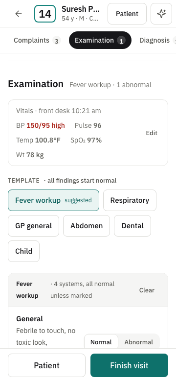
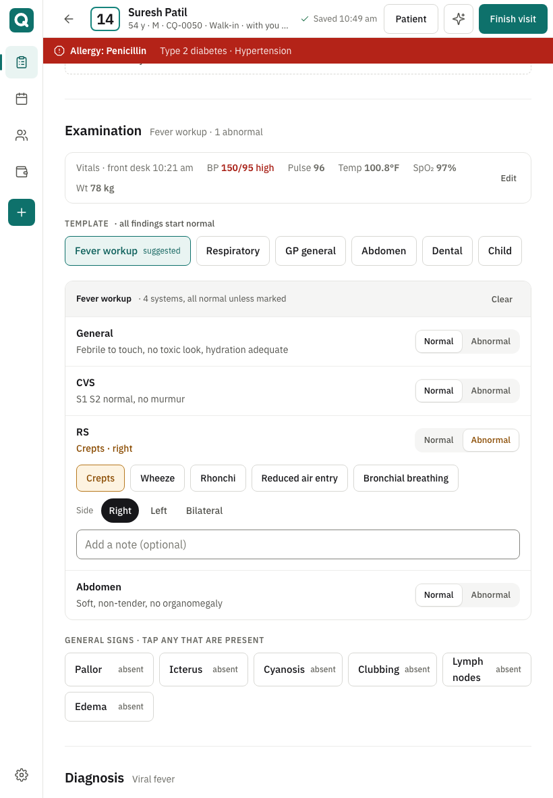
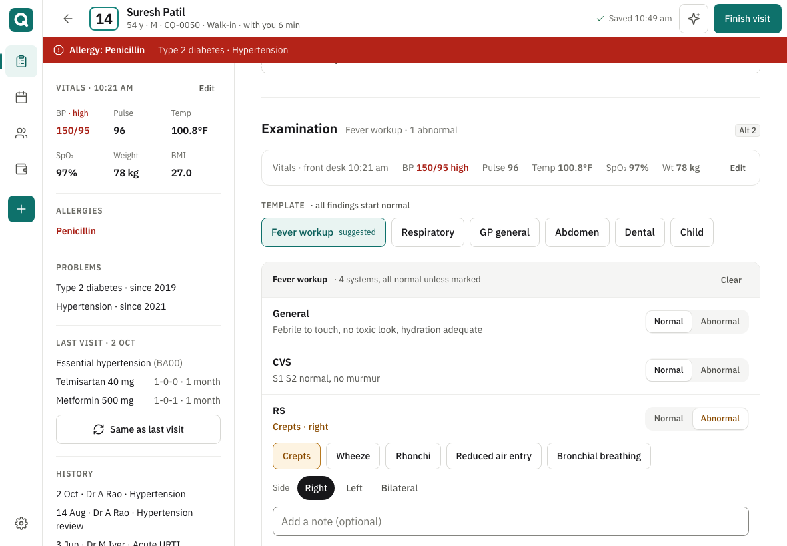
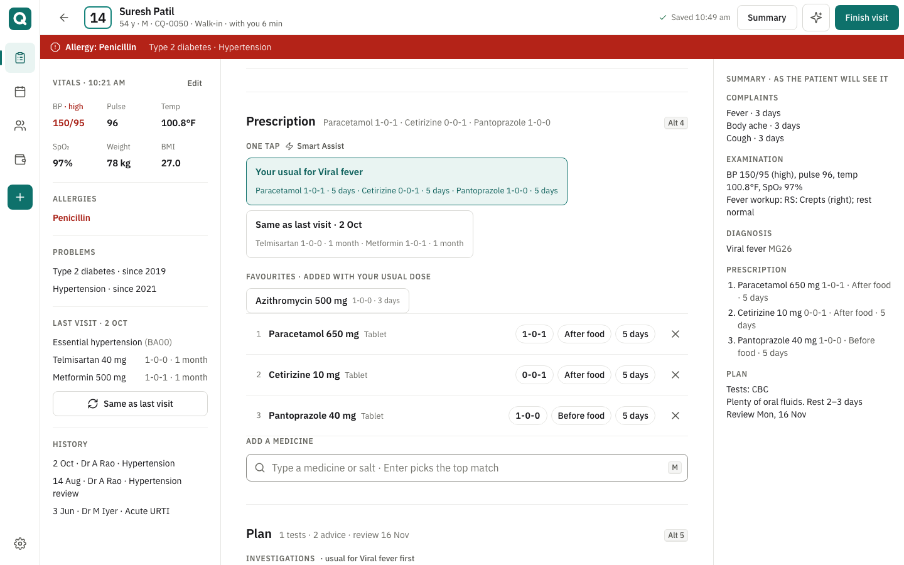

# V2-DX design proposal, round 2: "Clinic Paper" on a white canvas (for gate G2-D)

| | |
|---|---|
| Phase | V2-DX design exploration, round 2 (round 1 rejected on 13 Nov: not premium, palette, consult ergonomics) |
| Gate | **G2-D**: design direction approved, before plan 06-02 |
| Branch | `v2/phase-dx-design-exploration` (sandbox only, nothing under `app/`) |
| Evidence | [`v2-dx-evidence/README.md`](v2-dx-evidence/README.md). Every number below is produced by `v2-dx-capture.mjs` |
| v1 analysis | [`V2-DX-R2-V1-CONSULT-ANALYSIS.md`](V2-DX-R2-V1-CONSULT-ANALYSIS.md): every v1 consult capability with its tap and typing cost |
| Data | Synthetic names, a synthetic "doctor memory", `+91 90000 0xxxx` test numbers only |

## 30-minute review path

1. **5 min.** Read §1 (what changed) and the consult table in §2.
2. **10 min.** Open `004-consult/index.html` in Chrome from disk. Do the visit by tapping only: **Fever, Body ache, Cough → Fever workup → RS: Abnormal → Crepts → Viral fever → "Your usual for Viral fever" → Finish visit → Sign and finish.** Ten taps, nothing typed. Then try `/` (add anything), `M` (jump to medicines), type `para`, Enter, Enter.
3. **5 min.** Open `001-palette-type/index.html` for the two colour directions; add `?dir=b` to any prototype URL to see direction B live.
4. **5 min.** Scroll §3 (screenshots at 360 / 820 / 1180 / 1280 / 1440) and `003-today/index.html`.
5. **5 min.** Answer the numbered decisions in §6.

## 1. What changed after your feedback

| Your note | Round 2 |
|---|---|
| "Doesn't feel premium" | Hairlines instead of borders and tints; one accent; 15–16 px running text; titles tracked −1%; depth only on popovers and sheets; 32–40 px section rhythm; a fixed 832 px note column so lines never run long. Typography and numerals are from IBM Plex Sans (tabular figures for tokens, doses, ₹). |
| "Colour scheme is not good, I prefer a white canvas" | Canvas and every working surface are `#FFFFFF`. The only tinted surface left is a `#F5F5F4` well for keyboard hints and segmented tracks. Two accent directions are proposed in §4; status colours are unchanged and still never carry meaning alone. |
| "Ease of functionality is not great; look at v1's complaints, exam templates with tiles, diagnosis, prescription builder" | The consult is rebuilt as **one flowing note of tile sections**, with v1's functionality as the floor (analysis §3) and typing driven to zero on the common path. New since v1: exam templates with every system pre-filled as normal and one-tap abnormal → finding tiles; a complaint → exam → diagnosis → Rx → plan **suggestion chain** ranked from the doctor's own history; "Your usual for <diagnosis>" and "Same as last visit" one-tap bundles; favourites that carry the doctor's usual dose; a dose builder with frequency tiles, timing tiles, duration tiles plus a stepper; editable Rx lines; a live summary pane; a command bar (`/`) for those who type. |
| Clarification: v1 as floor, not model; typing toward zero; airy layout at every width | Measured: the whole consult is **10 taps, 0 typed characters** against v1's **12 taps and ≈ 197 typed** for the same five steps (M0 measured 12 actions / 105 keystrokes for a shorter note with no examination). Layouts: 360 single column with a sticky section strip and Finish bar; 820 single column; 1180 patient rail + note; 1280 adds a Summary toggle; 1440 shows the summary pane by default. |

## 2. Consult: v1 vs round 2, step by step (tool-measured, [counts.md](v2-dx-evidence/counts.md))

Taps = clicks; typed = characters typed into a field. v1 per step is derived from the v1 code (analysis §4); the whole-flow row also shows the M0 measurement. The v2 prototype asserts each outcome and records a video per flow (`walkthrough/`).

| Step | v1 taps | v1 typed | v1 path | **v2 taps** | **v2 typed** | v2 path |
|---|---|---|---|---|---|---|
| A. Add 3 complaints (durations set) | 3 | 0 | 3 fixed chips, 3 days default | **3** | **0** | 3 tiles, ranked by your history and by what accompanies what you already added; 3 days default, duration pills inline |
| B. Exam template, one abnormal finding | 0 | **≈ 170** | no templates; CVS/RS/PA/CNS textareas with placeholders that save nothing | **3** | **0** | "Fever workup" (suggested from the complaints) → RS: Abnormal → "Crepts"; side and note optional |
| C. Add a diagnosis | 1 | 0 | fixed 8 chips | **1** | **0** | "Likely from the complaints" tiles (Smart Assist), then your recent; search behind "Other…" |
| D. 3-drug Rx, standard dosing | **6** | **≈ 27** | per drug: type, pick, Add (M0: 78 typed as custom entries) | **1** | **0** | "Your usual for Viral fever" bundle. Alternatives: 3 favourite tiles (3 taps); keyboard `para ↵ ↵` × 3 (12 typed, 0 taps) |
| D4. Change a committed line | 5 | 9 | remove, confirm, retype, pick, Add | **3** | **0** | tap the line's duration pill → dose builder → "3 days" → Update |
| Repeat last visit | 1 | 0 | Rx only | **1** | **0** | diagnosis and Rx, lines marked "repeated" |
| E. Finish | 2 (M0: 3) | 0 | modal, toggle, sign | **2** | **0** | Finish visit → Sign and finish (WhatsApp and the billing hand-off default from clinic settings) |
| **Whole consult A–E** | **12** | **≈ 197** | M0: 12 actions, 105 keystrokes, 8 clicks | **10** | **0** | every step above by tap |

What stays reachable from the screen (the v1 floor): vitals with flags and Edit; complaint severity, note and custom entry (behind "Detail" / "Other…"); PICCLE signs; specialty templates (Dental, Child); ICD-11 search and custom diagnosis; medicine search with custom entry and a per-drug allergy match; frequency, timing, duration, instruction; investigations, advice and custom entries; follow-up intervals and a date; refer; attach; history; Same as last visit; AI Assist (preview, trial only); autosave; WhatsApp / Print at finish; billing hand-off; sign and lock.

## 3. The consult screen

### 3.1 Structure: one flowing note, five sections, progressive disclosure

- **Patient rail** (≥ 1180, a sheet below that): vitals with text flags, allergies, problems, last visit with "Same as last visit", history.
- **The note**: Complaints → Examination → Diagnosis → Prescription → Plan. Each section header carries a one-line summary of what has been recorded ("Fever 3d · Body ache 3d · Cough 3d", "Fever workup · 1 abnormal"), so a scan of five lines tells the doctor where they are. Detail (severity, notes, side, instruction) is revealed per item on demand.
- **Section strip**: pills with counts; sticky on phones, static above (keyboard: Alt 1–5, `M` medicines, `F` finish, `/` add anything).
- **Suggestion chain** (deterministic, labelled "Smart Assist" per AI-02): complaints re-rank the remaining complaint tiles and the exam templates; the diagnosis list splits into "Likely from the complaints" and "Your recent"; the primary diagnosis drives "Your usual" Rx, the investigation and advice order and the default follow-up.
- **Summary pane** (≥ 1440 by default, toggle at 1280, inside the Finish sheet below that): the visit as the patient will receive it, updating live.
- **Finish**: review, WhatsApp (default) or Print, fee hand-off (front desk default), Sign and finish, then "Call next".

### 3.2 Widths

| 360 (phone) | 820 (tablet portrait) |
|---|---|
|   |  |

| 1180 (tablet landscape): rail + note | 1440: rail + note + summary |
|---|---|
|  |  |

States: [dose builder](v2-dx-evidence/screens/states/consult-dose-builder-1280.png) · [command bar](v2-dx-evidence/screens/states/consult-command-bar-1280.png) · [finish sheet](v2-dx-evidence/screens/states/consult-finish-sheet-1280.png) · [complaint detail](v2-dx-evidence/screens/states/consult-complaint-detail-1280.png) · [patient sheet, 360](v2-dx-evidence/screens/states/consult-patient-sheet-360.png) · [AI Assist sheet](v2-dx-evidence/screens/states/consult-ai-sheet-1280.png) · [WebKit iPhone 15](v2-dx-evidence/screens/consult/webkit-iphone15-390.png).

### 3.3 Safety and labelling (unchanged rules, new rendering)

- Allergy strip: solid red, full width, never dismissible; chronic conditions on the same line.
- A medicine whose salt matches a recorded allergy is tinted, labelled in text and excluded from the signed Rx until "Prescribe anyway…".
- Abnormal findings are warning-toned **and** written out ("RS: Crepts · right"); normal is quiet grey text.
- "Smart Assist" marks every deterministic suggestion; the sparkle and the word "AI" appear only on the AI Assist sheet (copy check: 0 violations).

## 4. Colour: two directions on the same white canvas

Both share the neutrals (ink `#17171A`, greys ≥ 4.5:1, hairlines `#EDEDEB` / `#E5E5E2`, control border `#858580`), the type and the status colours (booked slate, waiting amber, with-doctor = accent, to-bill violet, done green, allergy red). They differ only in the accent and the primary action. Live: `?dir=b` on any prototype.

| **A · Clinic Teal (recommended)** | B · Graphite + Cobalt |
|---|---|
| Accent and primary action `#0E716B`; selection tint `#E9F4F2`; focus ring `#1F5FD1` | Primary action graphite `#17171A`; accent cobalt `#2F49C8` for links, active nav, selection, "with doctor"; focus ring moved to `#1540A8` |
| Reads as clinical without being hospital-blue; keeps clear of the info tone and the focus ring; the approved brand colour, so no brand change; front-desk staff keep "the green button" habit | Reads as Linear / Notion; the most "designer" option |
| Risk: none new | Risk: cobalt sits next to the info tone and the "To bill" violet; the focus ring must change hue to stay distinct from selection; the icon tile becomes black, which vanishes on dark wallpapers |
| Contrast: 119/119 gated pairs pass | Contrast: 119/119 gated pairs pass |

Direction B on the real screens: [Today](v2-dx-evidence/screens/today-b/1280.png) · [Consult](v2-dx-evidence/screens/consult-b/1280.png).

**Recommendation: A.** The premium feel in round 2 comes from the white canvas, hairlines and spacing, not from the accent; A gets that without the semantic collisions of B.

## 5. Today, palette page, icon, low-fi surfaces

- **Today** keeps the round-1 structure you did not object to (phone one lane, 820 two-pane, 1180 three lanes, 1280 four lanes plus collapsed Done) restyled: white canvas, hairline lanes, quieter lane headers, 15 px names, 36 px row actions on desktop. Doctor's "My queue" likewise.

   

- **Palette and type page** now shows the shared neutrals, the two directions side by side with live components, the type scale (with the new 15 px `body-md`), en-IN numerals and the focus rule.
- **App icon**: same geometric Q, stroke thinned from 58 to 50 of 512 and the tile rounded to 120, so it sits with the lighter UI. A teal (direction A), B graphite (direction B), C white (shown to rule out). `theme_color` and `background_color` are both `#FFFFFF` now. Maskable glyph at 155 of 204.8 px, inside the safe zone.
- **Low-fi surfaces** (`005-surfaces/`) restyled by the tokens only; structure and copy as approved in round 1 (DX-13, DX-16, DX-17).

## 6. Decisions (recommendation first)

1. **Canvas**: white canvas and white surfaces, hairline structure, as built. *Approve.*
2. **Accent**: **A, Clinic Teal** (B, Graphite + Cobalt, is the alternative). *Pick A or B.*
3. **Consult model**: one flowing note with tile sections, suggestion chain, one-tap bundles, dose builder, editable lines, command bar; the v1 floor in analysis §3 is the acceptance list for V2-09. *Approve.*
4. **Consult layouts**: 360 single column + sticky strip + Finish bar; 820 single column; 1180 rail + note; summary pane default-open from 1440, toggle at 1280. *Approve, or ask for the summary pane open at 1280.*
5. **Learned data** (recents, favourites, "your usual for <diagnosis>", usual dose per drug) is **per doctor**, computed deterministically from signed visits, never from AI. Doctors can pin or hide a tile. *Approve.*
6. **Exam templates**: shipped templates per specialty (GP general, Fever, Respiratory, Abdomen, Dental, Child) with every system pre-filled as normal; abnormal reveals finding tiles; clinics can edit templates in Settings (V2-09 scope). *Approve.*
7. **Finish defaults**: WhatsApp on, fee to the front desk, from clinic settings; "Collect here" one tap away. *Approve.*
8. **Icon**: A teal (B if direction B). `theme_color` / `background_color` white. *Approve.*
9. **Token file**: `themes/clinic-paper.css` keeps its name and its raw → semantic → structure → component layering, so plan 06-01b consumes it unchanged (Tailwind proof: 21/21 utilities, 172 names). Direction B lives in a separate override file. *Approve.*
10. **Carried over from round 1, unchanged**: Plex Sans vendored (DX-2), "CliniQ" name (DX-3), AI chip A and Smart Assist rule (DX-10/11), Preview chip (DX-12), price display (DX-13), focus halo (DX-14), `/settings/billing` (DX-16), low-fi surfaces as brief (DX-17). *Confirm.*

## 7. Evidence at a glance (tool output)

| Check | Result |
|---|---|
| axe (WCAG 2.0/2.1/2.2 A and AA) | **0 critical, 0 serious** across the surfaces × widths and the open sheets ([summary](v2-dx-evidence/axe/SUMMARY.md)) |
| Contrast, every gated token pair | **A: 119/119 · B: 119/119** pass ([contrast.md](v2-dx-evidence/contrast.md)) |
| Consult flows | 10/10 outcomes asserted; whole consult **10 taps, 0 typed** ([counts.md](v2-dx-evidence/counts.md), videos in `walkthrough/`) |
| Today flows | 7/7 asserted, targets met (unchanged from round 1) |
| AI-02 copy rule | 0 violations |
| ₹ and Devanagari | drawn by Plex, no fallback face |
| Network calls from the prototypes | 0 |
| Tailwind v4 compiles the token file unchanged | 21/21 utilities, 172 names registered |

Tap targets: 44 px on touch and below 1280; 40 px on desktop with a fine pointer. Running text ≥ 14 px, tiles and rows 15 px, inputs 16 px.

## 8. Limits (stated plainly)

- Static HTML with frozen data, a frozen clock and a synthetic doctor memory. Ranking is a stand-in for the per-doctor queries V2-09 builds.
- The exam templates, finding lists and "usual" bundles are illustrative; clinical content is owned by the PO and the doctors who pilot.
- Dental odontogram and paediatric growth tools are reached from their templates but not drawn in this round.
- Real-device checks (TalkBack, iOS standalone) belong to V2-06 and V2-09.
- No clinic users have seen either round (PO-13 has not arranged any).

## Sandbox contents

| Path | What |
|---|---|
| `themes/clinic-paper.css`, `themes/direction-b.css`, `themes/fonts/` | Tokens (A), the B override, vendored Plex with OFL and provenance |
| `themes/clinic-paper.theme.css` | Generated Tailwind registration (do not edit) |
| `001-palette-type/`, `002-icon/` | Neutrals, both directions, type, numerals; icon options |
| `003-today/`, `004-consult/` | Hi-fi prototypes (vanilla JS) |
| `005-surfaces/` | Low-fi pages |
| `shared/` | Prototype-only CSS and JS helpers |
| `V2-DX-R2-V1-CONSULT-ANALYSIS.md` | v1 consult capability inventory and per-step costs |
| `v2-dx-capture.mjs`, `v2-dx-evidence/` | Evidence generator and its output |
