# V2-DX design proposal: "Clinic Paper" (for gate G2-D)

| | |
|---|---|
| Phase | V2-DX design exploration (roadmap §12.2: DX-01 to DX-04 done; DX-05 is your walkthrough) |
| Gate | **G2-D**: design direction approved, before plan 06-02 |
| Branch | `v2/phase-dx-design-exploration` (sandbox only, nothing under `app/`) |
| Evidence | [`v2-dx-evidence/README.md`](v2-dx-evidence/README.md). Every number below comes from that folder, produced by `v2-dx-capture.mjs` |
| Data | Synthetic names and `+91 90000 0xxxx` test numbers only |

## How to review this in under an hour

1. **10 min.** Read the decision table below. Each row gives my recommendation first.
2. **30 min.** Scroll the decision sections. Each one has the screenshots it needs inline.
3. **Optional, 10 min.** Open the prototypes in Chrome straight from disk (no server, no network):
   - `.planning/sketches/003-today/index.html` for Today. Try `W` (walk-in), `B` (book), `/` then type `Pawar` and press Enter (check-in).
   - `003-today/index.html?mode=doctor` for the doctor's queue, and `?layout=lanes` for the tablet 3-lane variant.
   - `004-consult/index.html` for Consult. Try Alt+4, type `telmi`, Enter, `2`, `30d`, Enter.
   - `005-surfaces/*.html` for the low-fi pages.
4. **5 min.** Tick the [G2-D checklist](#g2-d-sign-off-checklist-8-items). Answer each item with approve, change (say what) or pick an option.

## At a glance (tool output)

| Check | Result |
|---|---|
| axe (WCAG 2.0/2.1/2.2 A and AA) | **0 critical, 0 serious** in 85 runs: 16 surfaces × widths, plus open sheets and menus ([summary](v2-dx-evidence/axe/SUMMARY.md)) |
| Contrast, every gated token pair | **97/97 pass** (text ≥ 4.5:1, non-text ≥ 3:1) ([contrast.md](v2-dx-evidence/contrast.md)) |
| §4/§5 interaction targets | **9/9 met.** Each flow's outcome is asserted, and each flow has a video ([counts.md](v2-dx-evidence/counts.md), `walkthrough/*.webm`) |
| AI-02 copy rule ("AI" only on AI elements; never near ₹, price or buy) | 0 violations ([copy-check.txt](v2-dx-evidence/copy-check.txt)) |
| ₹ in IBM Plex Sans | Drawn by Plex, so no fallback face is needed ([glyphs.txt](v2-dx-evidence/glyphs.txt)) |
| Network calls from the prototypes | 0 |
| Tailwind v4 compiles the token file unchanged | 17/17 probe utilities resolve ([tailwind-consumption.txt](v2-dx-evidence/tailwind-consumption.txt)) |

Interaction counts compared with v1 (M0, desktop):

| Flow | v1 M0 | Prototype |
|---|---|---|
| Walk-in | 4 actions, 28 keystrokes, 2 clicks | 4 actions, 13 keystrokes, 0 clicks (`W`, number, Enter, Enter) |
| Booking | 6 actions, 32 keystrokes | 4 actions (3 if typing is not counted), 13 keystrokes. The "next free slot" path takes 3 actions. |
| Collect | 9 actions | 3 actions |
| Consult (note, diagnosis, 2 medicines, sign) | 8 clicks, 105 keystrokes | 3 clicks, 58 keystrokes, every medicine entered by keyboard |

Under M0's rules each key press counts as an action, so the consult flow shows 18 actions against 12. The real gain is no mouse and half the typing.

---

## Decisions (recommendation first)

| # | Decision | **Recommendation** | Alternatives |
|---|---|---|---|
| DX-1 | Palette | **Clinic Paper exactly as in DESIGN_SYSTEM §2.1**: teal `#0E716B` on warm paper, ink neutrals | Harbour blue; Neem green |
| DX-2 | Typeface | **IBM Plex Sans 400/500/600, vendored (OFL), plus Plex Sans Devanagari loaded only by unicode-range** | Noto Sans; Inter |
| DX-3 | Product name on the device, icon, theme colour | **"CliniQ"**, **icon A** (teal tile, white Q), `theme_color #FFFFFF`, `background_color #F6F5F1` | "ClinicQ" / "CliniQ AI"; icons B or C; teal status bar |
| DX-4 | Today, phone (360, 744) | **One lane at a time with a lane switcher, one inline action per row, tap a row for details** | Grouped single list |
| DX-5 | Today, tablet portrait (820) | **Two-pane: list plus selected-patient detail** | Three lanes |
| DX-6 | Today, tablet landscape (1180) | **B: three lanes (Booked, Waiting, then a switchable third lane)** | A: two-pane, as at 820 |
| DX-7 | Today, desktop (1280) | **Four lanes plus a collapsed "Done" strip** | Five equal lanes (UX_AUDIT wireframe) |
| DX-8 | Queue row and token chip | **Status-toned token chip; a dashed time chip until arrival; wait time under the token; Today's filter is the one search, and Enter does the next step** | Separate filter and global search fields |
| DX-9 | Consult layouts | **360: tabs and a sticky Finish bar · 820: note plus Patient drawer · 1180: two-pane · 1280: three-pane, with the AI panel collapsed by default** | AI panel open by default at 1280 |
| DX-10 | AI Assist chip colour | **A: neutral chip; the sparkle is the only marker** | B: dedicated plum hue |
| DX-11 | Smart Assist label | **⚡ "Smart Assist" only where it introduces a suggestion; unlabelled where self-evident** | Always label; never label |
| DX-12 | "Preview" chip and "Coming soon" row | **Blue "Preview" chip next to AI Assist, with the one-line note; "AI features · Coming soon" as a muted row in its own section** | Amber chip; no note |
| DX-13 | Price display | **"₹1,499 + GST" everywhere; "₹1,768.82 per month incl. 18% GST" at checkout; first-debit date and time stated** | (fixed by PO-20; confirm only) |
| DX-14 | Focus indicator | **2 px blue ring, 2 px offset and a 2 px white halo, so it shows on every fill** | Ring only (fails on teal: 1.01:1) |
| DX-15 | Token additions to DESIGN_SYSTEM | **Accept the additions listed in DX-15** | Trim the list |
| DX-16 | Billing page URL | **`/settings/billing`**, as in roadmap, SUB and PWA. IA §3.3–3.4 says `/settings/plan`, so the IA doc needs a fix | `/settings/plan` |
| DX-17 | Low-fi surfaces | **Accept them as the brief for V2-06, V2-13b and V2-13c** | Request hi-fi before G2-D |

### DX-1 Palette: approve Clinic Paper unchanged

The canvas is warm paper. Working surfaces are white, separated by hairlines. Teal is the one brand colour and marks primary actions, links, the active nav item and the "with doctor" state. Every other hue means a status or a safety state, and always appears with an icon and text. All values match DESIGN_SYSTEM §2.1, so there is no new colour risk.

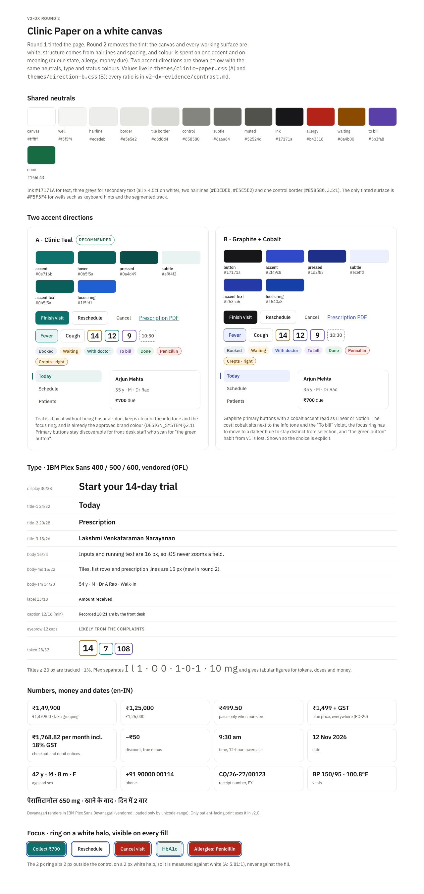

Alternatives (shown at the bottom of the palette page): harbour blue `#1D5C8C` collides with the info tone and the focus ring; neem green `#3D5A3C` reads as "success".

### DX-2 Type: IBM Plex Sans, vendored

- Plex distinguishes `I l 1` and `O 0`, which matters for IDs and doses such as "1-0-1" and "10 mg". It also gives tabular figures for tokens and money.
- The woff2 files are in `themes/fonts/`, unmodified, with `OFL.txt` and SHA-256 hashes in `PROVENANCE.txt`. They come from the npm tarballs (`npm pack`) and are **not** in `package.json`, so the build never fetches Google Fonts.
- The tool check shows that **₹ is drawn by Plex Sans**, so DESIGN_SYSTEM §3.1's open assumption is closed. Devanagari is drawn by Plex Sans Devanagari, which loads only when Devanagari text appears.
- The type scale is unchanged. Body text is 16 px and the minimum is caption 12 px; nothing in the prototypes is 9–11 px.
- **Change from the approved docs:** DESIGN_SYSTEM §3.1 says `next/font/google`. Vendored local files are required because the e2e build runs network-guarded. The 06 research already ruled this; the decision is listed here so it is not silent.

### DX-3 Name, icon and theme colour (PO-19)

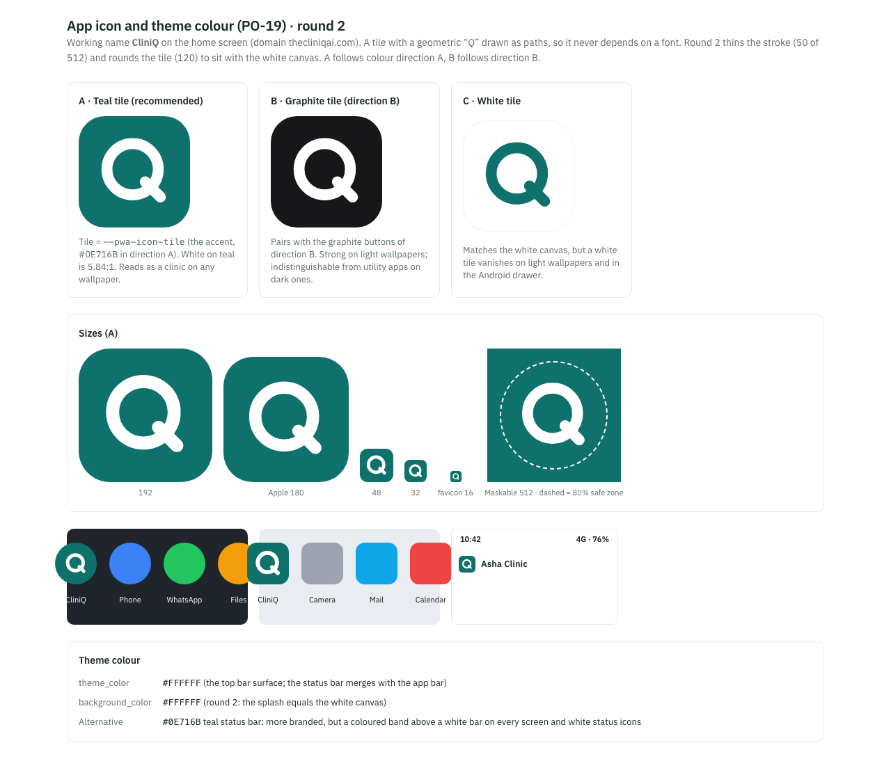

- **Name: "CliniQ"** on the home screen, in the manifest (`short_name`) and in the top-left mark. The domain stays **thecliniqai.com** for URLs and email.
  - I recommend against "CliniQ AI" as the in-app name. AI_STRATEGY §5.3 (D-3) and PO-21 say the base plan sells no AI. A product name containing "AI" would put the word on every screen, next to every price, and would trip the AI-02 copy rule.
  - PO-19's working spelling was "ClinicQ"; the domain suggests "CliniQ". **Please confirm the spelling.**
- **Icon A** (recommended): a teal tile with a geometric "Q" drawn as paths, so it never depends on a font. The maskable version keeps the glyph inside the 80% safe zone (the tool measured 191.6 of 204.8 px). PNGs at 192, 512, maskable 512, Apple 180 and favicon 32 are in [`icons/`](v2-dx-evidence/icons).
  - B (paper tile) disappears on light wallpapers.
  - C (ink tile) loses the teal brand link at small sizes.
- **Theme colour `#FFFFFF`**, so the status bar merges with the white top bar. The splash `background_color` is `#F6F5F1`, the same as the canvas. The alternative is a teal status bar, which puts a coloured band above a white bar on every screen.

### DX-4 Today on phones (360, 744)

The top bar shows the clinic name. Below it come the date and a Live indicator, then the filter and doctor select, then a lane switcher with counts, then the list. Each row shows:
- the token number and wait time;
- name, age, sex, doctor and arrival type;
- vitals and allergy chips;
- **one** primary action.

Tapping a row opens a bottom sheet with full details and every other action. The bottom bar has Today, Schedule, a centre "+", Patients and More. The iPad mini (744) uses this phone layout, per PWA §3.4.

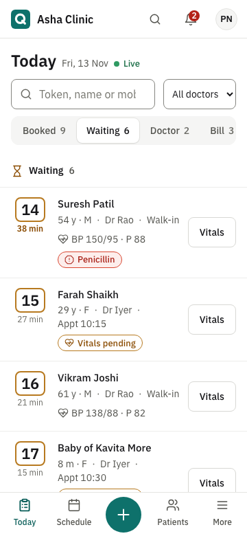 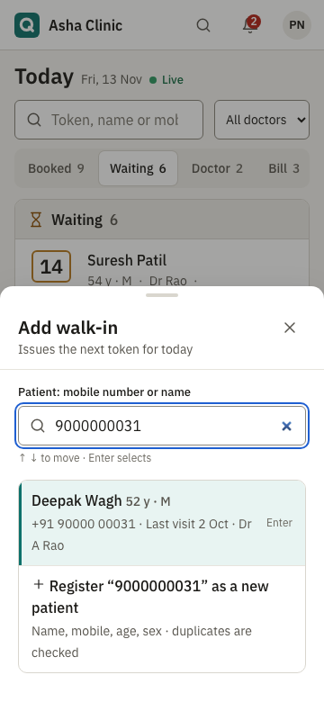 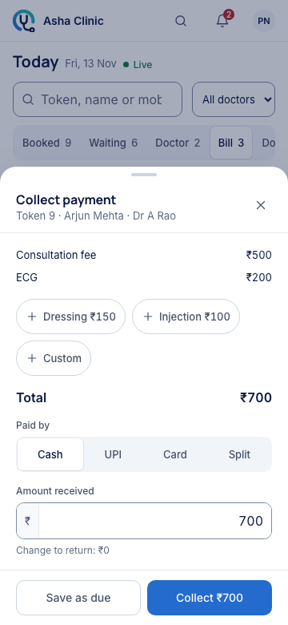

WebKit on an iPhone 15 profile: [today](v2-dx-evidence/screens/today/webkit-iphone15-390.png). Tablet mini: [744](v2-dx-evidence/screens/today/744.png).

### DX-5 Today on a tablet in portrait (820): two-pane

The list sits on the left with an inline Check in or Collect on each row. The selected patient sits on the right, with a large primary action, the allergy banner, vitals, today's timeline and the bill.

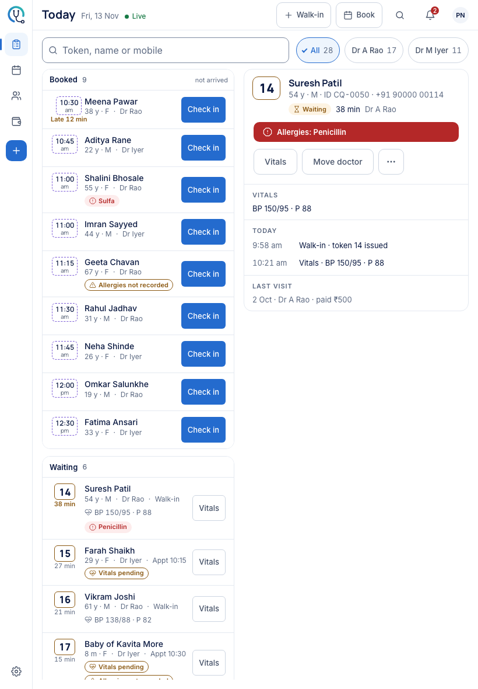

### DX-6 Today on a tablet in landscape (1180): recommend B, three lanes

| A: two-pane (as at 820) | **B: three lanes (recommended)** |
|---|---|
| 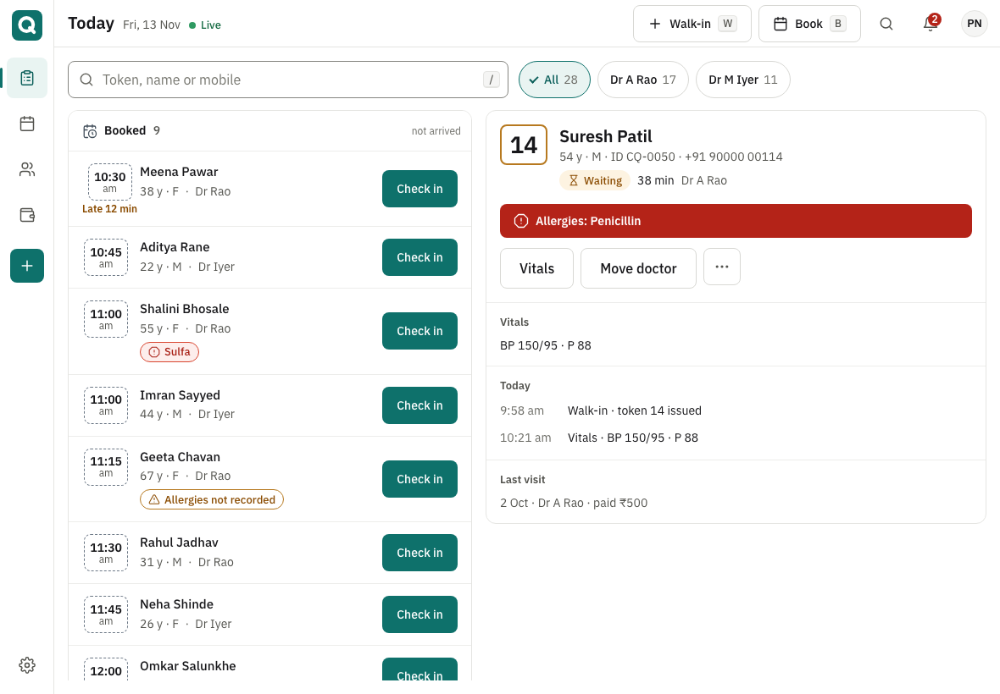 | 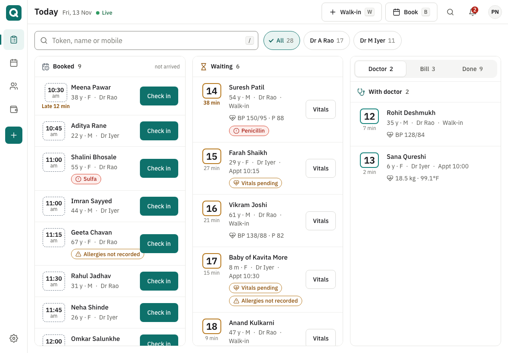 |

Why B: at a landscape front desk, the two lanes that drive the work (Booked for check-ins, Waiting for vitals) are visible together. The third lane switches between With doctor, To bill and Done. Details open in a side sheet. B is also the 1280 lane layout with fewer columns, so V2-08 builds one fewer layout. A stays the 820 layout either way.

### DX-7 Today on desktop (1280): four lanes plus a collapsed Done


Five equal lanes beside a 232 px sidebar leave about 190 px per lane, which wraps names and meta. Done is rarely acted on, so it collapses to a 64 px strip with its count, and one click expands it. The doctor's view ("My queue") pins the next patient and shows a deterministic patient snapshot, labelled Smart Assist:

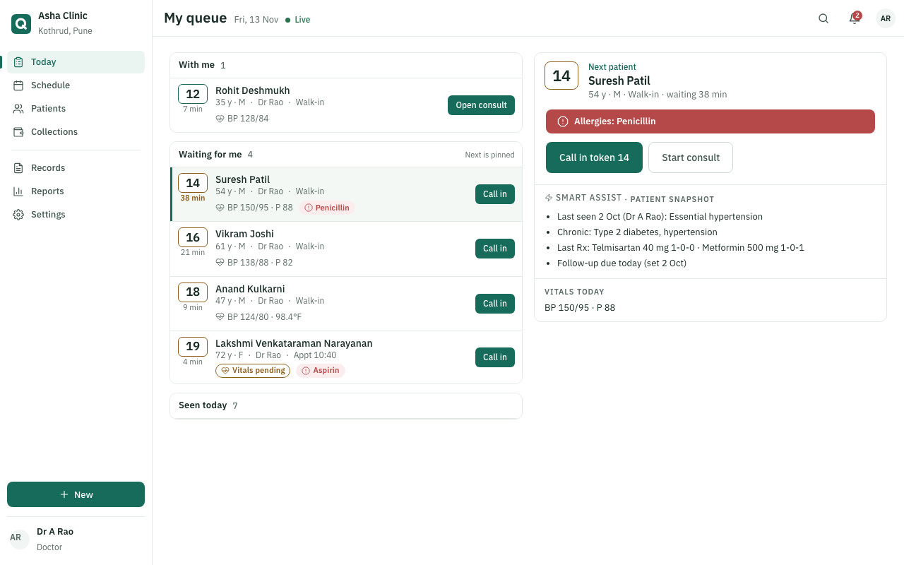 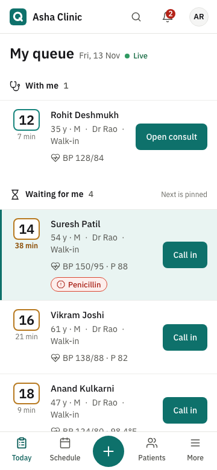

### DX-8 Row and token anatomy

- **Token chip:** 28/22 px tabular numerals with a 2 px border in the status colour. Before arrival it is a **dashed time chip** ("10:30 am"), so "booked, not here yet" reads at a glance.
- **Wait time** sits under the token. It turns warning-coloured at 30 minutes or more and danger-coloured above 60, always as text, never colour alone. Late arrivals show "Late 12 min".
- **One search on Today.** The filter takes a token, name or mobile number. Enter on a single match does that row's next step: check in, vitals or collect. With no match it offers "Search all patients", which opens walk-in with the text prefilled. The global ⌘K palette sits behind the search icon, so Today never shows two search boxes.
- **Actions:** one primary inline; the rest sit in ⋯ (Reschedule, No-show, Move doctor, Cancel). On narrow widths the ⋯ items are in the row's detail sheet. Destructive actions offer an 8-second Undo.

### DX-9 Consult layouts

| 1280: three-pane (AI panel shown open for review) | 820: note plus Patient drawer |
|---|---|
| 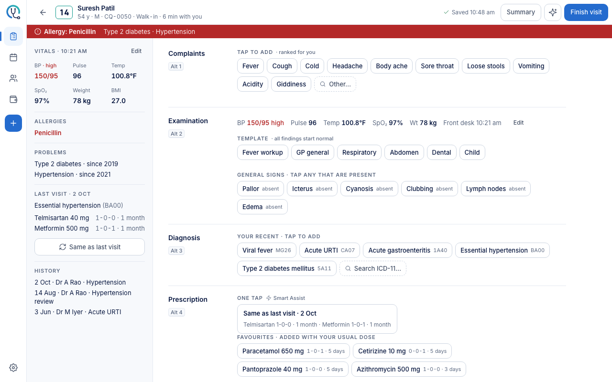 | 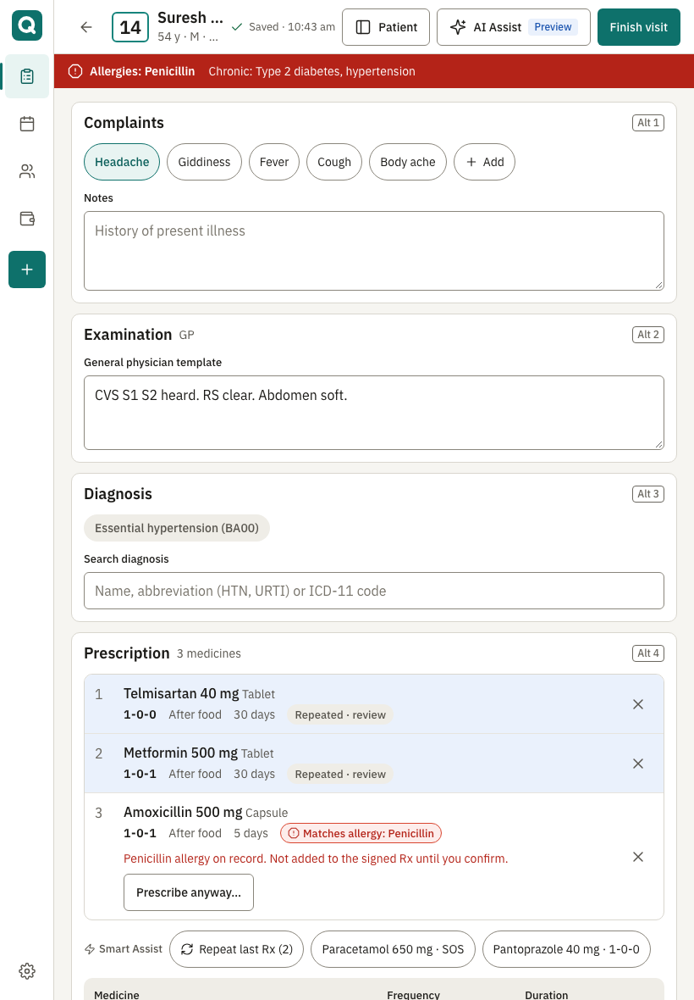 |

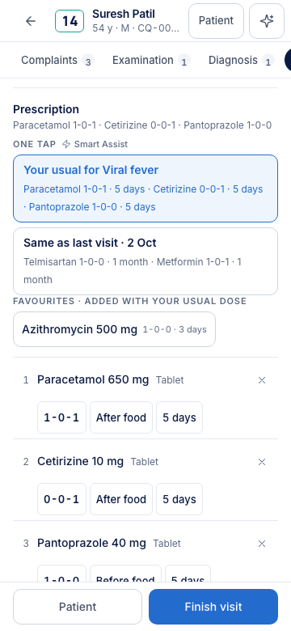 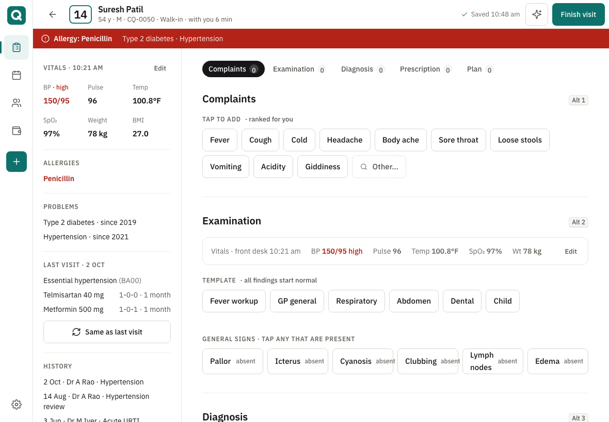 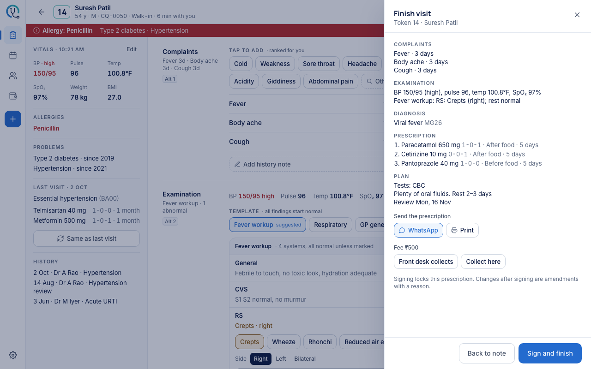

- **Allergy banner:** solid red, never dismissible, with chronic conditions on the same line.
- **Context pane:** vitals (BP flagged in text), the last visit with **Repeat last Rx** (1 action), problems and history.
- **Prescription entry, keyboard only:**
  1. Type the medicine and press Enter.
  2. Press a digit to pick the frequency preset (1 = 1-0-1, 2 = 1-0-0, …).
  3. Type the duration (`30d`) and press Enter.
- **Safety:** an allergy match shows a red chip and "Prescribe anyway…". Repeated lines are tinted and marked "Repeated · review".
- **Finish visit** opens a review sheet: summary, WhatsApp or Print, billing hand-off, then **Sign and finish**, then "Call next".
- **Recommendation:** at 1280 the AI panel is **collapsed by default** (UX_AUDIT §5.7) and remembered per user. It is rendered only during the trial (PO-21, PO-25). The screenshot shows it open so you can judge it.

### DX-10 to DX-12 AI labelling (AI-02, PO-21)

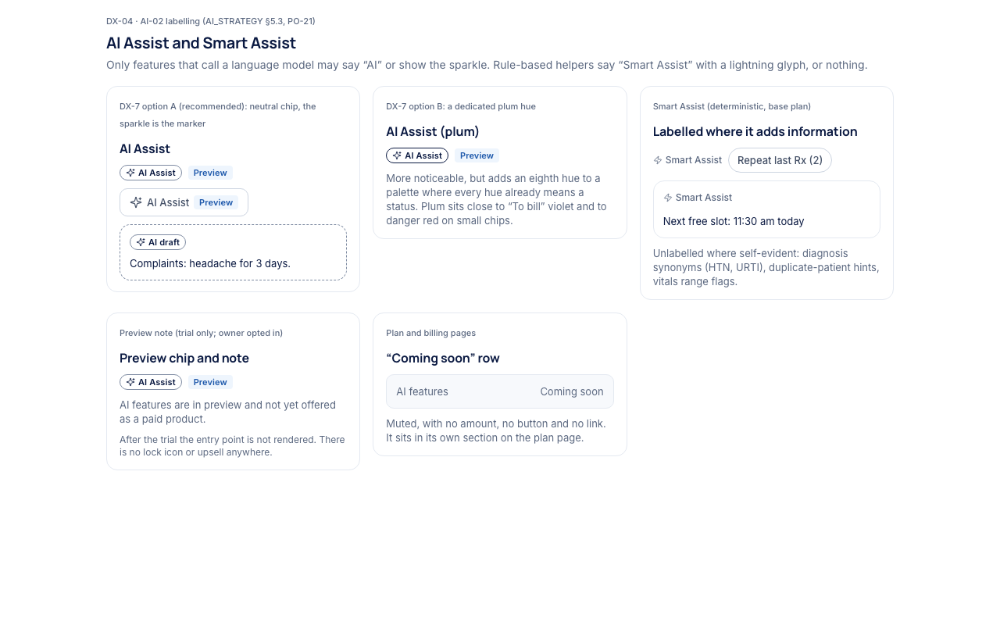

- **DX-10, recommend option A:** a neutral white chip with an ink "AI Assist" label, where the sparkle is the only marker. Every hue in the palette already means something, so an AI hue would compete with the status colours. Option B (plum) passes contrast (`plum-700` on `plum-50`) but sits close to "To bill" violet and to danger red on small chips.
- **DX-11:** "⚡ Smart Assist" appears on the slot suggestion, the Repeat and favourites row and the patient snapshot. Diagnosis synonyms, duplicate hints and vitals flags are unlabelled. The sparkle never appears on deterministic features; the tool checks this.
- **DX-12:** a blue "Preview" chip, plus "AI features are in preview and not yet offered as a paid product." On the plan page, "AI features · Coming soon" is a muted row in its own section, with no amount, button or link.

### DX-13 Price display (PO-20)

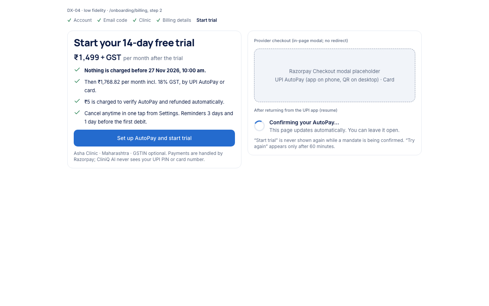 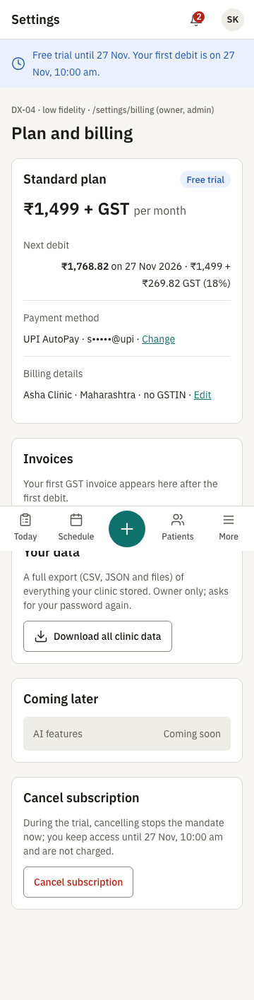

The start-trial screen states each of these:
- No charge before **27 Nov 2026, 10:00 am**.
- Then ₹1,768.82 per month incl. 18% GST.
- ₹5 is verified and refunded.
- Cancel anytime.

The return path from the UPI app shows "Confirming your AutoPay…". The [price page](v2-dx-evidence/screens/price/1280.png) lists the forms that are never allowed.

### DX-14 Focus indicator

The DESIGN_SYSTEM ring (`#1F5FD1`) is invisible against a teal button (1.01:1). The prototypes draw it 2 px outside the control on a 2 px white halo (`box-shadow`). The binding pair is then ring on halo, at 5.81:1 on every fill: teal, red banner and tints. This adds one line to the DESIGN_SYSTEM §2.4 `:focus-visible` rule. See the focus row on the [palette page](v2-dx-evidence/screens/palette/1280.png).

### DX-15 Token additions (everything else is DESIGN_SYSTEM verbatim)

`fg-body-tint`; status `*-border` tokens (token chips); the `ai-*` and `preview-*` tokens and `smart-fg`; `plum-*` (option B only); `ring-halo`; `text-token-sm` (22/24); `spacing-control-dense` (40 px rows at ≥ 1280 with a fine pointer only; touch stays 44 px); `spacing-sheet`, `spacing-context-pane`; `duration-flash`; `--pwa-*` (manifest mirror); and component aliases (`--button-*`, `--chip-*`, `--lane-*`, `--row-*`). All are in [`themes/clinic-paper.css`](themes/clinic-paper.css).

### DX-16 `/settings/billing` vs `/settings/plan`

The roadmap, SUBSCRIPTIONS_AND_PLANS and PWA_STRATEGY use `/settings/billing`. INFORMATION_ARCHITECTURE §3.3–3.4 uses `/settings/plan` and redirects `/settings/billing` to it. I recommend `/settings/billing`: it is the existing v1 URL and the name used by three approved documents. The IA tables get corrected in V2-06. **This is your call; I have not edited the IA doc.**

### DX-17 Low-fidelity surfaces (structure and copy, not polish)

| Install, update, offline | Offline page | Locked (owner, staff) | Platform clinics |
|---|---|---|---|
| 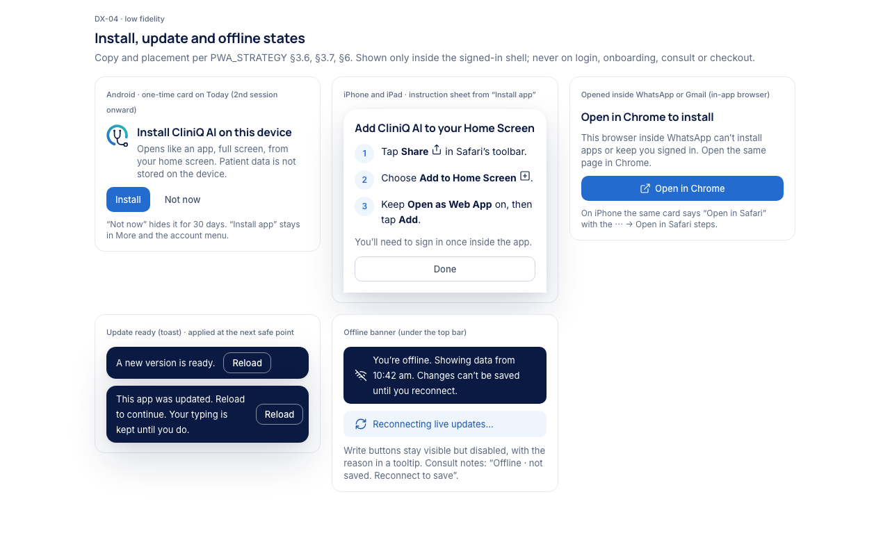 | 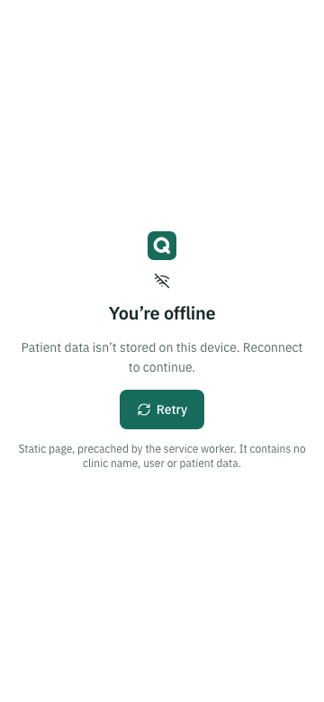 | 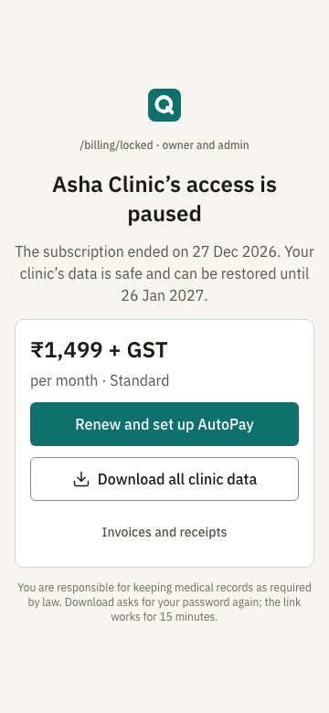 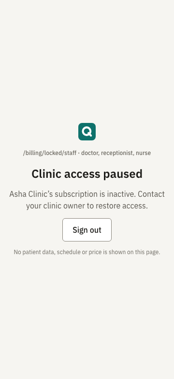 | 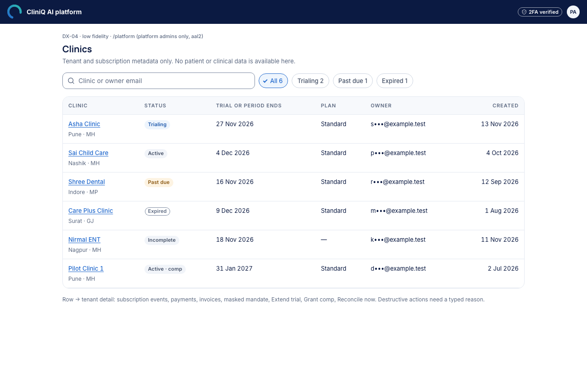 |

What each surface does:
- **Install:** an Android card on Today (from the second session), the iOS 3-step sheet with "Open as Web App", and "Open in Chrome" inside WhatsApp or Gmail.
- **Update:** an update toast and a skew toast.
- **Offline:** an offline banner, and a static offline page with no clinic or patient data.
- **Locked:** the owner page offers renew, export and invoices. The staff page shows no data.
- **Platform:** metadata only, "2FA verified" in the bar, and masked owner emails.

---

## G2-D sign-off checklist (8 items)

- [ ] **1. Palette** "Clinic Paper" (DX-1, DX-14, DX-15): approve or change.
- [ ] **2. Type**: IBM Plex Sans 400/500/600 vendored, with Devanagari only where Hindi renders (DX-2): approve.
- [ ] **3. Brand**: name "CliniQ" on the device and domain thecliniqai.com, icon A, `theme_color #FFFFFF`, `background_color #F6F5F1` (DX-3): approve or pick an alternative.
- [ ] **4. Today**: phone (DX-4), 820 two-pane (DX-5), **1180: A two-pane or B three lanes** (DX-6), 1280 four lanes plus collapsed Done (DX-7), row anatomy (DX-8).
- [ ] **5. Consult** layouts at 360/820/1180/1280, with the AI panel collapsed by default (DX-9).
- [ ] **6. AI labelling**: AI chip A or B (DX-10), Smart Assist rule (DX-11), Preview chip and note, "Coming soon" row (DX-12).
- [ ] **7. Price**: "₹1,499 + GST", and "₹1,768.82 per month incl. 18% GST" at checkout (DX-13).
- [ ] **8. Low-fi surfaces** accepted as the brief for V2-06, V2-13b and V2-13c (DX-17), and the billing URL (DX-16).

After your answers: an isolated Claude design reviewer reads only this file and the evidence folder. Your verbatim answer goes into the G2-D row of `docs/v2/VERIFICATION_LOG.md`. Then `/gsd-ui-phase 06` turns the approved sandbox into `06-UI-SPEC.md`.

## How 06-01b consumes `clinic-paper.css` unchanged

1. **Copy, do not edit.**
   - Copy `themes/clinic-paper.css` byte for byte to `app/styles/clinic-paper.css`, and `themes/fonts/*` to `app/styles/fonts/` (the `url()` paths stay valid).
   - A unit test compares the file's SHA-256 with the hash recorded in the G2-D log entry.
2. **Register names, not values.**
   - Tailwind v4 learns the token names from a generated `@theme reference { … }` block (`themes/clinic-paper.theme.css`, written by the same generator as the capture script).
   - Utilities such as `bg-canvas`, `text-fg-muted`, `h-control` or `rounded-lg` compile to `var(--token)`. The values come from `clinic-paper.css` at runtime.
   - This is proven on Tailwind 4.3.3 in [tailwind-consumption.txt](v2-dx-evidence/tailwind-consumption.txt): 17 of 17 utilities resolve, and 154 names are registered.
   - A unit test asserts that the generated list equals the token names in the file.
3. **`app/globals.css`** becomes:

   ```css
   @import "tailwindcss";
   @import "./styles/clinic-paper.css";
   @import "./styles/clinic-paper.theme.css";
   ```

   followed by the `@layer base` rules: body, the DX-14 focus rule and reduced motion.
4. **06-01a** (value-neutral, before G2-D) ships the same file *structure* with v1-equivalent values. 06-01b's diff is therefore one replaced file plus fonts.
5. **Font loading.** If `next/font/local` is adopted for preload and fallback metrics, 06-01b overrides `--font-sans` in `globals.css` after the import, never inside the file.
6. **Doc change to note.** DESIGN_SYSTEM §10 says tokens live only in `app/globals.css`. With this approach that becomes "`globals.css` and the token file it imports".
7. **Manifest mirror.** `lib/design/tokens.ts` mirrors the `--pwa-*` values for the manifest and icons. Its test parses `clinic-paper.css`.
8. **What 06-01b does not reuse.** `shared/sketch.css` and the prototype JS are throw-away. 06-02 and 06-03 rebuild them as primitives on Radix.

## Limits (stated plainly)

- The prototypes are static HTML with frozen data and a frozen clock (10:42 am, Fri 13 Nov). Live updates, save and Undo are simulated.
- Real-device checks (TalkBack, iOS standalone, UPI hand-off) belong to V2-06 and V2-13b, not to this sandbox.
- The drug-allergy match in Consult is illustrative; the salt mapping is a backend dependency (AI_STRATEGY SA-07).
- The low-fi surfaces use the real tokens but were not iterated for polish.
- No clinic users were shown these designs (PO-13 has not arranged any).

## Sandbox contents

| Path | What |
|---|---|
| `themes/clinic-paper.css`, `themes/fonts/` | Tokens (raw, semantic, structure, component) and the vendored Plex fonts, with OFL and provenance |
| `themes/clinic-paper.theme.css` | Generated Tailwind registration (do not edit) |
| `001-palette-type/`, `002-icon/` | DX-01 palette, type, numerals and icon options (SVG masters) |
| `003-today/`, `004-consult/` | DX-02 and DX-03 hi-fi prototypes (vanilla JS) |
| `005-surfaces/` | DX-04 low-fi pages |
| `shared/` | Prototype-only CSS and JS helpers |
| `v2-dx-capture.mjs` | Evidence generator: `node .planning/sketches/v2-dx-capture.mjs` |
| `v2-dx-evidence/` | Screenshots, axe, contrast, counts, videos, copy check, glyphs and icon PNGs |
