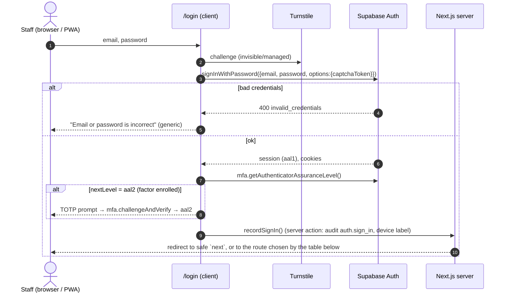
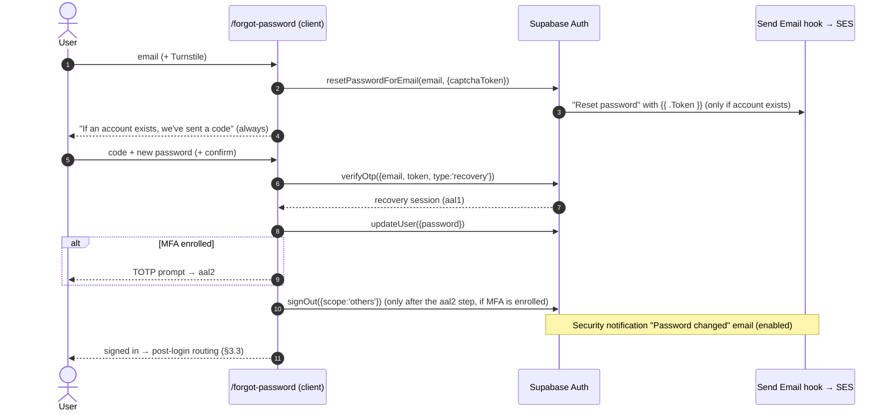
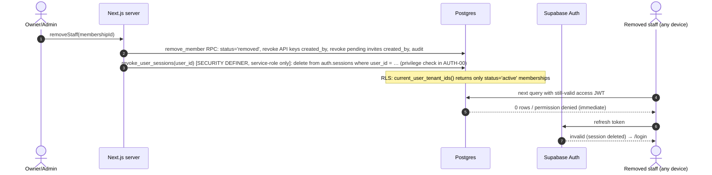

# AUTH_REDESIGN — Password login, OTP only for verification and recovery

| Field | Value |
|---|---|
| Track | **AUTH** (identity, sessions, invitations) |
| Driver | PO requirement #3 (2026-11-10): "Let users set passwords; send OTPs only for forgot password and for signup email verification." |
| Status | **Proposed, revised after independent review (2026-11-10, §13).** Planning only. No code, config or provider changes are made by this document. |
| Related | `SECURITY_ASSESSMENT.md` (SEC-07, SEC-08, SEC-11, SEC-14, SEC-17, SEC-26), `PRODUCT_BASELINE.md` §4 and row 19, `V2_MASTER_ROADMAP.md` (P0-02, P0-15, P1-09, P1-15, P1-26, P1-27, P2-07), `SUBSCRIPTIONS_AND_PLANS.md` (SUB: trial, mandate, tenant states, platform admin portal), `PWA_STRATEGY.md` (D-5 sign-out, §6.3 in-app browsers, §6.4 auth interplay, R-checklist) |
| Settled context | v1 is not live. The `.env` Supabase project is a test DB. Production will be a **new** Supabase project. Go-live happens only after all of v2 is finished, so there is **no user migration and no dual login path**. Team = PO + Claude (reviews by isolated Claude reviewer agents; no human reviewers). Stack: Next.js App Router + Supabase (Auth, Postgres, Storage) + Vercel, Tailwind + shadcn. Data is stored in India (PO-12). |
| Sources accessed | 2026-11-10 (see §12). Anything not confirmed is marked **(unconfirmed)**. |

Labels: **Fact**, **Problem**, **Risk**, **Assumption (validate)**, **Recommendation**, **Decision**, **Open question**. Priority P0–P3. Sizes S/M/L/XL (relative).

---

## 0. Summary

> Update (2026-11-10, PO round 3; roadmap C43, C46, PO-26, V2-16; VERIFICATION_LOG addendum 4). **These override the round-2 banner below where they disagree.**
> - **CAPTCHA scope: accepted default (ruling R3).** Supabase's native CAPTCHA covers sign-in, email OTP, magic link, recovery and resend as well as signup, and it cannot be scoped to signup. The **accepted default** is Cloudflare Turnstile in **Managed** mode on every endpoint Supabase enforces; Managed mode is usually invisible, so it adds no extra friction for most users. This is a superset of the PO's "add for signups". **Rejected alternative:** a custom signup-only path (Supabase's switch off, server-side `siteverify` in the signup action), because it leaves Supabase's public `signUp`, `/otp` and `/recover` endpoints without CAPTCHA and needs its own rate limiting (about S-M).
> - **Supabase Free only during the UAT stage.** The Pro-only settings below (leaked-password protection, session time-box and inactivity) are missing only while production runs the real-world UAT on Free (roadmap V2-16); FT-05/FT-06/FT-07 cover that window. They are switched on at the Supabase Pro + PITR upgrade at UAT exit, before paid launch (default timing; PO confirms, PO-26), and the hosted-settings drift check (§7) is re-run then.
> - **Coupon codes at signup (SUB §14):** the onboarding "Start trial" step gains an optional code field (or a `?code=` pre-fill from a UAT invite). Code validation is a server action with a Postgres rate limit (P1-26) and uniform errors; it needs no extra CAPTCHA because the owner is already signed in and verified at that step.

> Update (2026-11-10, PO round-2 decisions; roadmap PO-17 ✅, PO-23 ✅, C43, §9.1; VERIFICATION_LOG addendum 3). **These override anything below that disagrees.**
> - **CAPTCHA confirmed by the PO** ("CAPTCHA yes add for signups"). Supabase has a single "Enable CAPTCHA protection" switch, and the Auth server source shows it enforces the token on `/signup`, the `/token` **password** grant (refresh, PKCE and id_token grants are exempt), `/otp`, `/magiclink`, `/recover`, `/resend`, `/sso` and passkey options; `/verify` is not covered and admin-credential calls skip it. It **cannot be limited to signup**. **Decision (C43, option A):** Cloudflare Turnstile in **Managed** mode on every endpoint Supabase enforces, which matches this document's original design (signup, sign-in, recovery); most users never see a challenge. Each Auth call needs a fresh token (Turnstile tokens are single-use, **Assumption (validate)** in AUTH-00). A signup-only design (switch off, `siteverify` in the signup server action) would leave Supabase's public `signUp` endpoint unprotected and needs its own rate limiting; not recommended.
> - **Supabase Free during UAT (PO-17, scoped by round 3).** Production runs on the Free plan during the real-world UAT stage only, so the Pro-only settings in §4.1 are not available until the upgrade before paid launch (roadmap §9.1):
>   - **Leaked-password protection (HIBP) is Pro-only** → the app server checks every new password against the Pwned Passwords range API (k-anonymity, 5-character SHA-1 prefix) in the signup, invite-accept, reset and change-password server actions (roadmap **FT-05**, with AUTH-04b). Minimum length 10 stays in the Supabase config. A direct call to Supabase's Auth API that bypasses the app skips the app check; this residual risk is accepted until the upgrade.
>   - **Session time-box and inactivity timeout are Pro-only** → AUTH-D2 is enforced app-side in the server guard (roadmap **FT-06**, with AUTH-09).
>   - **Auth audit logs are kept 1 hour on Free** → auth events are written to the app's own audit table, kept ≥ 180 days (roadmap **FT-07**).
>   - **Custom SMTP and the Send Email hook work on Free** (Supabase docs). With custom SMTP the default email limit is 30/h and can be raised; the built-in mailer stays unusable for production (team members only, 2/h).
>   - Auth URLs stay on `*.supabase.co` (no custom domain on Free); the `auth.` subdomain is the email sender only (PO-19 ✅).
> - **PO-A1 (10-character minimum) and PO-A7 (owner email change) are accepted** (roadmap PO-23 (d), (e)).

- **Fact.** v1 has **no passwords**. Every staff login sends a Supabase email OTP (`features/auth/dev-actions.ts:59-62`, `app/(auth)/login/page.tsx:71,106-110`). MSG91 is **not** used for staff OTP. A WhatsApp template `staff_onboarding_otp` and an `otp_login` governance event exist but nothing calls them.
- **Problem.** Email cost and login friction scale with *logins* (staff × days), not with *accounts*. The built-in Supabase mailer is capped at 2 emails/hour and delivers only to the project team's own addresses, so v1 cannot run in production without custom email anyway.
- **Recommendation.** Use Supabase Auth email + password as the only day-to-day login. Send a 6-digit email OTP only for (a) owner signup verification and (b) forgot password. **No other OTP emails. Re-authentication uses password or TOTP, never email (§3.5).** Staff invitations are **one app-sent email** whose link lets the invitee set a password (Decision AUTH-D1). That email proves mailbox control, so no second OTP is needed. Send all email through **Amazon SES in ap-south-1 (Mumbai)**, preferably through the Supabase **Send Email hook** (which also lets the app drop unwanted OTP-login sends, §4.1), with SES custom SMTP as the fallback. Expected cost is about **US$0.10 per 1,000 emails**.
- **Recommendation.** Require Supabase **Pro** on production *(round 2/3: production runs the UAT stage on Free, PO-17; the app-side FT-05/FT-06 controls cover the gap until the upgrade before paid launch, see the updates above)*. Leaked-password protection and session time-box and inactivity limits are Pro-only. CAPTCHA (Cloudflare Turnstile) goes on signup, sign-in and recovery. TOTP MFA is **mandatory for platform admins** and **optional but nudged for clinic owners**. Staff removal is enforced **immediately at the data layer** through `memberships.status` in RLS, and it also deletes the user's Auth sessions where the privilege check allows (§3.6).
- **Decision (AUTH-D2).** Sessions: 7-day inactivity timeout, 14-day time-box, plus a local sign-out after 10 min idle on clinical screens. Personal devices re-enter the password at most every 14 days; a shared PC re-enters it after an idle clinical screen.
- **Effort.** Track total is about **L**: **10** backlog items (AUTH-00 … AUTH-09, §11), placed inside existing phases (V2-01a, V2-01, V2-03, V2-05, V2-11, V2-13b, V2-13c).

---

## 1. Current state (v1) — evidence

### 1.1 Flows

| Flow | What happens | Evidence |
|---|---|---|
| **Login and signup are the same flow** | `/login` collects the email and calls the public Server Action `requestOtpAction(email,"login")`. In non-production with a service key it calls `admin.generateLink({type:"magiclink"})` and **returns the OTP and the magic link to the browser**. Otherwise it calls `signInWithOtp({ shouldCreateUser: true })`, so **any email creates an account**. The user types a 6–8 digit code, and the browser calls `verifyOtp({type:"email"})`, then `router.push("/")`. | `app/(auth)/login/page.tsx:59-124`, `:152-155` (accepts up to 8 digits); `features/auth/dev-actions.ts:30-83` |
| **Owner onboarding** | The dashboard layout sees no membership and redirects to `/clinic/new`. The name-only form calls the `create_clinic_with_owner` RPC. There is no trial, no plan and no limit on clinics per user. | `app/(dashboard)/layout.tsx:13-29`; `app/(onboarding)/clinic/new/page.tsx`; `features/clinics/actions.ts:21-60` |
| **Staff invitation** | `inviteStaff` inserts `invitations` with a SHA-256 token hash and a 7-day expiry. **In production the link is neither returned nor emailed**, so there is no delivery channel. In dev it is logged to `.planning/dev-auth-logs.txt`. | `features/staff/actions.ts:21-104`, `features/staff/invite.ts:14-38`, `lib/auth/dev-logger.ts` |
| **Invite acceptance** | `/join?token&email` requests an OTP (`requestOtpAction(...,"join")`), then `verifyOtp`, then `acceptInvite(token)`, which calls the `consume_invitation` RPC. The RPC locks the row and checks expiry and consumption, but it **does not check that `auth.email()` equals `invited_address`**. | `app/(auth)/join/page.tsx:29-76`; `supabase/migrations/000002_invitations_billing.sql:120-165` |
| **`/verify`** | A standalone OTP page that resends with `signInWithOtp({shouldCreateUser:true})`. Nothing links to it (orphan). | `app/(auth)/verify/page.tsx:24-81`; PRODUCT_BASELINE §2 routes |
| **Callback** | `/auth/callback` exchanges a PKCE `code` or `token_hash` (types `email`/`magiclink`) and then redirects to `${origin}${next}`, with `next` unvalidated (open redirect, SEC-17). | `app/auth/callback/route.ts:4-32` |
| **Session refresh** | Middleware calls `getUser()` on every non-API request. It gates no routes. Guards live in the layout and in actions. | `middleware.ts:48`; SECURITY_ASSESSMENT §3 |
| **Sign-out** | `supabase.auth.signOut()` with no scope argument from the browser. Current supabase-js defaults this to `global`, so it signs out every device. That is surprising behaviour for a shared clinic PC. | `components/layout/user-dropdown.tsx:20-31`; supabase-js signOut reference |
| **Social login** | Google and Microsoft buttons are rendered disabled ("Phase 3"). | `components/auth/social-auth-buttons.tsx` |
| **Tests** | The integration seed creates users with the **password** `TestPassword123!` and signs them in with `signInWithPassword`. Password auth already works in the test DB; only the UI lacks it. `tests/e2e/` does not exist, although `playwright.config.ts:4` points to it. | `tests/helpers/tenants.ts:15-19,39,88`; `tests/auth/invite.spec.ts`, `tests/auth/rbac.spec.ts` |
| **Local Auth config** | `enable_signup = true`, `[auth.email] enable_confirmations = false`, `jwt_expiry = 3600`. No password policy, CAPTCHA, SMTP, session or MFA settings are in the repo. Hosted settings are unknown (SEC OI-1). | `supabase/config.toml:13-23` |

### 1.2 OTP provider actually used

- **Fact.** Staff OTP goes through **Supabase Auth email OTP** only (`signInWithOtp`, `verifyOtp type:"email"`).
- **Fact.** MSG91 is used for **patient** WhatsApp and SMS only. These OTP artefacts are unused:
  - the `staff_onboarding_otp` WhatsApp template (`lib/messaging/templates/whatsapp-templates.json:496-522`, `lib/messaging/templates/mapping.ts:68-69,100`);
  - the `otp_login` SMS-fallback branch in governance (`lib/messaging/governance.ts:144`);
  - `otp_code` in `scripts/msg91-test-send.ts:37`.
- **Assumption (validate).** The hosted test project uses the built-in Supabase mailer or an unknown SMTP. The login page accepting up to 8 digits suggests the OTP length was changed on the hosted project. Not checked, because that needs the dashboard or `.env`.

### 1.3 Cost drivers

| Driver | v1 behaviour | Why it costs |
|---|---|---|
| Login emails | One OTP email per login, per device, per session expiry | Scales with staff × working days × devices. One 5-staff clinic logging in once a day for 26 days sends about 130 emails a month. At 300 clinics that is about 39,000 emails a month, before any resends. |
| Resends | A 30 s client cooldown (`login/page.tsx:83`) on top of Supabase's 60 s per-user limit | Users press resend when mail is slow, doubling volume. |
| Provider ceiling | Built-in mailer: **2 emails/hour** per project, and only to the organisation's team-member addresses | Login is impossible for real users without custom email. This is a hidden blocker rather than a cost. |
| Abuse | `shouldCreateUser:true` plus no CAPTCHA | Anyone can make the system email any address. This harms reputation and cost, and enables email bombing. |
| Human cost | Email delivery latency in tier-2/3 networks; shared front-desk PCs need someone with mailbox access at every login | Lost minutes at the busiest moment, the morning queue. |

### 1.4 Defects (auth-specific)

| ID | Pri | Defect | Evidence |
|---|---|---|---|
| AD-1 | P0 | The dev OTP shortcut returns a working OTP and magic link for **any email** to the browser whenever `NODE_ENV !== "production"` and a service key is present (SEC-14). | `features/auth/dev-actions.ts:30-83` |
| AD-2 | P0 | No invite delivery in production. Invites are not bound to the invited email (SEC-08 / P0-15). | `features/staff/actions.ts:85-98`; `000002…:120-165` |
| AD-3 | P1 | Open self-signup via `shouldCreateUser:true` (two places), with unlimited clinic creation. | `dev-actions.ts:61`, `verify/page.tsx:63-69` |
| AD-4 | P1 | No staff removal and no session revocation (SEC-07). Sign-out is the default global scope, called from the client. | `user-dropdown.tsx:24` |
| AD-5 | P1 | No MFA, and session lifetime is undefined (SEC-26). | `config.toml:17`, no `mfa` code |
| AD-6 | P2 | Open redirect through `next` in the callback (SEC-17). | `app/auth/callback/route.ts:9,17,28` |
| AD-7 | P2 | Raw Supabase error messages are shown to users (`verifyError.message`). This can leak states such as "Email not confirmed" and confuses users. | `login/page.tsx:113`, `join/page.tsx:61`, `verify/page.tsx:38` |
| AD-8 | P2 | OTPs, invite links and emails are written to `.planning/dev-auth-logs.txt` (git-ignored, local). | `lib/auth/dev-logger.ts` |
| AD-9 | P3 | Orphan `/verify` page; disabled social buttons advertise features that do not exist; the trust footer claims "ABDM Compliant" and "256-Bit Encrypted" without evidence. | `verify/page.tsx`; `login/page.tsx:362` |
| AD-10 | P3 | `@supabase/ssr` is pinned at 0.5.2 (old). supabase-js is 2.117.2, which already supports `updateUser({ current_password })` (≥ 2.102.0 per Supabase docs). | `package.json:28-29`; `node_modules/@supabase/*/package.json` |

---

## 2. Design principles

1. **Passwords for daily use, email OTP only to prove mailbox control** (signup and recovery). This cuts identity email volume by more than 99% (§4.3).
2. **Supabase Auth does the cryptography.** No custom password hashing, session tokens or OTP generation. The app only adds UX, policy, CAPTCHA, email delivery (Send Email hook) and audit.
3. **Codes, not links, in Auth emails.** Use the `{{ .Token }}` 6-digit code. Supabase documents that link scanners such as Microsoft Defender Safe Links pre-fetch and consume `{{ .ConfirmationURL }}` links, and iOS Home Screen apps have a separate cookie jar (PWA §6.4). The app's own invite link is safe because it only renders a page; nothing is consumed until a POST that carries a password.
4. **Auth calls that rate-limit by IP run in the browser.** These are `signInWithPassword`, `signUp`, `resetPasswordForEmail`, `verifyOtp` and `resend`. When they run from Vercel Server Actions, Supabase sees Vercel's egress IP, so per-IP limits collapse into one global bucket. `Sb-Forwarded-For` support exists in a Supabase Auth PR (unconfirmed for hosted projects). Server-side code is used only for privileged steps: invite acceptance, staff removal, sign-out (`POST /auth/signout`, PWA D-5) and audit.
5. **Authorisation never depends on the session alone.** Access tokens cannot be revoked before they expire (Supabase docs), so removal takes effect through `memberships.status` in RLS on the very next query. Subscription locking is also authorisation (SUB-02 RLS), never an Auth block: a locked clinic's users still sign in successfully.
6. **No dual paths.** Production is a fresh project with no users, so v1 OTP-login code is deleted rather than feature-flagged.

---

## 3. Target flows

### 3.1 Owner signup (email + password → email OTP → clinic → mandate → trial)

```mermaid
sequenceDiagram
  autonumber
  actor O as Owner (browser)
  participant UI as Next.js /signup (client)
  participant TS as Turnstile
  participant SA as Supabase Auth
  participant SES as Send Email hook → SES (ap-south-1)
  participant APP as Next.js server (actions)
  participant DB as Postgres (RLS)
  O->>UI: name, email, password (+ Terms acceptance; separate DPDP notice for owner's own data)
  UI->>TS: challenge
  TS-->>UI: captchaToken
  UI->>SA: signUp({email, password, options:{captchaToken, data:{full_name}}})
  SA->>SA: policy check (min length, leaked-password check on Pro)
  SA->>SES: "Confirm signup" with {{ .Token }} (6 digits)
  SA-->>UI: user (unconfirmed, no session). Same response shape if email already exists
  UI-->>O: "Enter the 6-digit code we emailed" (identical message in every case)
  O->>UI: code
  UI->>SA: verifyOtp({email, token, type:'email'})
  SA-->>UI: session (aal1); cookies set via @supabase/ssr
  UI->>SA: updateUser({password}) with the password just entered (pre-account hijack guard)
  UI->>SA: signOut({scope:'others'})
  UI->>APP: redirect to clinic creation
  APP->>DB: create_clinic_with_owner(name, city, specialty...) → tenant_subscriptions status 'incomplete' (SUB-01)
  APP->>DB: audit auth.signup_verified, clinic.created
  APP-->>O: "Start trial" step: mandate checkout (UPI AutoPay / card), per SUB §5
  Note over O,APP: Trial starts only when the mandate is authenticated (SUB D2). Then: recommended (not forced) TOTP prompt (§4.6)
```

- **Recommendation.** `/signup` is the only route that creates owner accounts. Staff accounts are created only through invitations (§3.2). The login page shows "New clinic? Create an account" and never creates users.
- **Recommendation.** The resend button calls `auth.resend({type:'signup', email, options:{captchaToken}})`. `ResendParams` allows `'signup' | 'email_change'` (auth-js types). It has a 60 s client cooldown that matches Supabase's per-user limit.
- **Assumption (validate in AUTH-00).** `verifyOtp` with `type:'email'` confirms a signup code. `EmailOtpType` also includes `'signup'`. Supabase's own reference example "Verify Signup OTP" uses `'email'`. The spike proves which value works on the current hosted Auth version and pins it in a test.
- **Recommendation.** An unverified account cannot sign in. Supabase returns "Email not confirmed", and the UI maps that to "Verify your email: we've sent a new code", then calls `resend`. Unverified users are purged after 7 days by a scheduled job (P3).
- **Edge case: pre-account hijacking (P1).** An attacker can call `signUp` first with the victim's email and the attacker's password and leave the account unconfirmed. When the victim later signs up and verifies by code, it is **unconfirmed** whether Supabase keeps the attacker's password. **Fix:** immediately after a successful signup `verifyOtp`, the client calls `updateUser({ password })` with the password the owner just entered, then `signOut({scope:'others'})`. **Assumption (validate in AUTH-00):** the "Require current password" setting does not block this call in a session just created by OTP verification; if it does, the same step runs as a server action using `admin.updateUserById(user.id, { password })`, allowed only when the JWT shows an OTP sign-in less than 5 minutes old. Covered by a pinned integration test.
- **DPDP notice (P2).** The owner's own personal data (name, email, phone) gets a short, unbundled notice at signup, separate from the Terms checkbox. Text owned by DATA_HANDLING and SUB-10 (public Privacy page).
- **Ordering with billing (aligned with SUB).** Email verification **precedes** clinic creation and the mandate, so a mandate is never created for an unverified email. **Mandate required before the trial starts (SUB D2). Tenant state `incomplete` shows only the "Start trial" step.** One trial per clinic and one trial per owner account is decided in SUB §4. On every login, onboarding resumes at the first incomplete step: no membership → clinic creation; tenant `incomplete` → "Start trial" (§3.3 routing table).

### 3.2 Staff invitation → set password

**Decision AUTH-D1: invite = link + set password, no OTP.** An app-sent invite email with an app-token link; acceptance creates or completes the Auth user with a password on the server. Total: one email.

- **Why it complies with the PO's rule.** The rule is "OTPs only at signup and for forgot password". The invite carries no OTP and needs no second email; the link itself is the single proof of mailbox control.
- **Cross-doc note.** This supersedes `PWA_STRATEGY.md` §6.4 bullet 2 ("Staff invites should land on a page that asks for the code"). The PWA concern (iOS separate cookie jar) is still met, because acceptance needs no session from the link: the invitee sets a password on the page, then signs in from wherever they will use the app. Listed in §10 for the roadmap owner.

```mermaid
sequenceDiagram
  autonumber
  actor A as Owner/Admin
  participant APP as Next.js server
  participant DB as Postgres
  participant Q as Outbox/jobs (V2-04)
  participant SES as SES API (ap-south-1)
  actor S as Invitee (browser)
  participant SA as Supabase Auth (admin API, server-only)
  A->>APP: inviteStaff(email, role)
  APP->>DB: invite_staff RPC: checks role grant rules (only owner may grant admin), dedupes pending invite, stores sha256(token), expires 72h, invited_address
  APP->>Q: enqueue email "invite" (idempotency key = invite id)
  Q->>SES: SendEmail (clinic name, inviter, link /join?token=…)
  S->>APP: GET /join?token (renders only, no state change, so scanner-safe)
  APP->>DB: peek_invitation(hash) → clinic, role, masked email, status
  alt Invitee has no account
    S->>APP: POST set password (+ Turnstile token)
    APP->>APP: verify Turnstile server-side; length and blocklist check
    APP->>SA: admin.createUser({email: invited_address, password, email_confirm:true})
    APP->>DB: consume_invitation_for(user_id, hash), which binds email and is atomic
    APP-->>S: "Account created", then client signInWithPassword
  else Invitee exists but is unconfirmed (e.g. abandoned owner signup)
    S->>APP: POST set password (+ Turnstile token)
    APP->>SA: admin.updateUserById(id, {password, email_confirm:true})
    APP->>DB: consume_invitation_for(user_id, hash)
    APP-->>S: "Account ready", then client signInWithPassword
  else Invitee has a confirmed account
    APP-->>S: "Sign in to accept" → /login?next=/join?token=…
    S->>APP: (signed in) acceptInvite(token)
    APP->>DB: consume_invitation(hash): requires lower(auth.email()) = invited_address
  end
  APP->>DB: audit staff.invite_accepted
```

- **Why not Supabase `inviteUserByEmail`.** It creates the Auth user at invite time, which leaves orphans when invites are revoked. It cannot handle invitees who already have an account. It sends through the Auth mailer with its own template and limits. It would duplicate the existing hashed-token `invitations` table, which is sound design (SECURITY_ASSESSMENT §1).
- **Why possession of the link is enough.** The link goes only to `invited_address`. Possessing it proves mailbox control, just as an OTP would. Combined with a 72 h expiry, single use, a stored hash and binding to the email, this matches the assurance of an OTP flow at half the email cost. The same reasoning covers the unconfirmed-account branch: the server overwrites any password set by whoever created the unconfirmed account (this also closes the pre-account hijack for staff).
- **In-app browsers (PWA §6.3).** `/join` must work fully inside WhatsApp and Gmail in-app webviews (no install, no reliance on the session persisting). After success it says "Now open ClinicOS from your home screen / Chrome and sign in", with the PWA install guidance.
- **Service role.** `admin.createUser` and `admin.updateUserById` need the service role. They live in one server-only module (`features/auth/service.ts`, `import "server-only"`) on the service-role allow-list (roadmap P1 hygiene). They run only after the invite hash is validated, and only for `invited_address`. The token never selects the email.
- **Recommendation.** Revoke and resend come in v2.0. Resend rotates the token, so the old link dies. Expiry is 72 h (SEC-08).
- **Risk.** `admin.createUser` followed by the consume RPC is two steps. If the RPC fails, let the invite remain consumable by that user on retry. This is simple and idempotent, because the RPC accepts `user_id = existing user with invited_address`.

### 3.3 Login (email + password) and post-login routing



**Post-login routing (PO requirement #2).** Authentication always succeeds for a valid password; what the user can reach is decided by authorisation (SUB-02 RLS and the layout redirect in SUB §7.2). Route names follow SUB §7.2.

| Situation (resolved server-side from memberships and `tenant_subscriptions.status`) | Owner / admin | Other staff |
|---|---|---|
| Zero active memberships, and the user has never owned a clinic | Clinic creation (`/onboarding/clinic`) | — |
| Zero active memberships, but the user was removed, or already used a trial | Neutral page: "You are not a member of any clinic. Ask your clinic for an invite, or contact support." **Never** pushed into clinic creation and a new trial. | Same neutral page |
| `incomplete` | "Start trial" step (`/onboarding/billing`) | Paused page |
| `trialing`, `active`, `past_due` | Role home (with SUB banners) | Role home |
| `expired` | `/billing/locked` (renew, export, invoices) | `/billing/locked/staff`: "Clinic access paused — contact your clinic owner" |
| `archived` | Re-purchase or export download only | `/billing/locked/staff` |

- **Recommendation.** Use `autocomplete="email"` and `autocomplete="current-password"`, plus a show-password toggle. This lets the Android/iOS password managers and PWA autofill work (requirement #5).
- **Later (P3).** Phone + password, or phone OTP through a Supabase Send-SMS hook to MSG91. This is deferred: each SMS OTP has a per-message cost, and DLT template registration is needed.

### 3.4 Forgot password (email OTP → new password)



- **Assumption (validate in AUTH-00).** The Reset Password template accepts `{{ .Token }}`, and `verifyOtp({email, token, type:'recovery'})` returns a session. Supabase documents `{{ .Token }}` as available in auth templates and lists `recovery` in `EmailOtpType`, but the password guide shows only the link variant. AUTH-00 also checks that "Require current password" does not block `updateUser({password})` in a recovery session.
- **Recommendation.** If the user has MFA enrolled, the recovery session is aal1. After the reset, require the TOTP challenge before landing, and sign out other sessions only after that step, so a half-completed reset cannot leave the user signed out everywhere while stuck at the TOTP prompt. A lost TOTP device goes through the support recovery path (§4.6), never email alone.

### 3.5 Change password and re-authentication (signed in)

- **Change password.** `updateUser({ password: new, current_password: old })`, with the project's "Require current password" setting enabled. Then `signOut({scope:'others'})`, the audit event `auth.password_changed`, and the "password changed" notification email.
- If "Secure password change" (reauthentication nonce) is enabled, Supabase sends an email nonce for sessions older than 24 h. **Decision:** keep it **off** and rely on `current_password`. That saves an email, follows the PO's rule, and gives equivalent assurance for an already-authenticated user.
- **Re-authentication (defined once; used by §4.6 sensitive owner actions and SUB-06 data export). Never sends email.** A server helper `requireRecentAuth(level)`:
  1. If the user has a verified TOTP factor: require `aal2`, or a fresh TOTP challenge (`mfa.challengeAndVerify`) for the action.
  2. Otherwise: the JWT `amr` entry for `password` must carry a timestamp no older than **10 min**. If older, the UI prompts for the password (`signInWithPassword` with the current email and a Turnstile token) and the server re-checks the new JWT.
  3. For the most sensitive actions (data export, mandate or payment-method change, role grant, owner transfer): additionally confirm that the JWT `session_id` has a row in `auth.sessions` (Supabase sessions guide recommends this check "only for the most sensitive actions"), via a SECURITY DEFINER RPC.
  - **Assumption (validate in AUTH-00):** `amr` entries carry a per-method timestamp on hosted Auth, and a re-entered password refreshes it. If not, fall back to a short-lived server-side `reauth_at` record written after a successful password re-entry.

### 3.6 Session expiry, idle sign-out, revocation, sign-out-everywhere, staff removal



**Decision AUTH-D2 (session policy).** Chosen: **Option A** — 7-day inactivity timeout plus 14-day time-box, with shared-device protection from the idle local sign-out. Rejected: Option B (12 h inactivity), which would force daily password entry on every device because clinics close overnight and on Sundays. The PO may override.

| Mechanism | Setting / implementation | Effect |
|---|---|---|
| Access-token lifetime | `jwt_expiry` **900 s** (15 min), down from 3600 | Bounds token-only access. Data access is already cut by RLS status. |
| Refresh-token rotation and reuse detection | On (default). Keep the 10 s reuse interval. | A stolen refresh token gets the session killed. |
| Inactivity timeout (Pro) | **7 days** (AUTH-D2) | A device unused for a week signs in again. Covers holidays and a week-long absence. |
| Time-box (Pro) | **14 days** (AUTH-D2) | Every device re-enters the password at least every 14 days. It costs no email. |
| Single session per user | **Off** | Doctors use a phone PWA and a desk PC at the same time. |
| Idle local sign-out (clinical screens) (P2) | Client: after **10 min** without input on consultation, patient chart and Rx screens, call server **`POST /auth/signout` (scope local)** per PWA D-5, then `/login` with the email prefilled **on that device only**. The front-desk Today screen is exempt by default because it shows no clinical notes. | Protects PHI on shared consult-room PCs without email. No overlay, no extra sign-in path, no extra CAPTCHA case. A normal sign-in follows (Turnstile as usual). |
| Sign out (this device) | Server **`POST /auth/signout` (scope local)** per PWA D-5: revokes the session, clears cookies, sends `Clear-Site-Data`, the client purges caches, then `location.replace('/login')` | Fixes the v1 behaviour that signed out every device. |
| Sign out everywhere | Profile → Security → `POST /auth/signout` with scope `global` (same D-5 purge) | User-initiated. Also shows "last sign-in", from `auth.users.last_sign_in_at` via RPC. |
| Staff removal | `memberships.status` plus `revoke_user_sessions` plus API-key and invite revocation | **Fact:** `auth.admin.signOut(jwt, scope)` takes the user's JWT, not a user id (`node_modules/@supabase/auth-js/dist/module/GoTrueAdminApi.d.ts:61`). SEC-07's suggested `admin.signOut(userId,'global')` therefore cannot work as written. Sign-out removes rows from `auth.sessions` (Supabase sessions guide), so deleting those rows is the way to end sessions. **Assumption (validate in AUTH-00, privilege check):** a `postgres`-owned SECURITY DEFINER function may still `DELETE FROM auth.sessions` on hosted Supabase. The April 21, 2025 changelog restricts creating/dropping tables, functions and indexes in `auth` and writes to `auth.schema_migrations`, and still allows policies and triggers on `auth.sessions`; it does not address row deletes. **Fallback if blocked:** rely on RLS status, the 900 s JWT, and the `session_id` check (§3.5) for sensitive actions. Do **not** ban the Auth user, because the same person may belong to another clinic. |

### 3.7 Email change, owner transfer, last-owner guard

- **Decision: staff email change = re-invite.** If a staff member's email is wrong or changes, the owner removes the membership (§3.6) and invites the new address (§3.2). No email-change emails are sent. Their audit history stays under the old user id.
- **Owner email change = Supabase secure email change** (code sent to both the old and new addresses; templates use `{{ .Token }}`). This is rare, and it is listed in §10 as the **one explicit exception** to "codes only at signup and for forgot password". Requires re-authentication (§3.5, most-sensitive level). Audit `auth.email_changed`.
- **Owner transfer.** Uses the `change_member_role` RPC from **P0-02** (last-owner guard included): the current owner promotes an existing active admin to owner after re-authentication, then may step down. A clinic can never be left with zero owners. Audit `staff.owner_transferred`. The SUB billing profile and mandate stay with the clinic; the new owner may replace the payment method (SUB-08).

---

## 4. Implementation on Supabase Auth

### 4.1 Project settings (production, region ap-south-1; Supabase Free at go-live, then Pro per roadmap §9.1)

Manage these as code: `supabase/config.toml` for local and staging parity, and `supabase config push` where supported for hosted settings. Drift is checked automatically (§7, Config drift).

| Setting | Value | Note |
|---|---|---|
| Email provider | Enabled; **Confirm email ON** (`[auth.email] enable_confirmations = true`) | Required for the signup OTP |
| Allow new users to sign up | ON (owner self-signup) | Staff are created with the admin API |
| Email OTP expiration | **600 s** (10 min) | Default is 1 h. Shorter suits a code that is typed in. |
| Email OTP length | 6 | A 6-digit code is standard. v1's 8-digit acceptance becomes moot. |
| Min password length | **10** | See §5 for the rationale |
| Password requirements | **None** (no composition rules) | NIST SP 800-63B-4 §3.1.1.2: composition rules SHALL NOT be imposed |
| Leaked password protection (HIBP) | **ON after the Pro upgrade** | **Pro and above** (Supabase docs). On Free: app-side Pwned Passwords range check (FT-05) |
| Require current password on change | ON | Behaviour in fresh-OTP and recovery sessions checked in AUTH-00 |
| Secure password change (reauth nonce) | OFF | §3.5 |
| CAPTCHA | **Cloudflare Turnstile, Managed mode** (PO confirmed for signup; C43) | Supabase supports hCaptcha and Turnstile. Turnstile Free has unlimited challenges, is mostly invisible, and loads well on low-end Android. The Supabase docs do not list the endpoints, but the Auth server source shows the switch covers `/signup`, the `/token` password grant, `/otp`, `/magiclink`, `/recover`, `/resend`, `/sso` and passkey options, and not `/verify` or refresh grants. AUTH-00 confirms this on the local stack and staging. Invisible mode is not used (it needs the Turnstile Privacy Addendum in the privacy policy). |
| Rate limits | `/signup`, `/recover`, `/resend`, `/otp`: **30 per 5 min per IP**. `/token` (password and refresh grants): **150 per 5 min per IP**. `/verify`: **30 per 5 min per IP**. `/otp`, `/signup` confirmation and `/recover`: 1 per 60 s per user. MFA challenge/verify: **15/min per IP (not configurable)**. Email sent: configurable only once custom SMTP or the Send Email hook is set; with custom SMTP Supabase's default is 30/h (research of 2026-11-10), so **60/h is this project's chosen starting value** (raise after launch with monitoring; the same on Free and Pro). | Supabase rate-limits page. Per-IP buckets are shared by users behind mobile CGNAT (§4.4). |
| Email delivery | **Send Email hook** (HTTPS, Vercel route `app/api/auth/send-email`, standard-webhooks signature verified) → SES API ap-south-1. **Fallback:** custom SMTP `email-smtp.ap-south-1.amazonaws.com:587`, sender `no-reply@auth.<domain>`. Decided in AUTH-00. | §4.3; the hook also closes AR-5 |
| Before User Created hook | Optional, see Risk below | Free and Pro |
| JWT expiry | 900 s | |
| Inactivity timeout / time-box | **7 d / 14 d** (AUTH-D2) | Pro. On Free: enforced app-side in the server guard (FT-06) until the upgrade |
| Security notification emails | ON: password changed, email changed, MFA factor added or removed | Sent only for security events, so the cost is minimal |
| MFA (TOTP) | Enabled (free on all plans). Phone MFA disabled. | |
| Site URL / redirect allow-list | Production domain only; staging separate | Prevents redirect abuse |
| Anonymous sign-ins, magic-link UX, social providers | Off / not exposed | |

- **Risk (P1).** The `/otp` (magic link / email OTP) endpoint stays reachable while email+password is on; Supabase has no separate toggle that disables email-OTP sign-in **(unconfirmed)**. With signups ON it does more than mail existing users: `signInWithOtp`'s `shouldCreateUser` defaults to `true`, so a direct API call can **create passwordless users** for arbitrary addresses (the wire field `create_user` defaulting to true is from a third-party source, **unconfirmed**). **Mitigations (primary first):**
  1. **Send Email hook** (Free and Pro, confirmed): the hook receives every Auth email with its action type and simply does not send `magiclink` (and OTP-login) emails, so no unwanted mail leaves the system. **Caveat (AUTH-00):** `/otp` for a new address may arrive as a `signup`-type email (GitHub discussion #28947), so the hook must tell it apart from a real `/signup`, e.g. by whether the user has a password, **(unconfirmed)**.
  2. **Before User Created hook** (Free and Pro, confirmed, optional): reject users not created via `/signup` or the admin API. Whether its payload identifies the originating endpoint is **unconfirmed**; AUTH-00 checks this.
  3. CAPTCHA, which covers `/otp` (C43; confirmed in AUTH-00), the 60 s per-user limit, the email cap, and the 7-day purge of unconfirmed users. A passwordless user created this way cannot sign in (no code is delivered) and is purged; a real owner later signing up with that address is protected by the §3.1 pre-account-hijack guard.

### 4.2 Client code shape (Next.js App Router)

- `lib/supabase/client.ts` (browser) handles sign-in, sign-up, verify, resend, reset and MFA. Upgrade `@supabase/ssr` to the current release so the PKCE and cookie behaviour is current. Verify the version at implementation time.
- `features/auth/` (rewritten):
  - `schemas.ts`: zod schemas for email, password (10 chars minimum, 72 bytes maximum, §5) and the code.
  - `actions.ts` (Server Actions, thin wrappers): `recordSignIn`, `removeStaff`, `acceptInviteWithPassword`, `acceptInviteExistingUser`, `revokeInvite`, `resendInvite`. No `*Override` parameters (SEC-01 rule).
  - `service.ts` (`server-only`): admin `createUser` / `updateUserById`, the Turnstile `siteverify`, the `revoke_user_sessions` call, and `requireRecentAuth` (§3.5).
  - `errors.ts`: maps Supabase `AuthError.code` (`invalid_credentials`, `email_not_confirmed`, `weak_password`, `over_email_send_rate_limit`, `over_request_rate_limit`, `otp_expired`, `captcha_failed`) to fixed user-facing strings. **English strings in `messages/en.ts`; Hindi deferred (P3-01)** (INFORMATION_ARCHITECTURE, PWA "no i18n in v2.0", FE-10).
- Routes in the `(auth)` group: `/login`, `/signup`, `/signup/verify`, `/forgot-password`, `/join`, and the neutral "no clinic" page. Route handlers: **`POST /auth/signout`** (PWA D-5; scopes `local` and `global`), `app/api/auth/send-email` (Send Email hook), and `/auth/confirm` only if a link-based fallback remains, with `next` validated by `^/(?![/\\])` (fixes SEC-17). `/verify` and `/auth/callback` are deleted or merged.
- Middleware stays as a session refresh. **Recommendation:** add a cheap redirect for unauthenticated hits on `(dashboard)` paths, since layouts still enforce access. Platform-admin routes are `app/(platform)/platform/**` (SUB D6, SUB-09) and require aal2 (§4.6).

### 4.3 Email provider (Send Email hook or custom SMTP, plus app email)

| Option | India region | Price (list, accessed 2026-11-10) | Fit |
|---|---|---|---|
| **Amazon SES** | **Yes**: SMTP and API endpoints in ap-south-1 Mumbai (AWS endpoints table). Hyderabad has an API endpoint, but no SMTP row was found. | **US$0.10 per 1,000** outbound emails, plus US$0.12/GB attachments. A free tier may apply for the first 12 months (sources disagree, **unconfirmed**). | **Recommended.** It is the cheapest, keeps processing in India (consistent with PO-12), and one provider covers Auth email (via the Send Email hook, using the SES API, or via SMTP), invites, billing receipts and dunning. It needs sandbox exit (a production-access request), DKIM/SPF/DMARC on the domain, and bounce/complaint handling through SNS → webhook. The repo already depends on the AWS S3 SDK. |
| Resend | No India region found (**unconfirmed**) | Free 3,000/month (100/day cap); Pro US$20/month for 50,000; overage about US$0.90 per 1,000 (third-party summaries) | Best developer experience. Fine as a fallback if the SES sandbox exit stalls. Data is processed outside India. |
| Postmark | No (US/EU, **unconfirmed**) | From US$15/month for 10,000; overage US$1.20–1.80 per 1,000 (third-party summaries) | Excellent deliverability, but about 10× the cost of SES at this volume. Processed outside India. |

- **Fact.** The built-in Supabase mailer refuses addresses that are not members of the project's organisation team, as well as being capped at 2/h (Supabase SMTP guide). Custom email is therefore mandatory before any real user can sign up.

**Cost estimate at the target model** (Assumption: 300 clinics, 5 staff each, 2 % of users forget their password each week; 20 new clinics and 40 invites a month):

| Email type | v1 (OTP per login) | v2 |
|---|---|---|
| Login OTPs | about 39,000/month | **0** |
| Signup verification (1.3 incl. resends) | n/a | about 26 |
| Forgot password | n/a | about 130 |
| Invites | 0 (broken) | about 40 |
| Security notifications | 0 | about 150 |
| **Total Auth/identity** | **about 39,000** | **about 350** (more than 99% lower) |
| SES cost | about US$3.90 | about **US$0.04** |

Billing emails (receipts, mandate and dunning notices from SUBSCRIPTIONS_AND_PLANS) use the same SES account. At SES prices email cost is negligible. The PO's saving shows up mainly as **avoided login friction and removed dependency on mailbox access at the front desk**, and only marginally as money.

### 4.4 Rate limiting, lockout and enumeration resistance

- **Fact.** Supabase limits are per IP. The Password Verification Attempt hook, which would enable per-account lockout, needs the **Teams/Enterprise** plan (Supabase Auth hooks page). Pro does not have it.
- **Recommendation (right-sized).**
  1. Turnstile on signup, sign-in and forgot-password, every time (Supabase's switch also covers `/otp`, `/resend` and `/magiclink`; C43). Managed mode is invisible for most users.
  2. Default Supabase per-IP limits.
  3. A leaked-password blocklist (app-side on Free, FT-05; Supabase HIBP after the upgrade) plus a 10-character minimum, which makes online guessing impractical.
  4. TOTP for owners (nudged) and platform admins (mandatory).
  5. **No hard account lockout.** Lockout lets anyone deny service to a doctor by guessing at their email during clinic hours. **Known deviation:** NIST SP 800-63B-4 §3.2.2 requires disabling the authenticator after at most 100 consecutive failed attempts per account; on Pro there is no per-account counter (the hook is Teams+). Per-IP limits and CAPTCHA keep attackers far below that per IP; distributed attacks are the residual risk. Revisit with the Password Verification Attempt hook if the plan is ever upgraded (P3).
- **Mobile CGNAT.** Jio and Airtel put many unrelated users behind one public IP, so per-IP limits can produce false 429s at peak (e.g. the morning login wave). Monitor 429s (`over_request_rate_limit`) after launch before tuning the limits; the UI shows "Too many attempts, please wait a minute".
- **Monitoring (P3).** A daily credential-stuffing job reading Auth logs is **deferred**. It depends on (a) whether failed password grants are recorded in `auth.audit_log_entries` or the Auth logs **(unconfirmed)**, and (b) Pro log access (log drains are a paid feature, **unconfirmed**). On Supabase Free, auth audit logs are kept only 1 hour, so the app records its own sign-in failures from the server action (FT-07). AUTH-00 only notes what is available.
- **Enumeration.**
  - Signup with confirmations ON returns the same response for existing addresses **(Assumption, validate in AUTH-00)**.
  - Reset always shows "If an account exists…".
  - Login shows the generic error.
  - The `/join` page shows a masked email (`r***@gmail.com`) and only after a valid token.
  - Invite creation by owners can reveal "already a member of this clinic". That is acceptable because it only applies inside the tenant.
- **App-side throttles** (Postgres-backed limiter from P1-26): invite send is limited to 20/hour per tenant, invite resend to 3 per invite, and `acceptInviteWithPassword` to 10/hour per token hash.

### 4.5 Audit events

Write to `audit_logs` through the V2 audit RPC (actor = `auth.uid()`; P1-04). Whether Supabase's `auth.audit_log_entries` and the Auth logs record failed password attempts is **(unconfirmed)** (failed grants may not be written, and database audit logging can be disabled); the app does not depend on them.

`auth.signup_verified`, `auth.sign_in` (with method `password`, `aal`, and coarse user agent "Chrome on Android"; no IP stored in the app beyond what DATA_HANDLING allows), `auth.sign_out_all`, `auth.password_reset_completed`, `auth.password_changed`, `auth.reauthenticated` (sensitive actions only), `auth.email_changed` (owner), `auth.mfa_enrolled`, `auth.mfa_unenrolled`, `staff.invited`, `staff.invite_resent`, `staff.invite_revoked`, `staff.invite_accepted`, `staff.removed` (with counts of revoked keys, invites and sessions), `staff.role_changed`, `staff.owner_transferred`, `platform.admin_sign_in` (aal2), `platform.mfa_break_glass`.

### 4.6 MFA (TOTP)

| Population | Policy | Enforcement |
|---|---|---|
| **Platform admins** (the PO; plans and pricing, clinic subscriptions; SUB D6/SUB-09) | **Mandatory TOTP**, with **at least two factors enrolled at bootstrap (P1)**: phone authenticator plus a backup authenticator. | `app/(platform)/platform/**` checks `aal === 'aal2'` (JWT claim) in the layout and in every platform action. Platform tables and RPCs use **`is_platform_admin()`** (SUB §9.1: `platform_admins` row **and** `auth.jwt()->>'aal' = 'aal2'`). No public signup path: platform admins are created by SQL or seed only. |
| **Clinic owners** | **Optional, strongly recommended.** Prompt after onboarding and on each login until dismissed for 30 days. | If enrolled, sensitive owner actions (billing and mandate changes, role grants, API keys and webhooks, data export, clinic deletion) require aal2 via `requireRecentAuth` (§3.5; SEC-26). |
| Admin, doctor, nurse, receptionist | Optional | Same aal2 rule for API-key and webhook management if they hold that permission. |

- **Recovery for a lost TOTP device (clinic users).** In v2.0 there is no self-service recovery-codes UI; Supabase has no built-in recovery codes **(unconfirmed)**. The platform admin removes the factor with `auth.admin.mfa.deleteFactor` after an identity check: a callback to the clinic's registered phone plus a matching email. The action is audited.
- **Break-glass for the only platform admin.** The PO is the sole platform admin, so "a platform admin removes the factor" cannot help the PO. Documented runbook (`docs/runbooks/platform-admin-break-glass.md`, written in AUTH-08): sign in to the Supabase dashboard (protected by the Supabase organisation's own MFA) and delete the factor in Authentication → Users, or by SQL `delete from auth.mfa_factors where user_id = …` in the SQL editor. Then insert a `platform_audit_log` row by hand (`platform.mfa_break_glass`) and enrol two new factors. Whether SQL deletes on `auth.mfa_factors` are still allowed after the April 2025 auth-schema restrictions is **(unconfirmed)**; if not, use the dashboard. The two-factor bootstrap rule makes this path rare.

---

## 5. Password policy (NIST SP 800-63B-4 style)

| Rule | Policy | Rationale |
|---|---|---|
| Length | **Minimum 10 characters**; **maximum 72 bytes** (UTF-8), which is at least 64 ASCII characters. Longer passwords are **rejected** with a clear message ("Use at most 72 bytes; some symbols count as more than one") rather than silently truncated. | NIST SP 800-63B-4 §3.1.1.2 requires **15** characters for single-factor passwords and 8 when used with MFA, and a maximum of at least 64. bcrypt uses only the first 72 bytes, so 64 non-ASCII characters can exceed it. **Adopted default PO-A1:** 10, a known, documented deviation from the 15-character single-factor rule, offset by the HIBP blocklist and CAPTCHA. |
| Composition | **None** (no forced symbols or cases) | NIST: SHALL NOT impose composition rules. Supabase's "required characters" setting stays at none. |
| Blocklist | Server-side Pwned Passwords check: app-side range API call on Supabase Free (FT-05; it fails open with a logged warning if the API is unreachable), Supabase HIBP once on Pro; plus a small local list checked in the set-password form (clinic name, the user's email local-part, "clinic123", "password", common Indian cricket and film terms), loaded only on set-password screens. **No client `zxcvbn-ts` meter** (its dictionaries strain the PWA bundle budget and add little). | NIST requires a server-side whole-password blocklist (§3.1.1.2). |
| Rotation | **No periodic expiry.** Force a change only on evidence of compromise. | NIST |
| Paste and managers | Allow paste and `autocomplete`. Show-password toggle. | NIST; PWA usability |
| Hints and security questions | None | NIST |
| Storage | Supabase Auth (bcrypt) | Handled by the platform |
| Shared accounts | **Prohibited** by Terms and UI copy ("Each staff member needs their own login"). Invites are free and unlimited per plan. | Accountability for clinical signatures (SEC-02) |

**India and shared-device context.**
- Front-desk PCs and tablets are often shared, and staff often use personal Android phones with low-cost data.
- Default to **no "remember me" choice**. Sessions persist under the 7-day inactivity timeout and 14-day time-box (AUTH-D2).
- The idle local sign-out (§3.6) covers clinical screens. "Switch user" is in the user menu; it calls `POST /auth/signout` (local) and returns to `/login` with the email cleared.
- PWA (requirement #5): auth cookies are first-party, `SameSite=Lax`, `Secure`. Installed PWAs share the browser cookie jar on Android Chrome. iOS standalone PWAs have **separate storage from Safari**, so users sign in once more after "Add to Home Screen". Document this in the onboarding help. No email cost is involved now that login is by password.
- **Processing outside India (PO-12 accuracy).** Data is stored in India. Two small, non-health processing steps happen outside India: the Cloudflare Turnstile challenge (global network) and the leaked-password check, which sends a 5-character k-anonymity SHA-1 prefix to the HIBP Pwned Passwords service (from the app server on Free, FT-05; from Supabase after the Pro upgrade). Neither involves patient data. State this in the privacy notice / sub-processor list (DATA_HANDLING). Both are listed in roadmap PO-23(h), **accepted by the PO on 2026-11-10**.

---

## 6. What to delete from v1

| Delete | Path | Why |
|---|---|---|
| OTP login and join server action, dev OTP and magic-link return | `features/auth/dev-actions.ts` (whole file) | AD-1, AD-3; replaced by password flows |
| Dev auth logger and `.planning/dev-auth-logs.txt` writing | `lib/auth/dev-logger.ts`; its call in `features/staff/actions.ts:74-83` | AD-8. Local dev uses Supabase CLI **Mailpit** to read OTP and invite emails. |
| Raw token or link return in non-production | `features/staff/actions.ts:85-98` | SEC-14 |
| Orphan OTP page | `app/(auth)/verify/page.tsx` | AD-9 |
| OTP login UI | `app/(auth)/login/page.tsx` (rewritten: password form) | Requirement #3 |
| OTP join UI | `app/(auth)/join/page.tsx` (rewritten: set-password or sign-in-to-accept) | §3.2 |
| Callback `magiclink` handling and unvalidated `next` | `app/auth/callback/route.ts` (replace with `/auth/confirm` with a safe `next`, or delete if no link-based email remains) | SEC-17 |
| Client-side `signOut()` | `components/layout/user-dropdown.tsx:24` | Replaced by `POST /auth/signout` (PWA D-5) |
| Disabled social buttons and unverified trust claims | `components/auth/social-auth-buttons.tsx`; footer copy in `login/page.tsx:358-366` | AD-9 |
| MSG91 staff OTP artefacts | the `staff_onboarding_otp` template (`lib/messaging/templates/whatsapp-templates.json:496-522`, `mapping.ts:68-69`), the `otp_login` branch in `lib/messaging/governance.ts:144`, `otp_code` in `scripts/msg91-test-send.ts` | Unused; avoids DLT/WhatsApp template upkeep. **Keep MSG91** for patient appointment reminders (PO-8). |
| `shouldCreateUser: true` anywhere | grep gate in CI | AD-3 |

**Migration.** None for users: production is a fresh Supabase project with no accounts (settled context). Schema changes ship as new migrations on `feature/v2`:
- `memberships.status` (`active` / `suspended` / `removed`) and the RLS helper change (P1-09, replaced by AUTH-05; V2-05);
- `invitations`: add `revoked_at` and `resent_count`, with a 72 h default expiry;
- RPCs: `invite_staff`, `peek_invitation`, `consume_invitation` (email-bound), `consume_invitation_for` (service-role only), `revoke_invitation`, `remove_member`, `revoke_user_sessions` (service-role only; touches `auth.sessions`, privilege check in AUTH-00), `session_is_live(session_id)` (for §3.5);
- `platform_admins` and `is_platform_admin()`: **defined by SUB-01 (folded into V2-05)**; not created here.

**Test project (PO-14 approved).** Deleting the leftover `test-*@example.com` users is a separate, already-approved housekeeping task (roadmap E-2 / V2-00). It is out of scope for this doc. The integration seed keeps its password-based users, but the shared password moves to a generated per-run secret (P2-04).

---

## 7. Tests

| Layer | Tests | Where |
|---|---|---|
| Unit (Vitest) | Error-code → message mapping; safe-`next` validator (`@evil.example`, `//evil`, `/\evil` → `/`); password policy (10 chars minimum, >72 bytes rejected with the right message, local blocklist); Turnstile verify wrapper (mocked); post-login routing table (§3.3) as a pure function; Send Email hook filter (drops `magiclink`, passes signup/recovery/email-change, verifies the signature); a grep/AST check that no exported `"use server"` function in `features/auth` takes `*Override` and that `shouldCreateUser` appears nowhere | `tests/auth/*.spec.ts` |
| DB (pgTAP, local stack from V2-01a) | `consume_invitation` rejects a mismatched email, an expired invite, a revoked invite and a second use; `consume_invitation_for` binds an unconfirmed existing user correctly; `remove_member` sets status and revokes keys and invites; RLS returns 0 rows for a removed member's JWT; only an owner can grant admin; `revoke_user_sessions` is not executable by `authenticated` or `anon`; platform tables require `is_platform_admin()` (aal2) | `supabase/tests/auth_*.sql` |
| Integration (local Supabase plus Mailpit) | Signup sends exactly one email with a 6-digit code, the code verifies, and a second signup with the same email produces the identical response; **pre-account hijack:** attacker signs up first with password A, victim signs up with B and verifies, then A fails and B works; **unconfirmed invitee:** invite to an address with an unconfirmed account sets the password and confirms; reset sends a code only for existing users, with an identical API response either way; `/otp` with no CAPTCHA token is rejected once CAPTCHA is enabled, and `/otp` sends are dropped by the hook (AUTH-00 findings); after `revoke_user_sessions`, the refresh fails; `requireRecentAuth` rejects a stale `amr` timestamp | `tests/integration/auth/*.spec.ts` |
| **E2E (Playwright, 360 px and 1280 px)** | J-A1: owner signup → code from the Mailpit API → clinic → "Start trial" with the Fake billing adapter (SUB-03) → dashboard; a fresh owner with tenant `incomplete` who signs out and back in lands on "Start trial". J-A2: owner invites a receptionist → invite email in Mailpit → set password → lands on Today. J-A3: login with a wrong password shows the generic error; the right password lands on the role home. J-A4: forgot password → code → new password → the other session (second browser context) is signed out. J-A5: change password. J-A6: owner removes staff → staff's open tab gets 0 data on the next action and is redirected after refresh; the removed user signing in again lands on the neutral "no clinic" page, not clinic creation. J-A7: idle local sign-out on the consultation screen after 10 min (clock mocked) → `/login` with the email prefilled. J-A8: platform admin without aal2 is blocked; with TOTP (`otplib` generating codes from the enrolled secret) is allowed. J-A9: **standalone display-mode emulation: login persists across reload.** J-A10: subscription routing: `expired` owner → `/billing/locked`, `expired` receptionist → paused page (state set by the SUB time-travel RPC). | `tests/e2e/auth/*.spec.ts` |
| Real devices (PWA real-device checklist, PO executes, Claude reviews) | Add to PWA R-checklist: **install → sign in → close → reopen still signed in**, on a real Android device and a real iOS device (Playwright cannot emulate installation, standalone mode or the separate cookie jar). `/join` opened from WhatsApp and Gmail in-app browsers completes set-password. | `PWA_STRATEGY.md` §9 R-items (cross-doc) |
| Rate-limit / abuse | Local Supabase with lowered `[auth.rate_limit]` values in `config.toml`. The test lowers **`sign_in_sign_ups`** and **`token_refresh`**; AUTH-00 pins which of the two keys governs the `/token` password grant (the hosted page puts password sign-in in the `/token` bucket), and the test then asserts on that key only: the (limit+1)th sign-in attempt in a window returns 429 and the UI shows the "Too many attempts, wait" copy; `/signup` and `/recover` return 429 under `sign_in_sign_ups`; resend within 60 s is refused; invite-send throttle per tenant (Postgres limiter) | `tests/integration/auth/rate-limit.spec.ts` |
| Config drift | (1) A CI script asserts that `supabase/config.toml` auth keys match the policy table (§4.1). (2) An automated **read-only** check calls the Supabase Management API `GET /v1/projects/{ref}/config/auth` (fine-grained token permission `auth_config_read`) for staging and production and compares the result with §4.1. The token is held only in **GitHub Environments** (never in the app `.env`, per the roadmap secrets row). Settings are applied with `supabase config push` where supported. The isolated Claude reviewer signs off on the diff output at G6. | `scripts/check-auth-config.ts`; CI workflow |

**Note.** Turnstile test keys (Cloudflare testing page, accessed 2026-11-10): site keys `1x00000000000000000000AA` (always passes, visible), `2x00000000000000000000AB` (always fails, visible), `1x00000000000000000000BB` / `2x00000000000000000000BB` (invisible pass/fail); secret keys `1x0000000000000000000000000000000AA` (always passes) and `2x0000000000000000000000000000000AA` (always fails). CI uses the always-pass pair; one negative test uses the always-fail pair.

---

## 8. Risks

| ID | Risk | Pri | Mitigation |
|---|---|---|---|
| AR-1 | The `verifyOtp` type for signup and recovery codes behaves differently from these assumptions on hosted Auth | P1 | AUTH-00 spike on the local stack in V2-01a, re-checked on staging in V2-03; pinned integration test |
| AR-2 | Deleting `auth.sessions` rows is blocked by auth-schema privileges, or does not immediately invalidate refresh tokens | P1 | Data cut-off does not depend on it (RLS status). AUTH-00 privilege check. Fallback: RLS status + 900 s JWT + `session_id` check (§3.5); never ban the user |
| AR-3 | Email deliverability (spam folder) for a new sending domain blocks signup and reset | P1 | SES with DKIM, SPF and DMARC; a dedicated `auth.` subdomain; warm up during pre-launch testing; support fallback where the platform admin can trigger a reset email |
| AR-4 | The SES sandbox-exit request is delayed or denied | P2 | Apply early (V2-03). Resend as a drop-in fallback. |
| AR-5 | The email-OTP endpoint `/otp` stays callable and can create passwordless users | P1 | Send Email hook drops unwanted sends; optional Before User Created hook; CAPTCHA covered (C43; confirmed in AUTH-00); 7-day purge; pre-account-hijack guard (§3.1, §4.1) |
| AR-6 | Shared passwords at the front desk defeat accountability | P2 | Free unlimited staff invites, "Switch user" UX, Terms, and an audit per user |
| AR-7 | Owner loses both the mailbox and the TOTP device | P2 | Platform-admin assisted recovery with an identity check (§4.6) |
| AR-8 | **Realised during the UAT stage (PO-17, scoped by round 3):** production runs UAT on Supabase Free, without leaked-password protection or session controls | P1 | App-side FT-05 (Pwned Passwords range check) and FT-06 (time-box/inactivity in the server guard); Supabase settings switched on at the Pro upgrade at UAT exit, before paid launch (roadmap §9.1, PO-26 default; earlier on an early-upgrade trigger); PITR is part of the same upgrade |
| AR-9 | The Send Email hook endpoint fails (Vercel outage, bug, signature mismatch), so no signup or reset codes are sent | P2 | Hook endpoint has its own error tracking and alert (P1-25); the custom-SMTP fallback stays configured-ready in the runbook; integration test per release |
| AR-10 | Mobile CGNAT causes false 429s on shared per-IP buckets | P2 | Monitor 429s before tuning; clear "wait a minute" copy (§4.4) |
| AR-11 | The only platform admin loses all TOTP factors | P2 | Two factors at bootstrap (P1); dashboard break-glass runbook (§4.6) |

---

## 9. Phased plan and acceptance criteria

> Update (2026-11-10, PO decisions): Roadmap reconciliation (C36, C38): the subscription and admin phases are named **V2-13b** (SaaS subscriptions & billing, after V2-13) and **V2-13c** (Platform admin & tenant data lifecycle). The body below now uses V2-13b (AUTH-07) and V2-13c (AUTH-08 platform side) directly (final review). The former open question about the mandate step (C38) is closed by SUB R4: the mandate is required before the trial starts. PO-A1 and PO-A7 are bundled in roadmap PO-23; PO-A6 is part of PO-19.

Roadmap phase order (critical path, sequential): V2-00 → V2-01a → V2-01 → V2-02 → V2-03 → V2-04 → V2-05 → V2-06 → V2-07 → V2-08 → V2-09a → V2-09b → V2-09c → V2-10 → V2-11 → V2-12 → V2-13 → V2-13b → V2-13c → V2-14 → V2-15. Between V2-01 (v1 signup deleted) and V2-13b (new signup), tenants and owners exist only through synthetic seeds with `comp_until`.

1. **AUTH-00 Spike (local stack in V2-01a; staging re-check in V2-03).**
   - *Acceptance:* a written note pinning: the `verifyOtp` types; which endpoints require a CAPTCHA token (including the `/token` password grant and `/otp`); whether `/otp` creates users and how its email arrives at the Send Email hook; whether the Before User Created hook can identify the originating endpoint; the pre-account hijack behaviour and the post-verify `updateUser` fix; "Require current password" in fresh-OTP and recovery sessions; that a `postgres`-owned SECURITY DEFINER function may delete `auth.sessions` rows and that this revokes refresh; `amr` timestamps; the identical signup response for an existing email; which local `[auth.rate_limit]` key governs password sign-in; what Auth logs record failed sign-ins; the `@supabase/ssr` upgrade path. Staging re-check in V2-03 for the hosted-only items.
2. **V2-01 (Containment): AUTH-01 + minimal AUTH-04.**
   - Delete the v1 OTP paths and the dev shortcut (AUTH-01). In the same phase, ship a **minimal password sign-in form and forgot-password flow** (AUTH-04a) so a working login always exists; seed users already have passwords.
   - *Acceptance:* `features/auth/dev-actions.ts` and `lib/auth/dev-logger.ts` are gone; grep finds 0 `shouldCreateUser` and 0 `devOtp`; seeded users sign in by password locally; 0 emails sent on a normal login (Mailpit). V2-02's P1-27 characterisation e2e can log in.
3. **V2-03 (Platform hygiene): AUTH-02, AUTH-03, AUTH-04 completion.**
   - Config as code plus Mailpit and the drift check (AUTH-02). SES domain and the Send Email hook (or SMTP) on staging (AUTH-03). AUTH-04 completed: change password, error mapping, safe `next`, `POST /auth/signout` (server-side sign-out plus `Clear-Site-Data: "cache"`; PWA-02 in V2-06 wraps it in `hardSignOut()`), Turnstile on sign-in and reset.
   - *Acceptance:* staging sends a **password-reset** code through SES with DKIM passing; the Management-API drift check is green; J-A3, J-A4 and J-A5 pass at both viewports; generic errors only; Turnstile on sign-in and reset (signup arrives in V2-13b); a breached password is rejected by the change-password and reset actions (FT-05).
4. **V2-05: AUTH-05 (membership status, removal, revocation) and AUTH-06 backend (invitations v2).**
   - *Acceptance:* pgTAP shows a removed member reads 0 rows with a still-valid JWT; J-A6 passes; the removed user's API keys return 401; the audit row has counts; invite pgTAP cases (mismatch, expiry, revoke, reuse, unconfirmed invitee) pass; exactly one email per invite and resend through the outbox (no double send under retry).
5. **V2-13b (SaaS subscriptions & billing): AUTH-07** owner signup and onboarding hand-off, with SUB-03/SUB-08.
   - *Acceptance:* J-A1 and J-A10 pass; Turnstile on signup (PO-confirmed; Managed mode, C43); a breached password is rejected at signup (FT-05); the signup code is delivered through SES on staging; an unverified email cannot create a clinic or a mandate; onboarding resumes at the first incomplete step; the pre-account-hijack integration test passes.
6. **V2-11 (Profile/registers/staff): AUTH-06 UI, AUTH-08 clinic side, AUTH-09.**
   - *Acceptance:* J-A2 and J-A7 pass; owners can enrol TOTP; aal2 / `requireRecentAuth` gates sensitive owner actions; session settings (AUTH-D2) applied.
7. **V2-13c (Platform admin & tenant data lifecycle): AUTH-08 platform side.**
   - *Acceptance:* J-A8 passes; the platform admin has two factors; the break-glass runbook exists; the hosted settings check (§7) is green and signed off at G6 (UAT start) by an independent Claude reviewer agent, and re-run after the Supabase Pro upgrade before G7 (paid launch).

---

## 10. Decisions for the PO

The PO delegated process and technical judgement to Claude ("Claude can review everything"). These are therefore **adopted defaults (PO may override)** and do not block G1.

| ID | Adopted default (PO may override) |
|---|---|
| PO-A1 ✅ (PO-23(d), 2026-11-10) | Minimum password length **10** (with HIBP blocklist and CAPTCHA); a documented deviation from NIST's 15 for single-factor. Revisit after the first months live. |
| PO-A2 | MFA for clinic owners **optional and nudged**, with aal2 required for sensitive owner actions once enrolled. Mandatory only for platform admins (two factors). |
| PO-A3 | Email provider **Amazon SES ap-south-1**, via the Send Email hook (SMTP as fallback), for Auth and app email. |
| PO-A4 | Session policy **AUTH-D2**: 7-day inactivity, 14-day time-box, 10-min idle local sign-out on clinical screens only. |
| PO-A5 | **Decided in SUB §4** (one trial per clinic and per owner account). One owned clinic per account in v2.0 is a SUB-track cross-reference, not an AUTH decision. |
| PO-A6 | Sending domain: a dedicated `auth.` subdomain of the final product domain; product name on emails follows the naming decision in the roadmap (ClinicOS vs ClinicQ). |
| AUTH-D1 | Staff invite = link + set password, no OTP (§3.2). |
| AUTH-D2 | Session policy as in §3.6. |

**Genuinely open (PO's own rule is ambiguous):**

| ID | Question | Recommendation |
|---|---|---|
| PO-A7 ✅ (PO-23(e), 2026-11-10) | **Owner email change** needs codes sent to the old and new addresses (Supabase secure email change). Is this an acceptable, rare exception to "OTPs only at signup and for forgot password"? | **Yes.** Staff email changes use re-invite and send no codes (§3.7). |

**Cross-doc conflicts for the roadmap owner:**
- `PWA_STRATEGY.md` §6.4 bullet 2 ("Staff invites should land on a page that asks for the code") is superseded by AUTH-D1; update it.
- `PWA_STRATEGY.md` R-checklist: add "install → sign in → reopen" (Android and iOS) and "`/join` from WhatsApp/Gmail in-app browser" (§7).
- `V2_MASTER_ROADMAP.md`: P1-09 replaced by AUTH-05; P1-15's dev-OTP clause and P1-26's `requestOtpAction` throttle removed; P2-07 moved from V2-14 to V2-11/V2-13c as AUTH-08 (P1).

---

## 11. Roadmap impact — new backlog items

| ID | Item | Pri | Size | Depends on | Phase placement | Supersedes / closes |
|---|---|---|---|---|---|---|
| **AUTH-00** | Supabase Auth spike (list in §9 step 1) | P1 | S | V2-01a (local stack); staging (V2-03) for the re-check | **V2-01a** (local); re-check first task of V2-03 | — |
| **AUTH-01** | Delete v1 OTP login and join paths, the dev OTP shortcut, the dev auth logger, `/verify`, social buttons, MSG91 staff-OTP artefacts; CI grep gates | P0 | S | AUTH-00 (local) | **V2-01** | SEC-14, AD-1, AD-3, AD-8, AD-9; **removes P1-15's "dev OTP shortcut needs an explicit flag + localhost" clause** |
| **AUTH-02** | Auth config as code (`config.toml`), Mailpit for dev and tests, config-drift CI check (local file + Management API read-only, GitHub Environments token) | P1 | S | V2-01a, V2-02 (CI) | V2-03 | SEC-26 (config part), OI-1 |
| **AUTH-03** | Amazon SES ap-south-1: domain (DKIM, SPF, DMARC), sandbox exit, Send Email hook endpoint (filtering) or custom SMTP fallback, SES API sender for app email, bounce and complaint webhook | P1 | M | AUTH-00, PO-A3, PO-A6 | V2-03 (staging), V2-15 (production) | Enables P0-15 delivery and SUB billing emails; mitigates AR-5 |
| **AUTH-04** | (a) **Minimal** password sign-in and forgot password (email OTP) — S, V2-01. (b) Completion: change password, error mapping (`messages/en.ts`), safe `next`, `POST /auth/signout` (PWA D-5), Turnstile — S-M, V2-03; restyled in V2-11 | P1 | M (total) | (a) AUTH-01; (b) AUTH-00 staging re-check, AUTH-02 (the client purge is added later by PWA-02's `hardSignOut()` in V2-06, which depends on AUTH-04, not the reverse) | **V2-01** (a), **V2-03** (b) | SEC-17, AD-4 (sign-out), AD-7; unblocks V2-02 e2e login; **makes P1-26's "app throttle on `requestOtpAction`" obsolete** |
| **AUTH-05** | `memberships.status`, `remove_member` RPC, `revoke_user_sessions` (privilege-checked), `session_is_live`, API-key and invite revocation on removal | P1 | M | V2-05 RLS helper, P0-02 | V2-05 (backend), V2-11 (UI) | **Replaces P1-09**; SEC-07 |
| **AUTH-06** | Invitations v2: email-bound consume, 72 h, revoke/resend, owner-only admin grants, outbox-sent SES email, set-password acceptance through admin `createUser` / `updateUserById` (unconfirmed invitee), in-app-browser-safe `/join` | P0 | M | AUTH-03, AUTH-05, V2-04 outbox | V2-05 (backend), V2-11 (UI) | **Replaces P0-15**; SEC-08 |
| **AUTH-07** | Owner signup (email + password + OTP verify + pre-account-hijack guard), DPDP owner notice, onboarding state machine handing off to clinic creation and "Start trial", post-login routing by tenant state (§3.3) | P1 | M | AUTH-04, SUB-01/02 (V2-05), SUB-03/08 | **V2-13b** | AD-3; open signup |
| **AUTH-08** | TOTP MFA: enrolment UI, `requireRecentAuth` (§3.5) and aal2 gating for sensitive actions; platform side: mandatory aal2 with two factors at bootstrap, `is_platform_admin()` reuse, assisted factor reset, break-glass runbook; owner email change and owner transfer (§3.7) | P1 | M | Clinic side: AUTH-04; platform side: SUB-01 (`platform_admins`), SUB-09 | **V2-11** (clinic side), **V2-13c** (platform side) | **Moves P2-07 from V2-14 to V2-11/V2-13c and raises it to P1**; SEC-26 |
| **AUTH-09** | Session policy (JWT 900 s, AUTH-D2 inactivity and time-box), "sign out everywhere", last sign-in display, auth audit events; idle local sign-out on clinical screens (**P2** part) | P1 (idle sign-out P2) | S | AUTH-04, P1-04 audit RPC, PWA-02 | V2-11 | SEC-26 (session part) |

**Net effect on the roadmap.**
- Adds about **L** of work in total, partly offset because P0-15, P1-09 and P2-07 are absorbed and parts of P1-15 and P1-26 drop.
- E2E foundations (V2-02) become simpler: password login works from V2-01 with no OTP email round-trip, and Mailpit is needed only for signup, reset and invite journeys.
- No new phase is required. AUTH work rides in V2-01a, V2-01, V2-03, V2-05, V2-11, V2-13b and V2-13c.

---

## 12. Sources (accessed 2026-11-10)

- Supabase Auth rate limits (`/token` 150 per 5 min per IP; `/signup`, `/recover`, `/resend`, `/otp` 30 per 5 min; `/verify` 30 per 5 min; MFA 15/min not configurable; email limit configurable only with custom SMTP or Send Email hook): https://supabase.com/docs/guides/auth/rate-limits
- Supabase password security (leaked-password protection is Pro+; reauthentication; current password): https://supabase.com/docs/guides/auth/password-security
- Supabase sessions (time-box, inactivity, single session are Pro+; refresh rotation and reuse detection; sign-out deletes `auth.sessions` rows; check `session_id` against `auth.sessions` for the most sensitive actions): https://supabase.com/docs/guides/auth/sessions
- Supabase passwords guide (signup confirmation, reset, PKCE, SMTP note): https://supabase.com/docs/guides/auth/passwords
- Supabase email OTP (`{{ .Token }}`, expiry, 60 s resend; users created automatically unless `shouldCreateUser` is false): https://supabase.com/docs/guides/auth/auth-email-passwordless
- Supabase email templates (`{{ .Token }}`, link prefetch problem, security notifications): https://supabase.com/docs/guides/auth/auth-email-templates
- Supabase custom SMTP (built-in mailer: 2/h, team-member addresses only): https://supabase.com/docs/guides/auth/auth-smtp
- Supabase signOut scopes; access tokens are not revocable: https://supabase.com/docs/reference/javascript/auth-signout
- auth-js types (`EmailOtpType`, `ResendParams`, `SignOut` scope): https://raw.githubusercontent.com/supabase/auth-js/master/src/lib/types.ts, plus local `node_modules/@supabase/auth-js` 2.117.2 (`GoTrueAdminApi.d.ts:61` `signOut(jwt, scope)`)
- Supabase TOTP MFA (free on all projects): https://supabase.com/docs/guides/auth/auth-mfa/totp
- Supabase Auth hooks (Before User Created, Custom Access Token, Send SMS, Send Email: Free and Pro; Password / MFA Verification Attempt: Teams and Enterprise): https://supabase.com/docs/guides/auth/auth-hooks ; Send Email hook: https://supabase.com/docs/guides/auth/auth-hooks/send-email-hook ; Before User Created hook: https://supabase.com/docs/guides/auth/auth-hooks/before-user-created-hook
- Supabase changelog, "Restricting Access on Auth, Storage, and Realtime Schemas on April 21, 2025" (restricts creating/dropping tables, functions, indexes and migration-table writes; policies and triggers on `auth.sessions` etc. still allowed; row deletes not addressed): https://supabase.com/changelog/34270-restricting-access-on-auth-storage-and-realtime-schemas-on-april-21-2025
- Supabase Management API, get auth config (`GET /v1/projects/{ref}/config/auth`, fine-grained permission `auth_config_read`): https://supabase.com/docs/reference/api/v1-get-auth-service-config
- Supabase CAPTCHA (hCaptcha, Turnstile; does not list which endpoints require the token): https://supabase.com/docs/guides/auth/auth-captcha
- `signInWithOtp` creating users / `create_user` wire field (third-party, **unconfirmed**): https://www.guardlayer.io/blog/supabase-signups-not-allowed-for-otp ; `/otp` sending the signup template: https://github.com/orgs/supabase/discussions/28947
- Supabase pricing (Pro US$25/month; leaked-password protection is paid tier; custom SMTP on all tiers; PITR is an add-on, exact price unconfirmed): https://supabase.com/pricing
- `Sb-Forwarded-For` rate-limit header (PR; hosted availability **unconfirmed**): https://github.com/supabase/auth/issues/1236 and related search results
- Cloudflare Turnstile testing keys: https://developers.cloudflare.com/turnstile/troubleshooting/testing/
- Amazon SES pricing (US$0.10 per 1,000): https://aws.amazon.com/ses/pricing/
- Amazon SES endpoints (ap-south-1 SMTP): https://docs.aws.amazon.com/general/latest/gr/ses.html
- Resend and Postmark pricing (third-party summaries, verify on the vendor pages): https://automationatlas.io/answers/resend-pricing-explained-2026/ ; https://automationatlas.io/answers/postmark-pricing-explained-2026/
- NIST SP 800-63B-4, **Authenticators** (normative: §3.1.1.2 — 15 characters single-factor, 8 with MFA, maximum at least 64, no composition rules, blocklist; §3.2.2 — at most 100 consecutive failed attempts per account): https://pages.nist.gov/800-63-4/sp800-63b/authenticators/
- NIST SP 800-63B-4 passwords appendix (informative background): https://pages.nist.gov/800-63-4/sp800-63b/passwords

---

## 13. Review disposition (independent review, 2026-11-10)

All facts the review cited were re-checked on 2026-11-10 against the sources in §12.

| # | Disposition |
|---|---|
| 1 | Accepted: "(c) re-authenticating" removed; re-auth never emails (§0, §3.5). |
| 2 | Accepted: "more than 99% (§4.3)"; 10 backlog items. |
| 3 | Accepted: Option A chosen and recorded as Decision AUTH-D2 (§3.6). |
| 4 | Accepted: overlay unlock replaced by idle local sign-out via `POST /auth/signout`; `auth.idle_unlock_failed` dropped; idle part of AUTH-09 lowered to P2. |
| 5 | Accepted: sign-out routed through server `POST /auth/signout` (PWA D-5); route added to §4.2. |
| 6 | Accepted: rate limits corrected (`/token` 150 per 5 min confirmed); 60/h labelled as the project's chosen value; rate-limit test names the local key, mapping is an AUTH-00 check. |
| 7 | Accepted with caveat: `shouldCreateUser` defaults to true (Supabase docs); the `create_user` wire field is from a third-party source, marked unconfirmed. Send Email hook is now the primary control; Before User Created hook added as optional because its ability to identify the originating endpoint is unconfirmed. |
| 8 | Accepted: post-verify `updateUser` + `signOut(others)`, test and AUTH-00 item added; added an AUTH-00 check that "Require current password" does not block it, with a server-side fallback. |
| 9 | Accepted: third invite branch with `admin.updateUserById`; pgTAP/integration cases; in-app-browser handling for `/join`. |
| 10 | Accepted: Decision AUTH-D1, cross-doc note, listed in §10. |
| 11 | Accepted: SUB D2 and SUB §4 wording adopted; PO-A5 reduced to a cross-reference. |
| 12 | Accepted: routes use SUB §5.1/§7.2's names (`/onboarding/clinic`, `/onboarding/billing`, `/billing/locked`, `/billing/locked/staff`), because SUB owns them (corrected in the final review; an earlier draft wrongly said `/clinic/new/trial`). Neutral page for users with no active membership added; J-A6 and new J-A10 cover it. |
| 13 | Accepted: `(platform)` route group, `is_platform_admin()`, `platform_admins` defined by SUB-01. |
| 14 | Accepted: `requireRecentAuth` defined once (§3.5); `amr` timestamp behaviour is an AUTH-00 check. |
| 15 | Accepted: §3.7 added; owner email change listed as PO-A7, the one genuinely open question. |
| 16 | Accepted: break-glass runbook (dashboard first, SQL unconfirmed); two factors at bootstrap is P1. |
| 17 | Accepted with correction: the April 21, 2025 changelog explicitly still **allows** policies and triggers on `auth.sessions` (it restricts creating/dropping tables, functions and indexes and migration-table writes) and does not address row deletes. The privilege check and fallback are still added. |
| 18 | Accepted: minimal AUTH-04 in V2-01; AUTH-00 local in V2-01a with a V2-03 staging re-check; AUTH-07 → V2-13b, AUTH-08 platform side → V2-13c (C36). |
| 19 | Accepted: AUTH-05 replaces P1-09; P1-15 clause and P1-26 throttle noted as obsolete; P2-07 moved from V2-14. |
| 20 | Accepted: English strings in `messages/en.ts`; Hindi deferred (P3-01). |
| 21 | Accepted: Management API read-only drift check (`auth_config_read`, confirmed), GitHub Environments token, Claude reviewer sign-off. |
| 22 | Accepted: J-A9 renamed; real-device install checks added to the PWA checklist (cross-doc). |
| 23 | Accepted: AR-8 reworded; PITR is a separate add-on (consistent with INFRASTRUCTURE_ASSESSMENT). |
| 24 | Accepted: audit-log source marked unconfirmed; monitoring job dropped to P3; AUTH-00 notes availability. |
| 25 | Accepted: §10 recast as adopted defaults; only PO-A7 remains open. |
| 26 | Accepted: NIST authenticators page (numbers confirmed), auth-hooks, April 2025 changelog and Management API reference added. |
| Optional: zxcvbn | Accepted: client meter dropped; small local list loaded on set-password screens only. |
| Optional: 72 bytes | Accepted: reject over 72 bytes with a clear message. |
| Optional: built-in mailer | Accepted and confirmed (team-member addresses only). |
| Optional: Turnstile keys | Accepted and confirmed on Cloudflare's testing page. |
| Optional: CGNAT | Accepted (§4.4, AR-10). |
| Optional: DPDP owner notice | Accepted (§3.1). |
| Optional: PO-12 note | Accepted (§5): Turnstile and the HIBP prefix call are processed outside India; storage stays in India. |
| Optional: §3.4 sign-out order | Accepted. |
| Optional: drop `auth.signup_started` | Accepted. |
| Added by this revision | §4.4 now records the NIST §3.2.2 100-attempt rule as a known deviation, since Pro has no per-account counter. |
