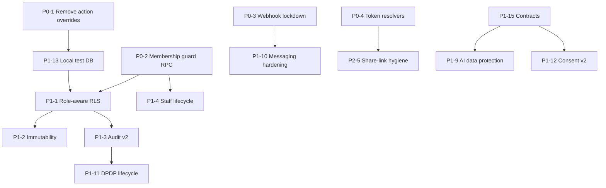

# clinicOS v2.0 — Security Remediation Plan

| | |
|---|---|
| Date | 2026-11-10 |
| Inputs | `SECURITY_ASSESSMENT.md` (SEC-xx), `THREAT_MODEL.md` (SR-x), `DATA_HANDLING.md` |
| Sizing | S (≤ 1 day-ish, single area), M (several files or a migration), L (cross-cutting refactor), XL (multi-phase). Relative only, with no day estimates. |
| Constraint | This is a plan. Nothing here has been implemented. All schema and auth changes need approval (prompt §15). |

## 0. Guiding decisions

1. **Fix the v1 baseline first** for the Criticals if v1 is live. These are small, surgical changes that do not wait for the v2 architecture.
2. **Defence in depth with the database as the last line.** v2 should assume any authenticated user can call PostgREST directly with their JWT, so RLS must encode both role and tenant rules. App-layer checks are for UX and early rejection.
3. **One way to get context.** All server entry points (actions, route handlers) call one `getRequestContext()` / `requirePermission()` and pass a server-built context object to `server-only` service functions. Service-role use is limited to a short allow-list of modules (public token resolution, webhooks, cron, API-key routes), each with a mandatory tenant binding.
4. **Simplest viable tools:** Supabase-native features (RLS, column grants, triggers, Auth MFA, Vault), Next.js headers, an Upstash/Vercel KV or Postgres rate limiter, gitleaks/Semgrep/OSV in CI. No new services beyond a log sink.

## 1. Phase P0: Immediate containment (v1 hotfix branch, then forward-port)

| # | Action | Fixes | Size | Owner (suggested) | Verification |
|---|---|---|---|---|---|
| P0-1 | Remove `clientOverride`/`sessionOverride`/`tenantIdOverride`/`actorSession` from **all** exported `"use server"` functions; move logic to `server-only` service functions; tests call services. Interim hotfix if the full refactor is too big: at the top of each exported action, `if (sessionOverride \|\| clientOverride) throw new Error("Forbidden")` when `process.env.VITEST !== "true"`. | SEC-01, SEC-02 | L (hotfix S-M) | Backend | TC-SA-* ; AST lint rule |
| P0-2 | Migration: guard `memberships`. Revoke table UPDATE from `authenticated`, grant column-level UPDATE on profile fields; add `change_member_role()` SECURITY DEFINER RPC (owner-only for owner/admin grants; last-owner guard); update `updateStaffMember` to use it. | SEC-03, SEC-08 (part) | M | Backend / DB | TC-RLS-MEM-* |
| P0-3 | Messaging webhook: delete or env-gate `dev`/`twilio`/`gupshup` handlers; default-deny unknown providers; MSG91 header-only secret with `timingSafeEqual`; remove cross-tenant phone fallback; stop returning tokens/IDs in responses; replace `.or()` with `.eq()`. | SEC-04, SEC-19 (part) | M | Backend | TC-WH-* |
| P0-4 | Token resolvers: add `.eq("tenant_id", token.tenant_id)` and a `resource_type` allow-list to `/api/r`, `/r`, `/api/reschedule`, `/reschedule`, `/api/reports/view`, `/reports/view`. Replace the `doc_tokens_staff_manage FOR ALL` policy with SELECT-only, and create tokens through a SECURITY DEFINER `create_share_token(resource_type, resource_id)` that verifies ownership. Fix the reschedule token's `resource_type` and `created_by`. | SEC-05, SEC-32 | M | Backend / DB | TC-TOK-* |
| P0-5 | Upgrade `next`, `zod`, `@supabase/ssr` (and transitive) to patched versions; run the full test suite locally. | SEC-24 | S-M | Frontend | `npm audit --omit=dev` = 0 high/critical |
| P0-6 | Confirm what the hosted test project is (OI-3). If it is production, stop running tests against it, rotate the **service-role key and Supabase access token** after P0-1..4 deploy, and rotate MSG91/AI/CRON secrets as hygiene. | SEC-25 | S (process) | Owner | Key rotation record |
| P0-7 | Forensics and legal triage, if v1 has real patients: review Supabase API logs and Vercel logs for `Next-Action` POSTs with override args, `/api/webhooks/messaging/dev` hits, `PATCH /rest/v1/memberships`, and `document_share_tokens` inserts with cross-tenant resource IDs; check `audit_logs` for `appointment_cancelled_whatsapp` anomalies. Decide on CERT-In / DPDP notifications with counsel. ⚖ | SEC-01/03/04/05 | M (process) | Owner + counsel | Written incident decision |
| P0-8 | Make dev messaging fail closed in production (`getMessagingProvider` throws in production if no real provider); stop file writes; redact logs. Purge local `.planning/dev-*.txt` after confirming their contents (owner). | SEC-15 | S | Backend | Unit test |
| P0-9 | Gate `requestOtpAction` dev shortcuts on `ENABLE_DEV_AUTH_SHORTCUTS=1` **and** a localhost Supabase URL. | SEC-14 | S | Backend | Unit test |

**Exit criteria for P0:** every TC in `SECURITY_VERIFICATION_PLAN.md` §6 tagged P0 passes on a local stack; no Critical remains open.

## 2. Phase P1: Essential for v2 launch

| # | Action | Fixes | Size | Depends on |
|---|---|---|---|---|
| P1-1 | **Role-aware RLS.** Add `current_user_role(tenant)` helper; rewrite clinical-table policies per the permission matrix (receptionist: demographics + scheduling + billing; nurse: vitals + triage; doctor: clinical; owner/admin: management). Generate policies from one source (SQL template or matrix file) and generate tests from the same source. | SEC-06 | L | P0-2 |
| P1-2 | **Clinical immutability.** Triggers blocking UPDATE/DELETE on signed `visits`, `prescriptions`, `prescription_items`, `consultation_diagnoses` except via `amend_visit()` RPC; DB-stamped `signed_by = auth.uid()`; write-once PDFs (`upsert:false`, versioned path, SHA-256 on row); remove member UPDATE/DELETE on the `prescriptions` bucket. | SEC-18, SEC-02 | M-L | P1-1 |
| P1-3 | **Audit v2.** `log_audit()` SECURITY DEFINER (actor from `auth.uid()`); revoke direct INSERT; read-access events for patient, visit, prescription, document, export, AI; hash chain or nightly export to append-only storage; retention ≥ 1 year ⚖; per-patient "access history" UI for owners. | SEC-29, SEC-06 | M-L | P1-1 |
| P1-4 | **Staff lifecycle.** `memberships.status`; `current_user_tenant_ids()` returns active only; "Remove/Suspend staff" with global sign-out (`auth.admin.signOut`), API-key revocation, invite revocation; email-bound invites delivered by email; 72-hour expiry. | SEC-07, SEC-08 | M | P0-2 |
| P1-5 | **MFA and sessions.** Enable Supabase TOTP MFA; require `aal2` for owner/admin and for sensitive permissions (API keys, webhooks, exports, staff management); configure inactivity timeout, time-box and refresh-token reuse detection on the hosted project; "sign out all devices"; disable auto-signup on `/login`. | SEC-26 | M | — |
| P1-6 | **Shared rate limiting** (Vercel KV/Upstash, or Postgres): middleware for public routes (`/r`, `/reschedule`, `/reports`, webhooks, `/api/ready`), per-user for Server Actions and AI, per-key for `/api/v1`; per-tenant monthly AI budget. | SEC-11 | M | — |
| P1-7 | **Security headers + CSP** (nonce-based) in `next.config.ts`/middleware; `Referrer-Policy: no-referrer` and `Cache-Control: no-store` on PHI and token pages. | SEC-13 | S-M | — |
| P1-8 | **SECURITY DEFINER hardening.** Tenant checks in `search_medicines`, `generate_daily_queue_token`, `generate_tenant_invoice_number`; `REVOKE … FROM PUBLIC, anon`; concurrency-safe counters (per-tenant sequence rows). Add `supabase db lint` to CI. | SEC-09 | S-M | — |
| P1-9 | **AI data protection.** Pseudonymised tool outputs; `stripPiiFromText` on all free text; server-owned conversation state (accept only `user` turns); remove the `app_metadata` fallback; route-level permission checks; tenant opt-in flag and patient-notice text; switch to an enterprise endpoint with no-training and limited retention, in an India region if available; DPA. | SEC-16 | M | Legal input |
| P1-10 | **Messaging hardening.** Replay dedupe table; dedicated webhook secret; inbound routing only via `replyMsgId`; opt-in capture; template content review (no diagnosis or test names). | SEC-19 | S-M | P0-3 |
| P1-11 | **DPDP data-lifecycle features.** Retention policy table and nightly job; erasure workflow with restrict-vs-erase; storage deletion; communication-log purge; staff UI for rights requests (access, correction, erasure, grievance) with SLA tracking; restrict exports to `exports:create`. | SEC-30, DATA_HANDLING §5, §11 | L | P1-3 |
| P1-12 | **Consent model v2.** Purpose-specific consents with notice version, language and evidence; guardian consent for minors; WhatsApp opt-in; enforce in governance. ⚖ | DATA_HANDLING §6 | M | Legal input |
| P1-13 | **Test infrastructure.** Local Supabase (`supabase start`) or branch DB in CI; seed synthetic data; RLS matrix tests; remove hosted credentials from developer machines. | SEC-25 | M | — |
| P1-14 | **Logging & CERT-In readiness.** Vercel log drain to India-region storage with 180-day retention; PII redaction helper; NTP note (platform-provided); incident-response runbook with 6-hour CERT-In and processor-to-fiduciary notification templates; security contact (`security.txt`). ⚖ | SEC-29, R10 | M | — |
| P1-15 | **Contracts & transparency.** Clinic DPA, sub-processor list, patient-notice template, privacy policy; confirm Supabase/Vercel regions (India). ⚖ | DATA_HANDLING §1, §4 | M (non-eng) | Legal |
| P1-16 | **In-network referrals.** Receiver can only update status fields (column grants/trigger); opt-in clinic directory; server-built snapshot; consent check. | SEC-33 | S-M | P1-1 |

## 3. Phase P2: Important hardening

| # | Action | Fixes | Size |
|---|---|---|---|
| P2-1 | SSRF hardening: `redirect:"manual"`, pinned-IP connect, `ipaddr.js` range checks, response-size cap. | SEC-10 | S |
| P2-2 | API key scopes, expiry, IP allow-list; atomic usage counters. | SEC-12 | M |
| P2-3 | Validate all filter inputs with zod; ban string-built `.or()` with request data (Semgrep rule). | SEC-20 | S |
| P2-4 | Generic error responses + correlation IDs everywhere (reuse `lib/api/envelope.ts`). | SEC-21 | S-M |
| P2-5 | Share-link hygiene: hashed tokens, path-only, shorter TTL, optional DOB challenge, masked phone, access log with IP/UA. | SEC-22 | M |
| P2-6 | Upload hardening: magic-byte sniffing, random object keys, explicit body-size limit or signed upload URLs; consider AV scanning for images/PDFs. | SEC-23 | S-M |
| P2-7 | Safe `next` redirect in auth callback. | SEC-17 | S |
| P2-8 | Origin/Sec-Fetch-Site check in middleware for cookie-authenticated `route.ts` POSTs. | CSRF defence-in-depth | S |

## 4. Phase P3: Optional / maturity

- `/api/ready` protection and caching; constant-time cron compare (SEC-27).
- Replace the test fake-key literal and add a gitleaks allow-list (SEC-28).
- OWASP ASVS L2 self-assessment as a v2 acceptance gate; external penetration test before GA (recommended: after P1); later ISO 27001 readiness.
- Digital signature (DSC/eSign) on e-prescriptions (voluntary). ⚖
- Column-level encryption (Supabase Vault/pgsodium) for ABHA if collected.

## 5. Sequencing & dependencies

P0-1 and P1-13 belong together: the override parameters exist because tests target a hosted DB. Moving to a local DB lets the tests use real sessions (sign in seeded users) instead of injected ones.

## 6. Ownership of v1 business logic

None of these changes alter clinical workflows. They change *who may call what* and *where context comes from*. The amendment flow (`reopenVisitForAmendment` / `finalizeVisitAmendment`), the consent ledger, the webhook outbox, the governance rules and the API envelope are worth keeping and wrapping. Behaviour changes users will notice: receptionists lose access to clinical notes (P1-1, confirm with the product owner), owners and admins must enrol MFA (P1-5), and share links expire sooner (P2-5).

## 7. Definition of done (security) for v2 release
- 0 Critical/High open; Mediums either fixed or with documented risk acceptance by the owner.
- `SECURITY_VERIFICATION_PLAN.md` suites green in CI: SAST (no high), SCA (no high/critical in prod deps), secrets (none), RLS/authZ matrix (100 % of cells), ZAP baseline (no high) on staging.
- External pen test completed, with findings triaged.
- DPA, sub-processor list, privacy notice and incident runbook published. ⚖
