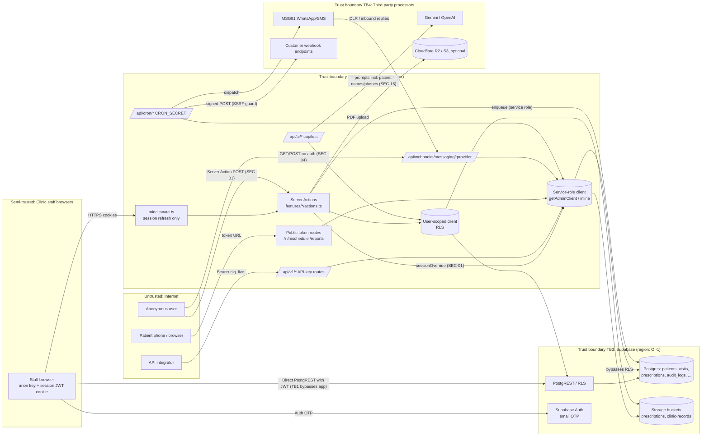

# clinicOS v2.0 — Threat Model

| | |
|---|---|
| Date | 2026-11-10 |
| Method | STRIDE per component and trust boundary, derived from static review of `feature/v2` @ `a6373b4` |
| Related | Finding IDs `SEC-xx` refer to `SECURITY_ASSESSMENT.md` |

## 1. System context

**Assets (by sensitivity):**
1. **Patient health data:** demographics, phone, address, ABHA ID, allergies, chronic conditions, vitals, chief complaints, clinical notes, diagnoses, prescriptions, lab reports, referral letters, invoices. These are DPDP personal data, and SPDI "sensitive" (health).
2. **Integrity of the clinical record:** signed consultations and prescriptions (medico-legal), audit trail, consent records.
3. **Credentials and secrets:** Supabase service-role key, Supabase access token, MSG91 auth key and webhook secret, AI API key, CRON_SECRET, staff sessions, API keys, webhook signing secrets, share tokens.
4. **Availability:** appointment calendar, queue, messaging quota (cost), AI spend.
5. **Business data:** invoices and payments, subscription.

**Actors:**
| Actor | Trust | Notes |
|---|---|---|
| Anonymous internet user | Untrusted | Can reach public pages, `/api/*`, and Server Action endpoints (any page URL + `Next-Action` header) |
| Patient (link holder) | Low | Holds share/reschedule tokens via WhatsApp |
| Self-registered user / clinic | Low | Signup is open; anyone can create a tenant (`create_clinic_with_owner`) |
| Staff: receptionist, nurse | Medium, scoped | Should be limited by role |
| Staff: doctor | Medium-high | Signs clinical documents |
| Owner / admin | High within tenant | Manages staff, API keys, webhooks |
| API integrator (API key) | High within tenant | Full admin scope |
| MSG91 | External processor | Sends inbound webhooks and DLRs |
| AI provider (Gemini / OpenAI) | External processor | Receives prompts |
| Supabase, Vercel, Cloudflare R2 / AWS S3 | Infrastructure processors | Host data |
| clinicOS developers / operators | Privileged | Hold service-role key, run tests against the hosted DB (SEC-25) |

## 2. Data-flow diagram

**Trust boundaries:**
- **TB1 (browser ↔ Supabase directly):** The anon key and user JWT are in the browser. **RLS is the only control** for anything the user can reach directly. The design assumes app-layer checks, but RLS is tenant-only (SEC-03, SEC-06).
- **TB2 (browser/Internet ↔ Next.js server):** Server Actions and route handlers. Each one must authenticate, authorise and derive the tenant. Service-role use crosses into "trusted" territory.
- **TB3 (Next.js ↔ Supabase):** Service-role key = god mode. It is used by `/api/v1`, public token routes, webhooks, cron, the messaging dispatcher, the appointments library, and (wrongly) user-reachable actions.
- **TB4 (Platform ↔ third parties):** MSG91, AI providers and customer webhook endpoints. Data leaves clinicOS control here.

## 3. STRIDE analysis

Legend: ✅ adequate control exists · ⚠️ partial · ❌ missing/broken. "Ref" points to the finding or recommended control.

### 3.1 Authentication (Supabase Auth, `/login`, `/verify`, `/join`, `/auth/callback`)
| STRIDE | Threat | Status | Ref |
|---|---|---|---|
| S | Takeover via compromised email (OTP-only, no MFA) | ❌ | SEC-26 |
| S | Dev OTP returned to browser in non-production environments | ⚠️ (NODE_ENV gate only) | SEC-14 |
| S | OTP brute force or OTP-send flooding | ⚠️ depends on hosted Auth limits | SEC-11, OI-1 |
| T | Open redirect after login (`next=`) used for phishing | ⚠️ | SEC-17 |
| R | Login and logout events not in the app audit trail (Supabase Auth logs only) | ⚠️ | SEC-29 |
| I | User enumeration via OTP responses | ⚠️ (`shouldCreateUser: true` hides it but creates accounts) | SEC-26 |
| D | Mass signups create junk users and tenants | ⚠️ | SEC-11 |
| E | Joining a clinic with a leaked invite link not bound to the email | ⚠️ | SEC-08 |

### 3.2 Server Actions (`features/*/actions.ts`)
| STRIDE | Threat | Status | Ref |
|---|---|---|---|
| S | Caller supplies `sessionOverride` to impersonate any user or tenant | ❌ | SEC-01, SEC-02 |
| T | Unauthenticated modification of clinic profile, consent records | ❌ | SEC-01 |
| R | Forged `created_by` / `signed_by` / audit actor | ❌ | SEC-02 |
| I | Unauthenticated cross-tenant patient search via service role | ❌ | SEC-01 |
| D | No rate limiting on actions (searches, PDF generation) | ❌ | SEC-11 |
| E | Receptionist performs doctor/owner actions; self-promotion via `updateStaffMember` | ❌ | SEC-02, SEC-03 |

### 3.3 Database & RLS (PostgREST reachable from browser)
| STRIDE | Threat | Status | Ref |
|---|---|---|---|
| S | Inserting audit rows as another actor | ❌ | SEC-06 |
| T | Editing signed prescriptions, visits, invoices directly | ❌ | SEC-06, SEC-18 |
| T | Inserting share tokens pointing at other tenants' resources | ❌ | SEC-05 |
| R | No DB-enforced actor stamping | ❌ | SEC-06 |
| I | Cross-tenant reads via SECURITY DEFINER RPCs lacking tenant checks | ⚠️ | SEC-09 |
| I | All roles read all clinical data in the tenant | ❌ | SEC-06 |
| I | Tenant isolation for ordinary SELECT/INSERT/UPDATE | ✅ tested | `tests/security/cross-tenant.spec.ts` |
| D | Raising `monthly_quota`, flooding `communication_queue` | ❌ | SEC-06 |
| E | Self-update of `memberships.role` → owner | ❌ | SEC-03 |
| E | Admin grants owner / invites owner | ⚠️ | SEC-08 |

### 3.4 Public API `/api/v1/*` (API keys)
| STRIDE | Threat | Status | Ref |
|---|---|---|---|
| S | Stolen key used indefinitely; key of departed creator still valid | ⚠️ | SEC-07, SEC-12 |
| T | Over-privileged keys (admin scope) | ⚠️ | SEC-12 |
| R | API actions audited with `actor_type=api_key` | ✅ partial | SEC-29 |
| I | Tenant scoping in handlers | ⚠️ | Reviewed the 15 route files (13 data routes); one gap: `POST /api/v1/lab-orders` accepts an arbitrary `storage_path` (ARC-06, P0-05) (erratum 2026-11-10, C1, C6) |
| I | Filter-string manipulation in visits query | ⚠️ (tenant-bounded) | SEC-20 |
| D | Rate limit per instance only | ⚠️ | SEC-11 |
| E | Key creation limited to `clinic:manage` (+ RLS owner/admin) | ✅ | — |

### 3.5 Public token pages (`/r`, `/reschedule`, `/reports/view`)
| STRIDE | Threat | Status | Ref |
|---|---|---|---|
| S | Guessing tokens | ✅ 256-bit | — |
| T | Rescheduling another clinic's appointment via a crafted token row | ❌ | SEC-05 |
| R | Accesses counted, not logged with IP/UA | ⚠️ | SEC-29 |
| I | Cross-tenant document disclosure (resource not bound to token tenant/type) | ❌ | SEC-05 |
| I | Token leakage via query string / Referer / long expiry; phone shown | ⚠️ | SEC-22, SEC-13 |
| D | No rate limit | ❌ | SEC-11 |
| E | n/a | — | — |

### 3.6 Inbound messaging webhook
| STRIDE | Threat | Status | Ref |
|---|---|---|---|
| S | Unauthenticated `dev` / unknown provider; Twilio header-presence check | ❌ | SEC-04 |
| S | MSG91 secret in query string, non-constant compare, auth key reused as webhook credential | ⚠️ | SEC-19 |
| T | Cancel/confirm/reschedule arbitrary appointments across tenants | ❌ | SEC-04 |
| R | Audit rows say `actor_role: patient` for forged requests | ❌ | SEC-04 |
| I | Appointment IDs and reschedule URLs returned in responses | ❌ | SEC-04 |
| D | Replays of DLRs; notification flooding | ❌ | SEC-19 |
| E | Service-role execution path | ❌ | SEC-04 |

### 3.7 Outbound webhooks & cron
| STRIDE | Threat | Status | Ref |
|---|---|---|---|
| S | Receiver authenticates clinicOS via HMAC + timestamp | ✅ | `lib/webhooks/signer.ts` |
| T | Payload integrity | ✅ | — |
| I | SSRF via redirects / DNS rebinding / IPv6 forms; status/latency oracle | ⚠️ | SEC-10 |
| I | Webhook payloads carry PHI to customer endpoints (per event type) | ⚠️ needs data-minimisation review | DATA_HANDLING §4 |
| D | Cron endpoints protected by CRON_SECRET | ✅ (non-constant compare) | SEC-27 |

### 3.8 AI copilots (`/api/ai/*`, `features/ai/actions.ts`)

*v1 state. The copilots are removed in v2.0 (AI-01); the remaining AI surface (scribe) is covered by AI-04/AI-05 (erratum 2026-11-10, AI §11.2).*
| STRIDE | Threat | Status | Ref |
|---|---|---|---|
| S | Tenant/role fallback to `app_metadata` | ⚠️ | SEC-16 |
| T | Prompt/tool-result injection via client-supplied history | ⚠️ (mutations preview-only ✅) | SEC-16 |
| R | AI interactions not audited | ❌ | SEC-29 |
| I | Patient names/phones sent to LLM provider; scrubber unused for free text | ❌ | SEC-16 |
| D | Unbounded LLM spend | ❌ | SEC-11 |
| E | Copilot cannot exceed user's RLS scope; booking requires human confirm | ✅ | — |

### 3.9 Storage & PDF generation
| STRIDE | Threat | Status | Ref |
|---|---|---|---|
| T | Overwrite of signed PDFs (upsert, member UPDATE policy) | ❌ | SEC-18 |
| I | Tenant-prefix storage policies | ✅ | `000008`, `000013` |
| I | Patient names in object keys | ⚠️ | SEC-23 |
| D | 25 MB files via Server Actions; no magic-byte check | ⚠️ | SEC-23 |

### 3.10 Operations, secrets & supply chain
| STRIDE | Threat | Status | Ref |
|---|---|---|---|
| S | Service-role key on developer laptops for tests against a hosted DB | ❌ | SEC-25 |
| T | Vulnerable dependencies (next, zod) | ❌ | SEC-24 |
| I | PHI and tokens in logs (dev messaging provider, console logs) | ⚠️ | SEC-15 |
| I | Secrets in git history | ✅ none found (pattern scan) | SEC-28 |
| R | No central log retention (CERT-In 180 d) | ❌ | SEC-29 |
| D | No WAF / bot protection | ⚠️ | SEC-11 |

## 4. Abuse cases (prioritised attack trees)

1. **AC-1 "Dump a competitor's patient list"** (unauthenticated): get the tenant UUID from any shared prescription link → find the `searchPatients` action ID in the JS chunk → POST `["a", null, {tenantId, userId}]` → 25 patients per query; iterate over the alphabet and digits. (SEC-01)
2. **AC-2 "Insider becomes owner"** (receptionist): `PATCH /rest/v1/memberships?id=eq.<own>` `{role:'owner'}` → create an API key → `GET /api/v1/patients/{id}/export` for every patient. (SEC-03, SEC-12)
3. **AC-3 "Cancel the clinic's day"** (unauthenticated): loop `GET /api/webhooks/messaging/dev?from=<2 digits>&action=btn_cancel` → cancels the next upcoming appointment matching each digit pair, across all clinics. (SEC-04)
4. **AC-4 "Read another clinic's prescriptions"** (any signed-up user): create own clinic → insert a `document_share_tokens` row with `resource_type='prescription'` and a victim prescription UUID (obtained from a webhook payload, export or referral) → open `/r/<token>`. (SEC-05)
5. **AC-5 "Ex-employee keeps access"**: the employee leaves; their membership cannot be removed; their session refreshes forever. (SEC-07)
6. **AC-6 "Rewrite a signed prescription after an adverse event"** (any member): PostgREST update of `prescription_items` and re-upload of the PDF with upsert. (SEC-06, SEC-18)
7. **AC-7 "Coupon abuse"** (round 3, SUBSCRIPTIONS_AND_PLANS §14; v2 design, not current code): (a) **enumeration** of codes through `validateCoupon` (mitigated: ~60-bit generated codes, uniform errors, 5/15 min and 20/day limits); (b) **replay of a leaked code** by another owner (single use, `assigned_email` for UAT, per-owner/tenant caps counting reservations, `first_subscription_only`, masked-mandate soft check, URL stripping of `?code=`); (c) **platform-admin abuse of refunds or comps** (aal2 platform portal, `platform_audit_log` with reason, 6-month guard, reconcile import of Dashboard refunds); (d) **offer/debit mismatch** (offer missing, wrong supply type or applied too long: expected-amount check in `sync_subscription`, PO alert, invoice from the captured amount, refund of the difference). Tests: SECURITY_VERIFICATION_PLAN §9 and SUB §14.9.

## 5. Security requirements for v2 (derived)

| ID | Requirement | Addresses |
|---|---|---|
| SR-1 | Exported server actions take only user input; context comes only from `requirePermission()`. Service-role usage is only in an allow-listed set of modules marked `server-only`. | SEC-01, 02 |
| SR-2 | RLS is role-aware; privileged columns (`role`, `tenant_id`, `signed_*`, `created_by`) are DB-guarded; signed records are immutable except via amendment RPC. | SEC-03, 06, 18 |
| SR-3 | Every public/unauthenticated endpoint is in an inventory with an explicit authN mechanism, rate limit and tenant binding. | SEC-04, 05, 11, 27 |
| SR-4 | Staff lifecycle: invite (email-bound) → active → suspended/removed, with global session revocation and key revocation. | SEC-07, 08 |
| SR-5 | MFA for owner/admin; session idle timeout and time-box. | SEC-26 |
| SR-6 | Security headers and CSP on all responses. | SEC-13 |
| SR-7 | PHI never in logs; dev providers fail closed in production. | SEC-15, 14 |
| SR-8 | AI: minimised and pseudonymised prompts, server-owned conversation state, per-tenant opt-in and budget, processor contracts. Delivered by `AI_STRATEGY.md` **AI-04** (AI gateway, Vertex `asia-south1`, pseudonymisation, `ai_calls`, rate limits) and **AI-05** (AI Scribe v2); the copilots in §3.8 are removed by AI-01 (erratum 2026-11-10, AI §11.2). | SEC-16, AI-04, AI-05 |
| SR-9 | Audit: reads and writes of clinical data, actor stamped by DB, retention ≥ 1 year (DPDP Rules) / 180 days (CERT-In), tamper evidence. | SEC-29 |
| SR-10 | Local / ephemeral DB for all tests; no production credentials outside the deployment platform. | SEC-25 |

## 6. Residual risk and assumptions
- **Assumption (validate):** the Vercel runtime has no reachable internal metadata service, which limits the SSRF impact (SEC-10).
- **Assumption (validate):** the hosted Supabase project has no additional out-of-band policies or triggers (OI-1). The threat model assumes the migrations reflect production.
- **Assumption:** Next.js Server Action IDs are discoverable by any user who can load the relevant JS chunks. This is standard behaviour; confirm on a local build (OI-5).
- Supply-chain risk from the GSD/agent tooling directories (`.agents/`, `.opencode/`) is out of scope; they are git-ignored.
